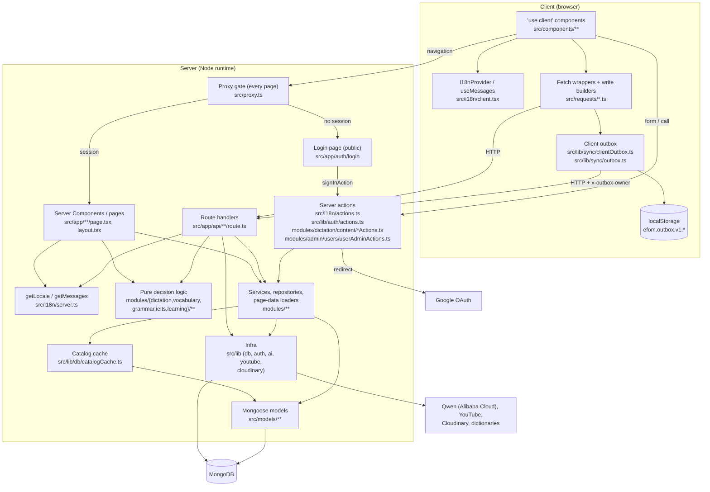
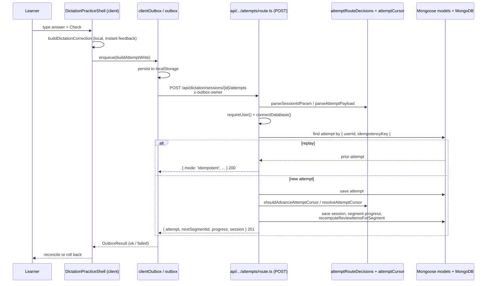
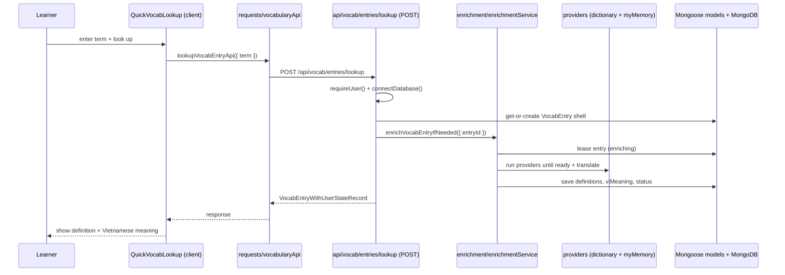
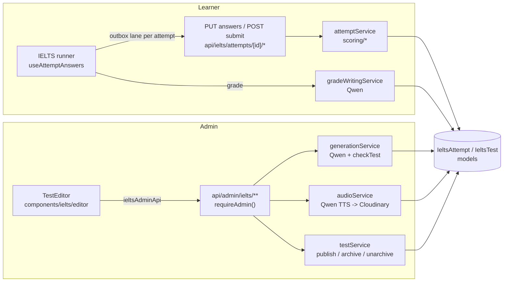
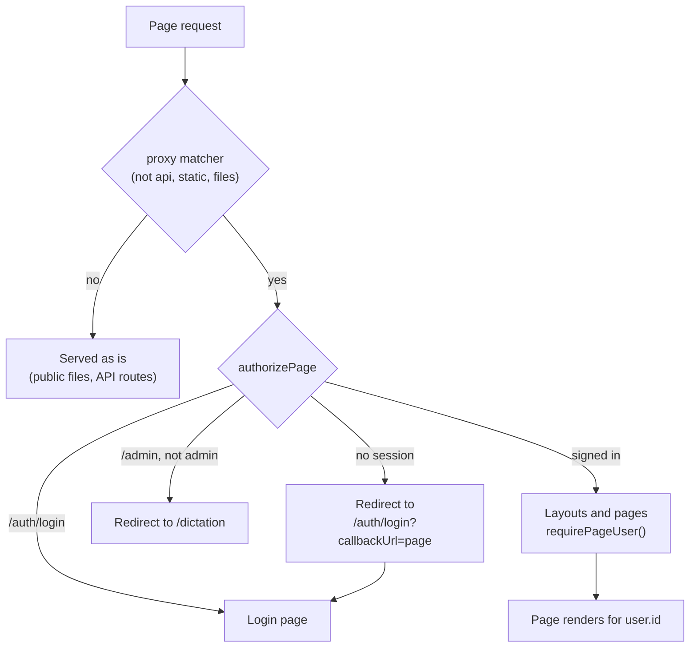
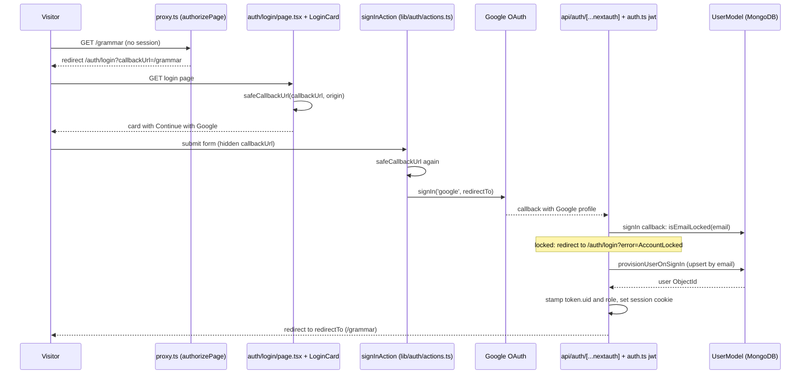

# Architecture: English For Only Me

English For Only Me is a private IELTS study app built on Next.js 16 (App Router),
React 19 (with the React Compiler), Mongoose, and Auth.js v5. It has four live modules
(`src/constants/modules.ts`): the "Dictation Lab", where a learner transcribes short
segments of a YouTube video and gets token-level correction, review scheduling, and
stats; "Vocabulary", where a learner searches, classifies, enriches, and recalls words;
"Grammar", a code-defined course of lessons, reviews, and unit checkpoints on a recall
ladder; and "IELTS", full Listening/Reading/Writing tests and drills with scoring,
AI writing grading, and an admin test editor with AI generation and TTS audio. The UI is
bilingual (EN/VI, cookie-driven), every page needs a Google sign-in (one public login
page; there is no guest mode), and learner writes go through a client outbox that
survives reloads and offline stretches. This document describes how the codebase is
layered so an AI (or engineer) can reason about the system without reading every file. It
is reference-heavy: every claim cites a path relative to the repo root; the `@/*` import
alias maps to `src/*` (see `tsconfig.json`).

## 1. Tech stack

The package manager is Bun (`bun.lock` is present; `.agents/rules/testing-quality.md`
and `.agents/rules/project-style.md` both direct contributors to prefer Bun). All
versions below are read from `package.json`.

| Concern             | Choice                                                            | Version                  | Notes                                                                                                                                              |
| ------------------- | ----------------------------------------------------------------- | ------------------------ | -------------------------------------------------------------------------------------------------------------------------------------------------- |
| Framework           | `next`                                                            | 16.2.10                  | App Router; middleware renamed to `proxy.ts` (Next 16). `next.config.ts` sets `reactCompiler: true`, permanent redirects, and YouTube image hosts. |
| UI runtime          | `react`, `react-dom`                                              | 19.2.4                   | Server Components by default.                                                                                                                      |
| Compiler            | `babel-plugin-react-compiler`                                     | 1.0.0                    | Auto-memoizes components and hooks (`next.config.ts`); opt out per component with `'use no memo'`.                                                 |
| Language            | `typescript`                                                      | ^5                       | `strict: true`, `moduleResolution: "bundler"` (`tsconfig.json`).                                                                                   |
| Data / ODM          | `mongoose`                                                        | ^9.7.3                   | Models in `src/models`; shared connection in `src/lib/db/connectDatabase.ts`.                                                                      |
| Auth                | `next-auth` (Auth.js)                                             | 5.0.0-beta.31            | Google provider, JWT sessions; edge-safe config split from Node config.                                                                            |
| Validation          | `zod`                                                             | ^4.4.3                   | Payload/param parsing at API boundaries and in schemas; also the source for strict JSON schemas sent to Qwen (`src/lib/ai/strictJsonSchema.ts`).   |
| UI primitives       | `@base-ui/react`                                                  | ^1.6.0                   | Underlying primitive layer for the shadcn components.                                                                                              |
| Component generator | `shadcn`                                                          | ^4.13.0                  | Config in `components.json` (style `base-nova`, `rsc: true`, lucide icons). Generated primitives live in `src/components/ui`.                      |
| Styling             | `tailwindcss` + `@tailwindcss/postcss`                            | ^4                       | Tailwind v4 via PostCSS only (`postcss.config.mjs`); no `tailwind.config`. Tokens in `src/app/globals.css`.                                        |
| Animations          | `tw-animate-css`                                                  | ^1.4.0                   | Tailwind animation utilities; reduced-motion preference in `src/lib/motion/useReducedMotion.ts`.                                                   |
| Class utilities     | `clsx`, `tailwind-merge`, `class-variance-authority`              | ^2.1.1 / ^3.5.0 / ^0.7.1 | `cn()` helper in `src/lib/utils.ts`; `cva` for variant styling in UI primitives.                                                                   |
| Icons               | `lucide-react`                                                    | ^1.23.0                  | Standard icon set (`components.json` -> `iconLibrary: "lucide"`).                                                                                  |
| Sound               | vendored ZzFX                                                     | -                        | `src/lib/audio/zzfx.ts` (MIT, vendored instead of a runtime dependency) drives four lesson stings.                                                 |
| Server boundary     | `server-only`                                                     | ^0.0.1                   | Imported by server modules to fail the build if pulled client-side.                                                                                |
| Scripts             | `tsx`                                                             | ^4.23.0                  | Runs `scripts/*.ts` under `node --conditions=react-server` (section 9).                                                                            |
| Testing (unit)      | `vitest`, `@testing-library/*`, `jsdom`                           | ^4.1.9 / ...             | Config in `vitest.config.mts`; jsdom env, globals on, `server-only` / `client-only` aliased to `src/test/serverOnlyStub.ts`.                       |
| Testing (e2e)       | `playwright`                                                      | ^1.61.1                  | Config in `playwright.config.ts`; matches `**/*.e2e.ts` under `src`; global setup signs a seeded learner in (section 9).                           |
| Lint / format       | `eslint` (+ `eslint-config-next`), `prettier` (+ tailwind plugin) | ^9 / ^3.8.1              | `eslint.config.mjs` bans `any` (`@typescript-eslint/no-explicit-any: error`) and restricts `console`.                                              |

## 2. Top-level directory map

| Directory                   | Purpose (one line)                                                                                                                                                                                                                                                                                                                                                                                              |
| --------------------------- | --------------------------------------------------------------------------------------------------------------------------------------------------------------------------------------------------------------------------------------------------------------------------------------------------------------------------------------------------------------------------------------------------------------- |
| `src/app`                   | App Router tree: pages, layouts, `loading`/`error` boundaries, route handlers under `api/**/route.ts`, plus root `layout.tsx`, `page.tsx`, `loading.tsx`, `error.tsx`, `robots.ts`, `globals.css`, and the public login page `auth/login`.                                                                                                                                                                      |
| `src/components`            | Shared React UI: `ui` (themed primitives), `common` (shell, nav, providers, account control), `auth` (the login hero and card), `admin` (`AdminMenuTrigger`, `users/` for user management), `journey` (landing and session-end primitives: `JourneyCard`, `NextStopCard`, `StatChip`, `SessionEnd`, ...), and domain folders `dictation`, `vocabulary`, `grammar`, `ielts`, `home`. See [06](./06-frontend.md). |
| `src/constants`             | Reusable settings and env wrappers: `environments.ts`, `modules.ts` (the four modules in `APP_MODULES`, nav, `MODULE_ICONS`), `theme.ts` (`PAGE_TAG_TONES`, `MODULE_THEMES`), `stateIcons.ts` (`DUE_ICON`, `DONE_ICON`: one icon per learner state, shared by every module's UI).                                                                                                                               |
| `src/i18n`                  | EN/VI UI text: `config.ts` (locales, cookie), `server.ts` (`getLocale`, `getMessages`), `client.tsx` (`I18nProvider`, `useMessages`), `actions.ts`, `format*.ts*`, `messages/{en,vi}`.                                                                                                                                                                                                                          |
| `src/lib`                   | Framework-level infrastructure shared by all modules (table below).                                                                                                                                                                                                                                                                                                                                             |
| `src/models`                | Mongoose schemas and models: `UserModel.ts` (with `status` / `lockedAt`) plus `dictation/`, `vocabulary/`, `grammar/`, `ielts/`; `userOwnedModels.ts` (`USER_OWNED_MODELS`: every per-user collection and its owner field, used by the admin delete and `scripts/dropGuestData.ts`). See [03](./03-data-model.md).                                                                                              |
| `src/modules`               | Business logic per learning domain: `dictation`, `vocabulary`, `grammar`, `ielts`, plus shared `learning/recall` and `admin/users` (admin user management).                                                                                                                                                                                                                                                     |
| `src/requests`              | Client-side fetch wrappers and outbox write builders around the internal API; fetch helpers end in `Api`.                                                                                                                                                                                                                                                                                                       |
| `src/types`                 | Ambient type declarations (`next-auth.d.ts` augments the session `user` with `id` and `role`).                                                                                                                                                                                                                                                                                                                  |
| `src/e2e`                   | Playwright sign-in support: `globalSetup.ts` mints a session for the seeded test learner (`e2eLearner.ts`, `provisionE2eUser.ts`); see section 9.                                                                                                                                                                                                                                                               |
| `src/test`                  | Vitest setup and helpers (`setup.ts`, `setupDom.ts`, `serverOnlyStub.ts`, `jsdom.d.ts`, `landingBudget.ts`).                                                                                                                                                                                                                                                                                                    |
| `src/proxy.ts`              | Next 16 proxy (renamed middleware) gating every page behind the Google sign-in (section 6).                                                                                                                                                                                                                                                                                                                     |
| `scripts` (repo root)       | Maintenance scripts (seed, resegment, IELTS patches, index sync, cache revalidation); `scripts/lib/requestContentRevalidation.ts`, `scripts/data/`. See section 9.                                                                                                                                                                                                                                              |
| `public` (repo root)        | Static assets: favicons, `logo.png`, `site.webmanifest`, icons referenced by `src/app/layout.tsx`.                                                                                                                                                                                                                                                                                                              |
| `.agents/rules` (repo root) | The six rule files defining the intended layering and conventions (style, App Router, API security, data/state, frontend UI incl. i18n, testing).                                                                                                                                                                                                                                                               |

`src/lib` subfolders:

| Folder               | Contents                                                                                                                                                                                                                                                                                                                                                                                                                                                                                                                                                                        |
| -------------------- | ------------------------------------------------------------------------------------------------------------------------------------------------------------------------------------------------------------------------------------------------------------------------------------------------------------------------------------------------------------------------------------------------------------------------------------------------------------------------------------------------------------------------------------------------------------------------------- |
| `src/lib/db`         | `connectDatabase.ts` (cached Mongoose connection), catalog cache (`catalogCache.ts`, `cacheTags.ts`, `jsonRecords.ts`), invalidation (`revalidateCatalog.ts`, `revalidateRequest.ts`).                                                                                                                                                                                                                                                                                                                                                                                          |
| `src/lib/auth`       | `auth.ts` (Node Auth.js), `auth.config.ts` (edge-safe; `authorizePage` is the proxy gate), `currentUser.ts` (`getOptionalUser`, `requireUser`, `requirePageUser`, `requireAdmin`), `accountStatus.ts` (`isAccountBlocked` with a 60 s cache, `isEmailLocked`, `forgetAccountStatus`), `callbackUrl.ts` (`safeCallbackUrl`, `loginUrlFor`, `LOGIN_PATH`, `ACCOUNT_LOCKED_ERROR`, `LOCKED_LOGIN_URL`), `actions.ts` (`'use server'` `signInAction` / `signOutAction`), `roles.ts`, `authErrorMessage.ts`, owner keys (`ownerKey.ts`, `clientOwnerKey.ts`), `userProvisioning.ts`. |
| `src/lib/sync`       | `outbox.ts` (framework-free write queue) and `clientOutbox.ts` (`'use client'` tab-wide singleton, sends the tab to the login page on a 401).                                                                                                                                                                                                                                                                                                                                                                                                                                   |
| `src/lib/ai`         | Qwen client (`qwenClientCore.ts`, `qwenDebriefClient.ts`), strict schemas (`strictJsonSchema.ts`), translation (`qwenTranslate.ts`), TTS (`qwenSpeech.ts`, `wavToPcm.ts`), the app locale as a model reads it (`languageNames.ts`).                                                                                                                                                                                                                                                                                                                                             |
| `src/lib/cloudinary` | `cloudinaryConfig.ts`, `uploadImage.ts`, `uploadAudio.ts` (WAV upload with an eager mp3).                                                                                                                                                                                                                                                                                                                                                                                                                                                                                       |
| `src/lib/youtube`    | `extractYouTubeId.ts`, `getYouTubeVideoMetadata.ts`.                                                                                                                                                                                                                                                                                                                                                                                                                                                                                                                            |
| `src/lib/audio`      | `lessonSfx.ts` (four stings), `useLessonSfx.ts` (`'use client'` hook, preference in localStorage), `zzfx.ts`.                                                                                                                                                                                                                                                                                                                                                                                                                                                                   |
| `src/lib/motion`     | `useReducedMotion.ts` (`'use client'`; OS media query plus `efom-reduce-motion` override).                                                                                                                                                                                                                                                                                                                                                                                                                                                                                      |
| `src/lib/journey`    | `nextStop.ts`: `pickNextStop`, the one next-stop rule (resume, then due, then next, else `done`) shared by module landings, home and session ends.                                                                                                                                                                                                                                                                                                                                                                                                                              |
| `src/lib/theme`      | `theme.ts`: pure light / light-up resolver shared with the inline no-FOUC script in `src/app/layout.tsx`.                                                                                                                                                                                                                                                                                                                                                                                                                                                                       |
| `src/lib/utils.ts`   | `cn()` helper. `src/lib/styleGuards.test.ts` enforces style rules repo-wide (corner roles, palette, weights, `hover-pop`, touch targets, no em dash in `src` and `docs`) with shrink-only baselines.                                                                                                                                                                                                                                                                                                                                                                            |

## 3. Layered architecture and dependency direction

The system flows in one direction: UI (pages and client components) sits at the top,
persistence sits at the bottom, and dependencies point downward only. The `.agents/rules`
files codify this: pages stay thin, business logic lives in modules, data access goes
through `connectDatabase()` and models, and client code talks to the server only through
`src/requests`, the outbox, route handlers, or server actions
(`.agents/rules/project-style.md`, `.agents/rules/nextjs-app-router.md`,
`.agents/rules/data-and-state.md`).

Every domain module follows the same split: pure decision logic (no I/O, unit-tested),
server services that touch models (start with `import 'server-only'`), doc -> API record
mappers, and page-data loaders that pages call directly.

| Module                   | Pure logic (examples)                                                                                                                                                                                                                                               | Server services (examples)                                                                                                                                                                                                                                                     | Detail doc                                          |
| ------------------------ | ------------------------------------------------------------------------------------------------------------------------------------------------------------------------------------------------------------------------------------------------------------------- | ------------------------------------------------------------------------------------------------------------------------------------------------------------------------------------------------------------------------------------------------------------------------------ | --------------------------------------------------- |
| `src/modules/dictation`  | `correction/compareAnswer.ts`, `correction/normalizeAnswer.ts`, `segmenting/buildSegments.ts`, `review/reviewScheduler.ts`, `stats/globalStats.ts`, `practice/attemptCursor.ts`, `practice/practiceSync.ts` (outbox write builders), `services/*RouteDecisions.ts`. | `content/contentRepository.ts`, `content/catalogReaders.ts` (cached catalog), `content/adminActions.ts` and `content/favoriteActions.ts` (server actions), `review/reviewItemService.ts`, `stats/globalStatsService.ts`, `ai/debriefService.ts`.                               | [05](./05-modules.md)                               |
| `src/modules/vocabulary` | `normalizeVocabTerm.ts`, `recall/recallScheduler.ts`, `recall/recallTaskToken.ts`, `vietnameseMeaning.ts`, `services/vocabularyRouteDecisions.ts`.                                                                                                                  | `services/vocabEntryService.ts`, `services/userVocabItemService.ts`, `services/vocabDashboardService.ts`, `explore/exploreService.ts`, `recall/recallAnswerService.ts`, `enrichment/enrichmentService.ts`, providers in `providers/`, NGSL seed in `seed/seedVocabulary.ts`.   | [05](./05-modules.md)                               |
| `src/modules/grammar`    | Course content as code (`course/units/u01.ts` .. `u12.ts`, `course/validateCourse.ts`), `path/buildGrammarPath.ts`, `grading/gradeCard.ts`, `session/planGrammarSessionWrite.ts`, `session/parseSessionRequest.ts`.                                                 | `services/grammarProgressService.ts` (`getGrammarProgressForActor`, `recordGrammarSession`), `services/grammarPageData.ts`.                                                                                                                                                    | [08](./08-grammar.md)                               |
| `src/modules/ielts`      | `scoring/*` (answer keys, band tables, overall band), `consistency/checkTest.ts`, `markdown/parse.ts`, `attempts/attemptRouteDecisions.ts`, `attempts/deadline.ts`, `tests/testRouteDecisions.ts`, `drill/selectDrillGroups.ts`, `stats/shapeWeakness.ts`.          | `attempts/attemptService.ts`, `tests/testService.ts`, `generation/generationService.ts`, `audio/audioService.ts`, `writing/gradeWritingService.ts`, `drill/drillService.ts`, `vocab/testVocabService.ts`, page data in `services/*PageData.ts`; `http.ts` holds route helpers. | [09](./09-ielts.md)                                 |
| `src/modules/admin`      | `users/userDirectory.ts` (row shape, `filterAndSortUsers`, `summarizeUsers`, `managementBlock`, `deleteConfirmationMatches`), `users/formatUserDates.ts` (relative and calendar dates).                                                                             | `users/userAdminService.ts` (`listUsersForAdmin`, `getUserForAdmin`, `setUserLocked`, `deleteUserAndData`), `users/userAdminActions.ts` (server actions).                                                                                                                      | [06](./06-frontend.md), [04](./04-api-reference.md) |
| `src/modules/learning`   | `recall/recallLadder.ts`: the shared 7-stage recall ladder used by vocabulary (per word) and grammar (per lesson).                                                                                                                                                  | -                                                                                                                                                                                                                                                                              | [05](./05-modules.md), [08](./08-grammar.md)        |

`src/requests` is the client-side network layer. Fetch helpers set `cache: 'no-store'` and
rethrow the API `{ message }`: dictation (`dictationAttemptsApi.ts`,
`dictationSessionsApi.ts`, `dictationVideosApi.ts`,
`dictationTranscriptsApi.ts`, `dictationTranslationsApi.ts`, `dictationHintsApi.ts`,
`dictationImportsApi.ts`, `dictationDebriefsApi.ts`), vocabulary (`vocabularyApi.ts`),
IELTS (`ieltsApi.ts`, `ieltsAdminApi.ts`), and grammar (`grammarSessionsApi.ts`). Writes that
must survive a reload are not fetched directly: files such as `grammarSessionsApi.ts`
(`buildGrammarSessionWrite`), `ieltsApi.ts` (`buildIeltsAnswersWrite`,
`buildIeltsSubmitWrite`), `src/modules/dictation/practice/practiceSync.ts`, and
`src/components/vocabulary/vocabItemWrites.ts` build `OutboxEnqueueInput` items for the
client outbox (section 5.3). Client components never import server-only modules.



Dependency rule: arrows only point downward toward persistence. Client components reach
the server through `src/requests` and the outbox (HTTP), through server actions, or for
reads via props hydrated by a Server Component. `src/lib` and `src/models` never import
from `src/app` or `src/components`. Every module resolves identity through one seam,
`src/lib/auth/currentUser.ts`: `requirePageUser` in pages and layouts (redirects to the
login page), `requireUser` / `requireAdmin` in route handlers and server actions (401 /
403), and `getOptionalUser`.

## 4. Server vs client component boundaries

- Server Components are the default. Every `page.tsx` and `layout.tsx` under `src/app`
  is a Server Component. Pages call module services or page-data loaders directly (e.g.
  `src/app/page.tsx` reads the home view cookie (`HOME_VIEW_COOKIE`, parsed by
  `parseHomeView` in `src/components/home/homeView.ts`) and calls `requirePageUser`,
  `getGlobalStatsForUser`, `getVocabStatsForUser`, `getGrammarProgressForActor` and
  `buildGrammarPath`; `src/app/(app)/grammar/page.tsx` calls `loadGrammarPageData`), then
  pass plain data down as props.
- Only serializable props cross the server-to-client boundary. A component type (such as
  a lucide icon) cannot, so server pages pass a module key (`AppModuleKey`) and the
  client component looks the icon up in `MODULE_ICONS` (`src/constants/modules.ts`;
  used by `src/components/common/AppTopbar.tsx` and
  `src/components/journey/JourneyCard.tsx`).
- Error boundaries (`error.tsx`) are `'use client'` and render the shared
  `src/components/common/RouteError.tsx` with `common.errorBoundary` text and the
  `unstable_retry` prop. One sits at the app root (`src/app/error.tsx`), one per module
  (`src/app/(app)/{dictation,vocabulary,grammar,ielts}/error.tsx`), and one for admin
  (`src/app/admin/error.tsx`).
- `'use client'` is added only to files that use hooks, event handlers, browser APIs, or
  local state, per `.agents/rules/nextjs-app-router.md`. Main client islands:
  `src/components/dictation/DictationPracticeShell.tsx` (typing state, shortcuts, the
  YouTube player hook `modules/dictation/player/useYoutubeDictationPlayer.ts`, outbox
  writes), `src/components/grammar/player/LessonPlayer.tsx` and
  `src/components/grammar/path/GrammarPath.tsx`, the IELTS runner
  (`src/components/ielts/runner/useAttemptAnswers.ts`) and editor
  (`src/components/ielts/editor/*`), and `src/components/vocabulary/VocabularyDashboard.tsx`.
- Providers mounted by layouts:

  | Provider              | Mounted in                 | Hands to the client                                                                                                                                                                                                                                                                     |
  | --------------------- | -------------------------- | --------------------------------------------------------------------------------------------------------------------------------------------------------------------------------------------------------------------------------------------------------------------------------------- |
  | `AccountProvider`     | `src/app/layout.tsx`       | The session read once per root render (`readAccount()`: `auth()`), as `{ account }` with first name, image, initial and `isAdmin`; `account` is null only on the login page. `AccountControl` reads it with `useAccount()`, so the topbar and rail never re-read the session per route. |
  | `I18nProvider`        | `src/app/layout.tsx`       | Locale from the `efom-locale` cookie and the message catalogue (omitted for English, which every client bundle already carries).                                                                                                                                                        |
  | `ThemeProvider`       | `src/app/layout.tsx`       | Light / light-up theme; an inline script stamps `data-theme` before first paint (`src/lib/theme/theme.ts` logic, key `efom-theme`).                                                                                                                                                     |
  | `OutboxOwnerProvider` | `src/app/(app)/layout.tsx` | `ownerKey` = `toClientOwnerKey(user.id)` (a one-way hash, never the raw user id) from `requirePageUser()`, which reads the session JWT plus the cached account-lock check (section 6). The layout also redirects a signed-out or locked request to the login page.                      |

- i18n boundary: server code reads text with `await getMessages()` from `@/i18n/server`
  (`import 'server-only'`, cached per request); client code uses `useMessages()` /
  `useLocale()` from `@/i18n/client`. Plain client modules outside React (the outbox) read
  `getActiveMessages()` from `src/i18n/active.ts`. The locale toggle
  (`src/components/common/LocaleToggle.tsx`) calls the server action `setLocaleAction`
  (`src/i18n/actions.ts`), which writes the cookie and calls `refresh()`. Routes are the
  same in both languages. Rules: `.agents/rules/frontend-ui.md`.
- Server actions (`'use server'`): `src/i18n/actions.ts`, `src/lib/auth/actions.ts`
  (`signInAction` is the form action of `src/components/auth/LoginCard.tsx`,
  `signOutAction` is called from the client `src/components/common/AccountControl.tsx`, so
  the NextAuth / Mongoose chain stays out of the browser bundle), `src/modules/dictation/content/adminActions.ts`,
  `src/modules/dictation/content/favoriteActions.ts`, `src/modules/admin/users/userAdminActions.ts`
  (lock / delete a user). Everything else writes through route handlers.
- Secret isolation: server-only infra imports `server-only` so any accidental client
  import fails the build (`src/lib/db/connectDatabase.ts`, `src/lib/db/catalogCache.ts`,
  `src/i18n/server.ts`, `src/modules/ielts/audio/audioService.ts`). Env access is
  centralized in `src/constants/environments.ts`; secret getters read `process.env`
  server-side and there are no `NEXT_PUBLIC_*` secrets (`.agents/rules/api-security.md`).
  Only a one-way hash of the user id reaches HTML (`src/lib/auth/clientOwnerKey.ts`).
- Shared pure logic runs on both sides: `buildDictationCorrection`
  (`modules/dictation/correction/compareAnswer.ts`) gives instant feedback in the browser
  and the authoritative record on the server; grammar answers are graded locally for
  feedback and re-graded server-side (`modules/grammar/grading/gradeCard.ts`).
- Runtime and dynamic flags: data pages export `dynamic = 'force-dynamic'` and
  `runtime = 'nodejs'` so per-user content is never frozen (`src/app/page.tsx`,
  `src/app/auth/login/page.tsx`, `src/app/admin/layout.tsx`, most pages under `src/app/(app)/**`
  and `src/app/admin/**`). Route handlers set `runtime = 'nodejs'` because Mongoose is not
  edge-compatible. Shared catalog data is cached separately (section 5.6).

## 5. Request / data-flow walkthroughs

All live modules share one shape: a client component builds a request (direct fetch for
reads, outbox item for learner writes), a route handler parses input with pure decision
helpers, resolves the user with `requireUser()` (401 without a session; it also checks the
`x-outbox-owner` header), connects to Mongo, delegates to module services, and returns
safe records with messages from `getMessages()`. API contracts are in
[04](./04-api-reference.md).

### 5.1 Dictation practice attempt

Scenario: the learner types an answer for the current segment and presses check. The app
shows local feedback immediately, queues the attempt in the outbox, and reconciles when the
server answers.

1. `src/components/dictation/DictationPracticeShell.tsx` (`'use client'`): computes local
   feedback with `buildDictationCorrection` / `createLocalDictationAttempt` from
   `@/modules/dictation/correction`, then enqueues `buildAttemptWrite(sessionId, payload)`
   (`src/modules/dictation/practice/practiceSync.ts`) on `useClientOutbox()`.
2. The outbox (`src/lib/sync/outbox.ts`) stores the item in localStorage, sends
   `POST /api/dictation/sessions/{sessionId}/attempts` with the `x-outbox-owner` header,
   and retries network / 5xx failures in the session's lane.
3. `src/app/api/dictation/sessions/[sessionId]/attempts/route.ts` (`POST`): parses the
   `sessionId` with `parseSessionIdParam` (`services/sessionRouteDecisions.ts`) and the body
   with `parseAttemptPayload` (`services/attemptRouteDecisions.ts`, zod), resolves the user
   with `requireUser()`, and calls `connectDatabase()`.
4. Idempotency: it looks up an existing attempt by `{ userId, idempotencyKey }`;
   `resolveAttemptSubmissionMode` turns a hit into a replay (`mode: 'idempotent'`, 200)
   that leaves the cursor alone. A duplicate-key race on insert is also treated as a
   replay (`practice/duplicateKeyError.ts`).
5. Correction: it loads the segment, checks `canRecordAttemptForSession`
   (`practice/attemptCursor.ts`, 409 when the session is not active), runs the
   authoritative `buildDictationCorrection`, and saves a `DictationAttemptModel`.
6. Session cursor: `shouldAdvanceAttemptCursor` (`services/attemptRouteDecisions.ts`) and
   `resolveAttemptCursor` (`practice/attemptCursor.ts`) move `session.currentSegmentId` to
   the next segment by `order`, or mark the session `completed` (per-user; the shared video
   is not mutated).
7. In parallel it saves the session, loads per-segment progress
   (`practice/segmentProgressService.ts`), and runs `recomputeReviewItemsForSegment`
   (`review/reviewItemService.ts`).
8. Response: `toDictationAttemptRecord` / `toDictationSessionRecord`
   (`services/dictationAttemptRecords.ts`, `services/dictationSessionRecords.ts`) produce
   `{ attempt, mode, nextSegmentId, progress, session }` with status 201. The shell reads it
   with `readAttemptWriteResult`.



### 5.2 Vocabulary lookup and enrichment

Scenario: the learner looks up a word. The route creates a shell entry on demand, then
enriches it from dictionary and translation providers before returning definitions and the
Vietnamese meaning. (Status marks and recall answers are outbox writes: marks on the
`vocab:items` lane, `src/components/vocabulary/vocabItemWrites.ts`, recall answers on
the `vocab:recall` lane, `src/components/vocabulary/vocabRecallSession.ts`.)

1. `src/components/vocabulary/QuickVocabLookup.tsx` (`'use client'`) calls
   `lookupVocabEntryApi` (`src/requests/vocabularyApi.ts`, `POST /api/vocab/entries/lookup`)
   and renders `getEnglishDefinition` / `getRequiredVietnameseMeaning`
   (`@/modules/vocabulary/vietnameseMeaning`).
2. `src/app/api/vocab/entries/lookup/route.ts` (`runtime = 'nodejs'`) resolves the user
   with `requireUser()`, connects, gets or creates the entry shell, then calls
   `enrichVocabEntryIfNeeded({ entryId })`.
3. `src/modules/vocabulary/enrichment/enrichmentService.ts` leases the entry
   (`VOCAB_ENRICHMENT_LEASE_MS`), runs the providers in order until one is ready
   (`providers/dictionaryApiDev.ts`, `providers/freeDictionaryApi.ts`), fetches the
   Vietnamese meaning via `providers/myMemoryTranslate.ts`, and sets `enrichmentStatus`.
4. `services/vocabEntryRecords.ts` maps the doc plus per-user state into a
   `VocabEntryWithUserStateRecord`.



### 5.3 Client outbox (offline-tolerant writes)

`src/lib/sync/outbox.ts` is a framework-free queue; `src/lib/sync/clientOutbox.ts` keeps one
instance per tab and owner, and `useClientOutbox()` (`src/components/common/OutboxOwnerProvider.tsx`)
hands it to components.

- Lanes: items in one lane are delivered in order with one in flight; lanes run in
  parallel. Lanes in use: one per dictation session (`getPracticeLane`), `grammar`,
  `vocab:items`, `vocab:recall`, and one per IELTS attempt (`ieltsAttemptLane`). A `mergeKey` replaces a newer queued item in place
  (IELTS autosave snapshots, repeated vocabulary marks).
- Storage: `efom.outbox.v1.<owner>.<tabId>` in localStorage; the tab id lives in
  sessionStorage, and tabs adopt queues left by closed tabs of the same owner.
- Outcomes: 2xx drops the item and resolves ok; network errors retry with backoff; 5xx /
  429 retry up to a cap; 401 (the session ended) keeps the item stored, pauses every lane
  and calls `onUnauthorized`, which sends the tab to `/auth/login?callbackUrl=<this page>`
  (`handleUnauthorized` in `src/lib/sync/clientOutbox.ts`); other 4xx (including 409 owner
  mismatch) settle as failed so the UI rolls back.
- Sign-back-in: the owner key is a hash of the user id, so the same account signing back
  in gets the same key and the held queue replays on the next load; another account never
  sees it.
- Safety: every item carries `x-outbox-owner`; `requireUser()` throws
  `OutboxOwnerMismatchError` (409) when it names another learner
  (`src/lib/auth/clientOwnerKey.ts`). Replays are safe because attempt-like routes dedupe
  on an idempotency key and other writes set a desired state rather than toggling.

### 5.4 Grammar session

1. `src/components/grammar/player/LessonPlayer.tsx` runs the cards; `PlayerResult.tsx`
   enqueues `buildGrammarSessionWrite` (`src/requests/grammarSessionsApi.ts`) on the
   `grammar` lane with the idempotency key as item id.
2. `src/app/api/grammar/sessions/route.ts` (`POST`) parses with `parseSessionRequest`, resolves
   the actor, connects, and calls `recordGrammarSession`
   (`src/modules/grammar/services/grammarProgressService.ts`).
3. `recordGrammarSession` claims the key in `GrammarSessionModel` first (a concurrent
   duplicate gets a retryable 503; a finished one replays the stored response), loads
   progress, plans the write with `planGrammarSessionWrite` (re-grades raw answers, applies
   stars, unlocks, recall ladder, misses), applies it, and stores the response.
4. Pages rebuild the path from course code plus progress with `buildGrammarPath`
   (`src/modules/grammar/services/grammarPageData.ts`). Domain detail: [08](./08-grammar.md).

### 5.5 IELTS attempt and admin authoring

- Learner: `startIeltsAttemptApi` / `startIeltsDrillApi` (`src/requests/ieltsApi.ts`) ->
  `POST /api/ielts/attempts` or `/api/ielts/drills` -> `startOrResumeAttempt` /
  `drill/drillService.ts`. The runner (`src/components/ielts/runner/useAttemptAnswers.ts`)
  mirrors answers to localStorage (`ielts:attempt:<id>`) and enqueues debounced
  `buildIeltsAnswersWrite` (`PUT .../answers`, stale `seq` returns `applied: false`) and a
  final `buildIeltsSubmitWrite` (`POST .../submit`) on the attempt lane.
  `submitAttempt` (`src/modules/ielts/attempts/attemptService.ts`) flips the status and
  finalizes scoring (`scoring/*`). Writing is graded on demand via
  `POST .../grade` -> `writing/gradeWritingService.ts` (Qwen, daily cap from
  `getIeltsWritingDailyLimit`).
- Admin: `src/app/admin/ielts/[testId]/page.tsx` hosts the editor; it calls
  `src/requests/ieltsAdminApi.ts` -> `src/app/api/admin/ielts/**` (each handler calls
  `requireAdmin()`). Section generation goes through `generation/generationService.ts`
  (Qwen strict schemas, consistency checks in `consistency/checkTest.ts`); audio goes
  through `audio/audioService.ts` (`synthesizeSpeechPcm` -> WAV -> `uploadAudioBuffer` to
  Cloudinary); publish, archive and unarchive routes manage test status. Domain detail:
  [09](./09-ielts.md).



### 5.6 Catalog cache and revalidation

Shared (non-per-user) catalog reads are wrapped by `createCatalogReader`
(`src/lib/db/catalogCache.ts`): `unstable_cache` keyed with `CATALOG_CACHE_VERSION`, a tag
from `src/lib/db/cacheTags.ts`, a time-based safety net (`CACHE_REVALIDATE_SECONDS`), JSON
round-tripping via `src/lib/db/jsonRecords.ts`, and React `cache()` for per-request dedupe.
Today the readers are in `src/modules/dictation/content/catalogReaders.ts` (tag
`dictation-catalog`, used by the catalog pages); `grammar-content` and
`ielts-content` tags exist for scripts to expire.

| Writer                                                  | Invalidation                                                                                                                                                                                          |
| ------------------------------------------------------- | ----------------------------------------------------------------------------------------------------------------------------------------------------------------------------------------------------- |
| Server actions (`content/adminActions.ts`)              | `updateTag(CACHE_TAGS.dictationCatalog)` (read-your-own-writes).                                                                                                                                      |
| Route handlers (dictation videos, transcripts, imports) | `revalidateDictationCatalog()` / `expireCacheTags()` in `src/lib/db/revalidateCatalog.ts` (`expire: 0`).                                                                                              |
| Scripts (`scripts/lib/requestContentRevalidation.ts`)   | `POST /api/admin/revalidate` (`src/app/api/admin/revalidate/route.ts`): admin session or `REVALIDATE_SECRET` header, body validated by `decideRevalidateRequest` (`src/lib/db/revalidateRequest.ts`). |

## 6. Auth, proxy, and the login gate

Google sign-in is required for every page. There is no guest mode: a visitor without a
session sees only the login page. (Before this gate existed, anonymous visitors practised
under a guest identity that merged into their account on sign-in; that code and its
cookie are gone, and `scripts/dropGuestData.ts` clears the leftover `guest_` rows.)

`src/proxy.ts` is the Next 16 middleware (renamed convention). It builds `auth` from the
edge-safe `authConfig` (`src/lib/auth/auth.config.ts`, no Mongoose), so it only decodes
the session JWT and never touches the database. `config.matcher` covers every path except
`api`, `_next/static`, `_next/image` and any path whose last segment has a file extension
(`/buddy/ready.png`, `/favicon.ico`). Its `authorized` callback is `authorizePage`:

| Request                    | Result                                                                                                                 |
| -------------------------- | ---------------------------------------------------------------------------------------------------------------------- |
| `/auth/login`              | Always allowed (the only public page).                                                                                 |
| Any page without a session | `false`: Auth.js redirects to `pages.signIn` (`/auth/login`) with `callbackUrl=<page>`.                                |
| `/admin` and `/admin/**`   | Admin role passes; a signed-in non-admin is redirected to `NON_ADMIN_HOME` (`/dictation`), not back to the login page. |
| Any other page, signed in  | Allowed.                                                                                                               |

API routes are not matched by the proxy; each one checks for itself (below).

Defense in depth: `src/app/(app)/layout.tsx`, `src/app/page.tsx` (home sits outside the
`(app)` group) and `src/app/admin/layout.tsx` call `requirePageUser()`
(`src/lib/auth/currentUser.ts`), which redirects to `loginUrlFor(returnTo)` without a
session (or to `LOCKED_LOGIN_URL` for a locked or deleted account, below), and the admin
layout also sends a non-admin to `/dictation`. Route handlers call `requireUser()` (401,
plus the `x-outbox-owner` check) or `requireAdmin()` (401 / 403). `requireUser` also
asserts the session's id is an ObjectId (`assertOwnerKey`).

Account lock. Sessions are JWTs, so an admin's lock or delete (`/admin/users`) cannot
revoke a cookie already issued. Instead every identity read checks the account:

| Where                                                 | Check                                                                                                                                                                                    | Locked or deleted account                                                                  |
| ----------------------------------------------------- | ---------------------------------------------------------------------------------------------------------------------------------------------------------------------------------------- | ------------------------------------------------------------------------------------------ |
| `signIn` callback, `src/lib/auth/auth.ts`             | `isEmailLocked(user.email)` (`src/lib/auth/accountStatus.ts`)                                                                                                                            | Google sign-in refused: redirect to `LOCKED_LOGIN_URL` (`/auth/login?error=AccountLocked`) |
| `readSessionAccess` (React `cache`), `currentUser.ts` | `isAccountBlocked(session.user.id)`: `User.findById` for `status`, cached 60 s per user id (`ACCOUNT_STATUS_TTL_MS`; the map is cleared at 5000 entries); fails open on a database error | `getOptionalUser()` returns null, so `requireUser()` throws 401                            |
| `requirePageUser()`                                   | same `readSessionAccess`                                                                                                                                                                 | redirect to `LOCKED_LOGIN_URL`                                                             |

The admin service clears the cache entry (`forgetAccountStatus`) after a lock, unlock or
delete, so a lock bites at once on the instance that served it and within a minute
elsewhere. The proxy still only decodes the JWT; the lock is enforced by the Node checks.



Login flow (the login page is `src/app/auth/login/page.tsx`, outside `(app)`):



Login page rules (`src/app/auth/login/page.tsx`, `loginPageState.ts`):

- A signed-in visitor is redirected at once to `safeCallbackUrl(callbackUrl)`.
- `safeCallbackUrl` (`src/lib/auth/callbackUrl.ts`) accepts a same-origin path or an
  absolute URL on this request's own origin (Auth.js hands the proxy redirect an absolute
  `callbackUrl`) and falls back to `/` for another origin, `//host`, control characters,
  the login page itself and `/api/**`. `loginUrlFor(path)` builds the way back.
- `?error=` is read by the page itself (`noticeForError`): `AccessDenied`, `AccountLocked`
  (`ACCOUNT_LOCKED_ERROR`) and `Configuration` get their own notices, any other code reads
  as a plain retry. `pages.error` points at the same page.
- A locked or deleted account counts as signed out (`getOptionalUser()` is null), so the
  page renders instead of bouncing it back.
- Google OAuth not configured (`hasGoogleAuth()` false) fails closed: a notice, no button.
- `robots: { index: false, follow: false }`; `src/app/robots.ts` disallows all crawling.

Identity model:

- Every per-user row is owned by one owner key: the user's ObjectId hex
  (`OWNER_KEY_PATTERN`, `assertOwnerKey` in `src/lib/auth/ownerKey.ts`). There is no
  other owner shape.
- Sign-in: the Node `jwt` callback in `src/lib/auth/auth.ts` calls
  `provisionUserOnSignIn` (`src/lib/auth/userProvisioning.ts`) and stamps the id into the
  token. The role is derived from the `ADMIN_EMAILS` allowlist on every token pass. A
  locked email is refused before provisioning (account lock, above).
- Admin user management (`src/modules/admin/users/`): an admin can lock / unlock an
  account (`UserModel.status`, `lockedAt`) or delete it with every row in
  `USER_OWNED_MODELS` (`src/models/userOwnedModels.ts`); never their own account and never
  an `ADMIN_EMAILS` admin (`managementBlock`). Signing in again after a delete creates a
  fresh, empty account.
- The browser only ever sees `toClientOwnerKey(user.id)`, a hash, handed to
  `OutboxOwnerProvider` by `src/app/(app)/layout.tsx`.
- Session lost mid-practice: the outbox keeps the 401'd write, pauses its lanes and sends
  the tab to the login page with the current page as the way back (section 5.3); the
  favorite star does the same when its server action answers `needsAuth`
  (`src/components/dictation/browse/FavoriteButton.tsx`). Dictation answer drafts are
  stored per owner key, so they need a signed-in learner.

Details: [07](./07-auth-infra-testing.md).

## 7. Route group structure

```
src/app/
  layout.tsx            Root layout: fonts, theme script, session read once,
                        I18nProvider, AccountProvider, ThemeProvider
  page.tsx              Home study desk (force-dynamic, home view cookie,
                        requirePageUser itself)
  loading.tsx           Root loading skeleton
  error.tsx             App-wide error boundary (RouteError)
  robots.ts             Disallow all (every page is behind sign-in)
  globals.css           Tailwind v4 tokens + theme
  auth/login/           The one public page: LoginHero + LoginCard, no rail, no tab bar
                        (page.tsx, loginPageState.ts)
  (app)/                Route GROUP - learner-facing, no URL segment
    layout.tsx          requirePageUser + OutboxOwnerProvider
                        (each module folder below has its own error.tsx)
    dictation/          page, favorites/, review/, no-topic/, [topicSlug]/,
                        videos/[videoId]/practice/ (?segment= review deep link),
                        videos/[videoId]/results/
    vocabulary/         page (?recall=1 opens the recall session), words/
    grammar/            page (path), practice/, lessons/[lessonId]/{,notes/,review/},
                        units/[unitId]/checkpoint/
    ielts/              page (catalogue), [slug]/, [slug]/[skill]/, [slug]/[skill]/mock/,
                        attempts/[attemptId]/, drill/[attemptId]/
  admin/                Admin (proxy admin gate + layout re-check)
    layout.tsx, page.tsx, error.tsx
    dictation/          page (topics + videos), import/, videos/[videoId]/edit/
    ielts/              page (test catalogue), [testId]/ (editor)
    vocab/              Enrichment queue
    users/              page (user directory) + loading, [userId]/ (one account:
                        practice, lock / delete)
  api/
    auth/[...nextauth]/ Auth.js handler (Google callback)
    dictation/          sessions/, sessions/[sessionId]/{,attempts/}, sessions/translations/,
                        segments/[segmentId]/{,translate/}, transcripts/{,[transcriptId]/},
                        videos/[videoId]/ (admin detail GET), debriefs/, imports/youtube/
    vocab/              entries/lookup/, search/, explore/, items/, occurrences/,
                        recall/due/, recall/answer/, stats/
    grammar/            sessions/
    ielts/              attempts/, attempts/[attemptId]/{,answers,submit,check,grade,
                        evidence,audio-events}/, drills/
    admin/              revalidate/, vocab/enrich/, ielts/{assist,uploads/sign,tests}/,
                        ielts/tests/[testId]/{,publish,archive,unarchive,vocab,
                        sections/[key]/{,generate,audio}}/
```

The `(app)` group applies the signed-in outbox owner layout without adding a URL segment;
`auth`, `admin` and `api` are real path segments, and `auth/login` is the only page
outside the sign-in gate. `next.config.ts` permanently redirects old paths
(`/grammar/points/**`, `/grammar/archive`, `/admin/grammar/**`, `/admin/topics`,
`/admin/videos/**`, `/admin/import`) to their new homes. Page and component detail:
[06](./06-frontend.md); endpoints: [04](./04-api-reference.md).

## 8. Graceful-degradation design

The app boots and serves pages even when MongoDB, Qwen, YouTube, or Cloudinary
credentials are absent. The mechanism is centralized in `src/constants/environments.ts`
(keys in `ENV_KEYS`: `MONGODB_URI`, `AUTH_SECRET`, `GOOGLE_CLIENT_ID`,
`GOOGLE_CLIENT_SECRET`, `ADMIN_EMAILS`, `SITE_URL`, `DASHSCOPE_API_KEY`,
`DASHSCOPE_HOST`, `QWEN_DEBRIEF_MODEL`, `QWEN_TRANSLATION_MODEL`,
`QWEN_IELTS_GENERATION_MODEL`, `QWEN_IELTS_GRADING_MODEL`, `QWEN_TTS_MODEL`,
`IELTS_WRITING_DAILY_LIMIT`,
`IELTS_GOAL`, `YOUTUBE_API_KEY`, `CLOUDINARY_URL`, `MYMEMORY_EMAIL`, `REVALIDATE_SECRET`):

- `hasMongoDbUri()` guards DB work. `src/app/page.tsx` renders `<HomeStudyDesk />` without
  any DB call when it is false, `loadGrammarPageData` returns an empty path with `canSave: false`, and
  route handlers short-circuit (`getMissingMongoResponse()` in
  `src/modules/dictation/services/videoRouteDecisions.ts`, `ieltsMissingMongo()` in
  `src/modules/ielts/http.ts`, 503 in `src/app/api/grammar/sessions/route.ts`).
- Optional-service getters return `null` instead of throwing (`getOptionalServerEnv`:
  `getYoutubeApiKey()`, `getQwenApiKey()`, `getRevalidateSecret()`), while
  feature-required secrets use `getRequiredServerEnv` (throws `MissingEnvironmentError`,
  mapped to a clean error in handlers). Model getters, `getIeltsGoal()` and
  `getIeltsWritingDailyLimit()` (default 10) fall back to defaults; `hasGoogleAuth()` gates
  OAuth (without it the login page shows a notice and no button); `getSiteUrl()` falls back to `AUTH_URL` then `http://localhost:3000`;
  `getQwenHost()` falls back to `https://dashscope-intl.aliyuncs.com`.
- `requestQwenStructuredOutput` (`src/lib/ai/qwenClientCore.ts`) and
  `synthesizeSpeechPcm` (`src/lib/ai/qwenSpeech.ts`) never throw; they return
  `{ ok: false }` when `DASHSCOPE_API_KEY` is not set.

Net effect: no key is required to start the app, and the login page always renders. Past
it, sign-in needs `AUTH_SECRET`, the Google client keys and `MONGODB_URI` (the sign-in
provisions the user row), so pages only open once those are set; other features light up
as their env vars are provided. Env details: [07](./07-auth-infra-testing.md).

## 9. Build, run, and test commands

From `package.json` scripts (run with Bun, e.g. `bun run dev`). Scripts run with
`node --conditions=react-server --env-file-if-exists=.env --import tsx scripts/<file>.ts`
unless noted.

| Command                                    | Action                                                                                                                                                                                                                                                         |
| ------------------------------------------ | -------------------------------------------------------------------------------------------------------------------------------------------------------------------------------------------------------------------------------------------------------------- |
| `bun run dev`                              | Frees port 3000 (`fuser -k 3000/tcp`) then runs `next dev`.                                                                                                                                                                                                    |
| `bun run build`                            | `next build` - production build.                                                                                                                                                                                                                               |
| `bun run start`                            | `next start` - serve the production build.                                                                                                                                                                                                                     |
| `bun run lint` / `bun run lint:fix`        | `eslint` / `eslint . --fix`.                                                                                                                                                                                                                                   |
| `bun run test` / `bun run test:watch`      | `vitest run` / `vitest` (jsdom). Pass `-- --dir src` (e.g. `bun run test -- --dir src`) so the copies under `.claude/worktrees/**` are not collected ([07](./07-auth-infra-testing.md)).                                                                       |
| `bun run format` / `bun run format:check`  | `prettier . --write` / `--check`.                                                                                                                                                                                                                              |
| `bun run db:sync-indexes`                  | `scripts/syncIndexes.ts` - sync Mongoose indexes.                                                                                                                                                                                                              |
| `bun run content:revalidate`               | `scripts/revalidateContent.ts` - expire cache tags via `POST /api/admin/revalidate`.                                                                                                                                                                           |
| `bun run resegment`                        | `scripts/resegmentAllTranscripts.ts` - re-segment every transcript; dry run unless `-- --apply` (destructive).                                                                                                                                                 |
| `bun run dictation:reset-segment-progress` | `scripts/resetSharedSegmentProgress.ts` - one-shot reset of legacy progress fields on shared segments.                                                                                                                                                         |
| `bun run auth:drop-guest-data`             | `scripts/dropGuestData.ts` - delete the `guest_` rows anonymous visitors left behind; dry run by default (destructive with its apply flag).                                                                                                                    |
| `bun run grammar:check`                    | `scripts/checkGrammarUnits.ts` - validate the code-defined course (no env file).                                                                                                                                                                               |
| `bun run grammar:drop-legacy`              | `scripts/dropLegacyGrammar.ts` - drop the grammar v2 collections; dry run unless `--apply --i-am-sure` (destructive).                                                                                                                                          |
| `bun run vocab:seed` / `vocab:seed-family` | `scripts/seedVocabulary.ts` (NGSL top 1000 shells) / `scripts/seedVocabularyFamily.ts`.                                                                                                                                                                        |
| `bun run vocab:enrich`                     | `scripts/enrichVocabularyBatch.ts` - batch enrichment.                                                                                                                                                                                                         |
| `bun run ielts:*`                          | IELTS content tools: `seed-sample`, `attach-image`, `paragraph-breaks`, `set-standfirst`, `set-sample-title`, `set-prompts`, `set-group-title`, `eval-generation`, `dump-test`, `patch-section`, `scan-warnings`, `set-vocab` (one script each in `scripts/`). |
| `bun run clean`                            | `rm -rf .next node_modules bun.lock` - destructive; do not run unless asked.                                                                                                                                                                                   |

End-to-end tests use Playwright (`playwright.config.ts`, matching `**/*.e2e.ts` under
`src`, e.g. `src/app/cornerRoles.e2e.ts`, `src/modules/grammar/grammarPath.e2e.ts`,
`src/modules/vocabulary/vocabularyCore.e2e.ts`) and run via the Playwright CLI rather than
a package script. Every page is behind the sign-in, so `globalSetup`
(`src/e2e/globalSetup.ts`) mints an Auth.js session JWT for a seeded test learner
(`src/e2e/e2eLearner.ts`, upserted by `src/e2e/provisionE2eUser.ts`) with the server's
`AUTH_SECRET`, stores it as the session cookie, and refuses any host but localhost. No
test-only route ships in the app. Two projects: `signed-out` (only
`src/app/auth.e2e.ts`: the redirect to `/auth/login` and the public files, no cookie) and
`chromium` (everything else, signed in via the stored state, e.g.
`src/app/authSignedIn.e2e.ts`). Tests skip themselves unless `PLAYWRIGHT_BASE_URL` points
at a running dev server.
