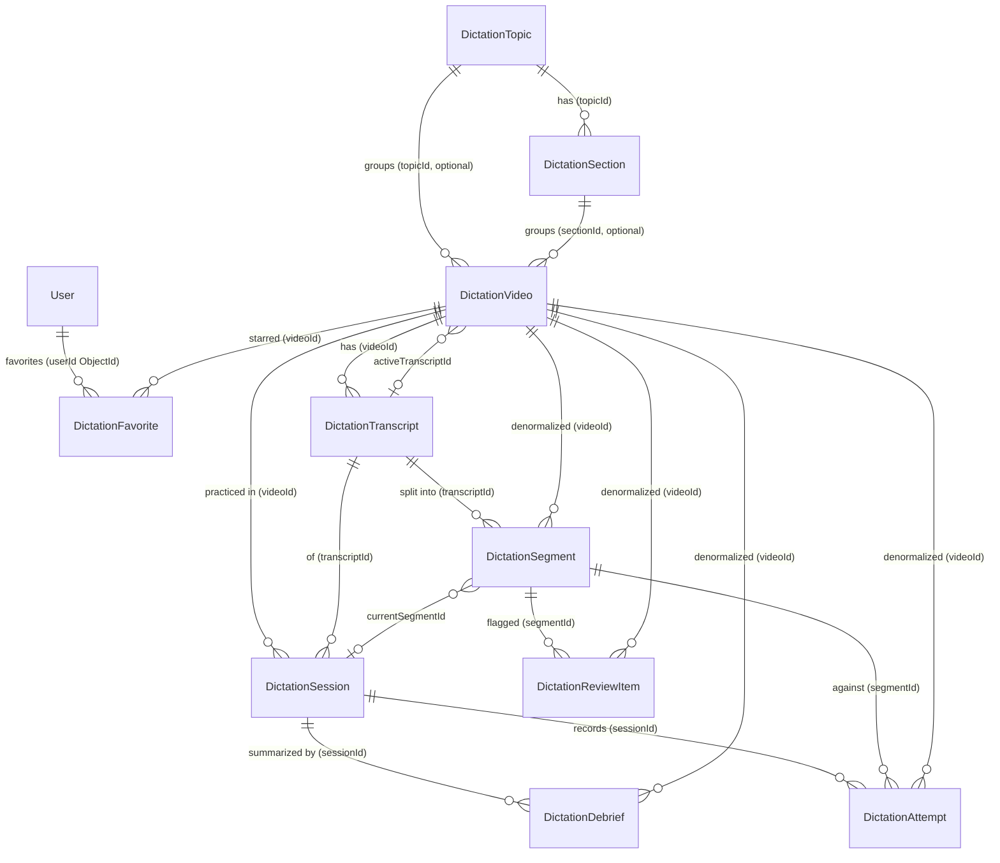
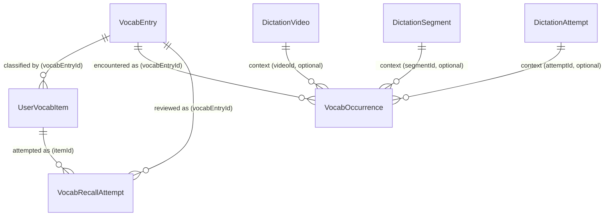
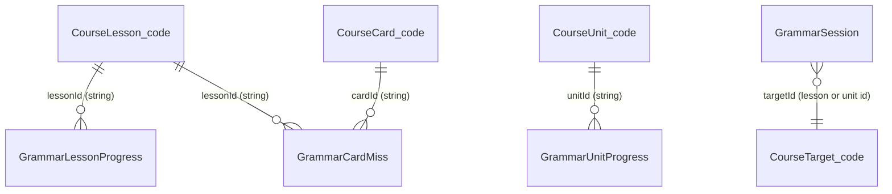
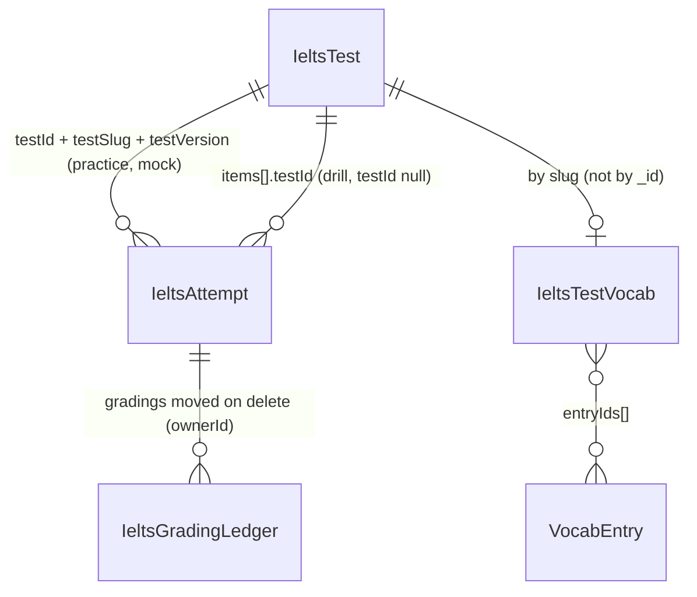
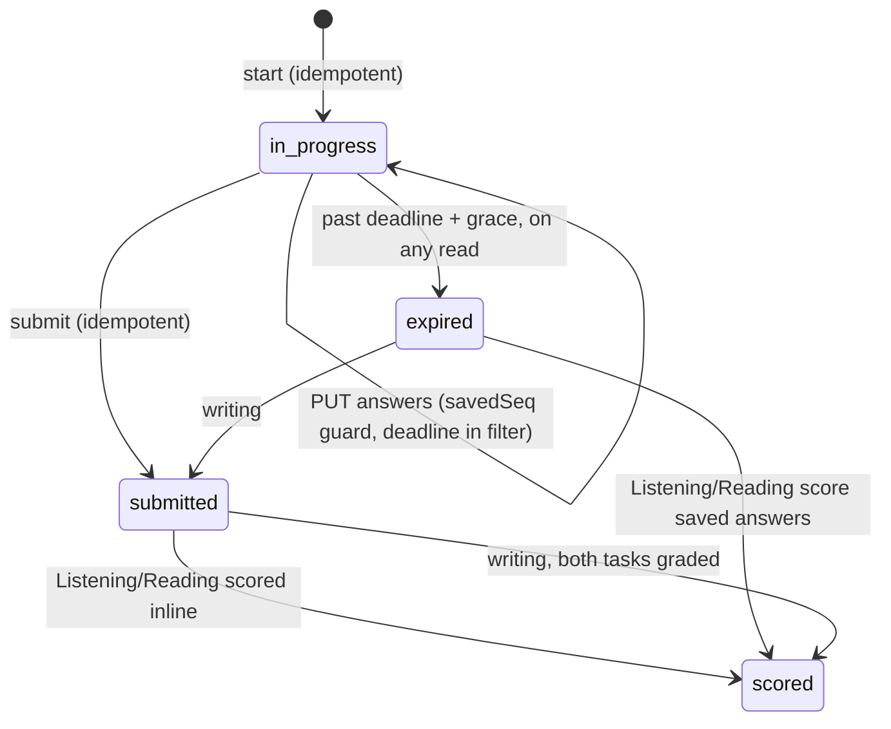

# Data Model Reference

This document is the persistence-layer reference for "English For Only Me", an IELTS-focused English practice app built on Next.js and Mongoose (MongoDB) with four learning modules: dictation, vocabulary, grammar, and IELTS mock tests. It describes the connection pattern, every Mongoose model in `src/models/` (23 models across `dictation/`, `vocabulary/`, `grammar/`, `ielts/`, plus `User`), their fields, indexes (unique, partial, and TTL), status and enum unions, derived counters, the owner-key contract that scopes every per-user row to the signed-in user, and the idempotency guarantees, so an AI can reason about the data layer without opening every schema file. Every claim is grounded in real source and cites a repo-relative path.

## 1. Database Overview

The app talks to MongoDB through Mongoose 9 (`package.json`). There is no Auth.js database adapter; the whole app shares one ODM and one MongoDB driver, and even users are managed as a plain Mongoose model (see the header comment in `src/models/UserModel.ts`, which explains that an adapter would peer-require `mongodb ^6` while the project ships `mongodb 7` via `mongoose 9`).

### 1.1 Cached-connection pattern

Connection setup lives in `src/lib/db/connectDatabase.ts`. It is a `server-only` module that caches a single `Mongoose` connection (and its in-flight promise) on `globalThis` so hot reload and serverless invocations reuse one connection instead of opening a new one per request:

- A `MongooseCache` object `{ connection, promise }` is stashed on `globalThis.mongooseCache` (`connectDatabase.ts:7-21`).
- `connectDatabase()` returns the cached `connection` immediately if present (`connectDatabase.ts:63`).
- Otherwise it starts (once) `mongoose.connect(getMongoDbUri(), getConnectOptions())` and caches the promise (`connectDatabase.ts:65-69`).
- On success the resolved connection is cached and returned; on failure the promise is reset to `null` so the next call retries (`connectDatabase.ts:71-77`).

`getConnectOptions(nodeEnv)` (`connectDatabase.ts:23-48`):

| Option                     | Value                      | Why                                                                                   |
| -------------------------- | -------------------------- | ------------------------------------------------------------------------------------- |
| `bufferCommands`           | `false`                    | Queries issued before the connection is ready reject rather than buffer.              |
| `maxIdleTimeMS`            | `60000`                    | Close idle pooled sockets after a minute.                                             |
| `maxPoolSize`              | `10`                       | Small pool for serverless functions.                                                  |
| `serverSelectionTimeoutMS` | `15000`                    | Long enough to ride out an Atlas primary election instead of failing writes.          |
| `autoCreate`, `autoIndex`  | `false` in production only | Cold starts skip one `createIndex` per declared index; indexes are built by a script. |

`getManualSchemaConnectOptions()` forces `autoCreate: false` and `autoIndex: false` in every environment; owner-run scripts such as `scripts/syncIndexes.ts` and `scripts/resetSharedSegmentProgress.ts` use it so a dry run writes nothing (`connectDatabase.ts:50-60`).

The Mongo URI comes from `getMongoDbUri()` in `src/constants/environments.ts`. Callers `await connectDatabase()` before running queries (for example `src/modules/grammar/services/grammarProgressService.ts`).

### 1.2 Index builds

Because production connects with `autoIndex: false`, new indexes reach the database only through `bun run db:sync-indexes` (`package.json`, `scripts/syncIndexes.ts`). The script is additive only: it calls `Model.createIndexes()`, never `Model.syncIndexes()`, and only reports indexes present in the database but absent from a schema (header comment of `scripts/syncIndexes.ts`). Its `MODELS` list covers every model in `src/models/`, and `src/lib/db/syncIndexesCoverage.test.ts` fails when a model file is missing from it.

### 1.3 Model registration guard

Every model file is `server-only` and reuses `mongoose.models.X` when it already exists so Next.js hot reload does not re-register a model and throw `OverwriteModelError`. Dictation, vocabulary, IELTS, and `User` use the typed form:

```ts
export const XModel =
  (models.X as Model<XDocument> | undefined) ?? model<XDocument>('X', XSchema)
```

(for example `src/models/UserModel.ts:70-72`, `src/models/dictation/DictationVideoModel.ts:192-194`, `src/models/ielts/IeltsTestModel.ts:213-215`). The four grammar models use a looser variant, `(models.X as Model<XDocument>) || model('X', XSchema)` (for example `src/models/grammar/GrammarSessionModel.ts:37-39`). Document types are derived with `InferSchemaType<typeof XSchema>` rather than hand-written interfaces.

Registered model names (the string passed to `model(...)`):

| Model name              | File                                               | Ownership                         |
| ----------------------- | -------------------------------------------------- | --------------------------------- |
| `User`                  | `src/models/UserModel.ts`                          | identity                          |
| `DictationTopic`        | `src/models/dictation/DictationTopicModel.ts`      | global content                    |
| `DictationSection`      | `src/models/dictation/DictationSectionModel.ts`    | global content                    |
| `DictationVideo`        | `src/models/dictation/DictationVideoModel.ts`      | global content                    |
| `DictationTranscript`   | `src/models/dictation/DictationTranscriptModel.ts` | global content                    |
| `DictationSegment`      | `src/models/dictation/DictationSegmentModel.ts`    | global content\*                  |
| `DictationSession`      | `src/models/dictation/DictationSessionModel.ts`    | per-owner (user id)               |
| `DictationAttempt`      | `src/models/dictation/DictationAttemptModel.ts`    | per-owner (user id)               |
| `DictationReviewItem`   | `src/models/dictation/DictationReviewItemModel.ts` | per-owner (user id)               |
| `DictationDebrief`      | `src/models/dictation/DictationDebriefModel.ts`    | per-owner (user id)               |
| `DictationFavorite`     | `src/models/dictation/DictationFavoriteModel.ts`   | per-user (signed in only)         |
| `VocabEntry`            | `src/models/vocabulary/VocabEntryModel.ts`         | global dictionary cache           |
| `UserVocabItem`         | `src/models/vocabulary/UserVocabItemModel.ts`      | per-owner vocabulary state        |
| `VocabOccurrence`       | `src/models/vocabulary/VocabOccurrenceModel.ts`    | per-owner vocabulary trail        |
| `VocabRecallAttempt`    | `src/models/vocabulary/VocabRecallAttemptModel.ts` | per-owner recall attempts         |
| `GrammarLessonProgress` | `src/models/grammar/GrammarLessonProgressModel.ts` | per-owner grammar progress        |
| `GrammarUnitProgress`   | `src/models/grammar/GrammarUnitProgressModel.ts`   | per-owner grammar progress        |
| `GrammarCardMiss`       | `src/models/grammar/GrammarCardMissModel.ts`       | per-owner weak spots              |
| `GrammarSession`        | `src/models/grammar/GrammarSessionModel.ts`        | per-owner idempotency record      |
| `IeltsTest`             | `src/models/ielts/IeltsTestModel.ts`               | global content (admin-authored)   |
| `IeltsTestVocab`        | `src/models/ielts/IeltsTestVocabModel.ts`          | global content (per test slug)    |
| `IeltsAttempt`          | `src/models/ielts/IeltsAttemptModel.ts`            | per-owner (`ownerId`)             |
| `IeltsGradingLedger`    | `src/models/ielts/IeltsGradingLedgerModel.ts`      | per-owner rate-limit ledger (TTL) |

\*`DictationSegment` is shared content. It still declares legacy progress fields (`attemptStatus`, `attemptCount`, `lastAttemptAt`) that practice no longer writes; per-learner progress is derived from `DictationAttempt` (see sections 3.6 and 5).

Grammar course content (units, lessons, cards) is not stored in MongoDB: it lives in code under `src/modules/grammar/course/`, and the grammar collections only hold string ids (`lessonId`, `unitId`, `cardId`) into it (comment `src/models/grammar/GrammarLessonProgressModel.ts:11-15`). `scripts/dropLegacyGrammar.ts` drops the retired v2 collections (`grammarpoints`, `usergrammaritems`, `grammardrillattempts`, `grammartestsessions`).

## 2. Entity-Relationship Overview

References are stored as raw `ObjectId` or string fields (with `ref:` hints on some ObjectIds), not populated relations. Per-owner collections key on a string owner (`userId`, or `ownerId` for IELTS) that holds the signed-in user's ObjectId string; only `DictationFavorite.userId` is an `ObjectId ref User`. The diagrams are split per module for readability.

### 2.1 Dictation

Content hierarchy is `Topic -> Section -> Video -> Transcript -> Segment`. Per-owner practice data (`Session`, `Attempt`, `ReviewItem`, `Debrief`, `Favorite`) hangs off `Video`/`Segment`/`Transcript`/`Session`.



### 2.2 Vocabulary



### 2.3 Grammar

There are no ObjectId references: every grammar row is keyed by an owner string plus a string id into the in-code course (`src/modules/grammar/course/`). The "course" boxes below are code, not collections.



Each owner has at most one `GrammarLessonProgress` per lesson, one `GrammarUnitProgress` per unit, one `GrammarCardMiss` per card, and one `GrammarSession` per idempotency key (unique indexes in section 3.16-3.19).

### 2.4 IELTS



`IeltsTest` documents are shared and never written per learner; all per-learner state lives on `IeltsAttempt` (comments `src/models/ielts/IeltsTestModel.ts:21-38`, `src/models/ielts/IeltsAttemptModel.ts:19-35`). `IeltsTestVocab` is keyed by slug so a word list follows the test across versions (`src/models/ielts/IeltsTestVocabModel.ts:11-16`). The ledger has no foreign key: it copies `{ ownerId, at }` from a deleted attempt's `gradings` (`src/modules/ielts/attempts/attemptService.ts:225-247`).

## 3. Models

Every model uses Mongoose `{ timestamps: true }` (adding `createdAt`/`updatedAt`) unless noted. `required`/`default` columns below reflect the schema definitions exactly. "owner key" means the string matches `OWNER_KEY_PATTERN` (section 6.1).

### 3.1 User (`src/models/UserModel.ts`)

Purpose: app user, provisioned on first Google sign-in (Auth.js v5, JWT sessions). Persists durable identity, a login timestamp and the admin's lock (`status`, `lockedAt`). `role` is NOT stored here; it is derived from `ADMIN_EMAILS` at token time (class comment `UserModel.ts:15-24`; `src/types/next-auth.d.ts` puts `role: UserRole` and `uid` on the session/JWT, not the DB).

| Field         | Type   | Required / Default                       | Meaning                                                                    |
| ------------- | ------ | ---------------------------------------- | -------------------------------------------------------------------------- |
| `email`       | String | required, unique                         | Login email; `trim`, `lowercase`.                                          |
| `googleSub`   | String | default `null`, indexed                  | Google subject id (stable OAuth id).                                       |
| `name`        | String | default `null`                           | Display name; `trim`.                                                      |
| `image`       | String | default `null`                           | Avatar URL.                                                                |
| `lastLoginAt` | Date   | default `null`                           | Last successful login time.                                                |
| `status`      | String | enum `USER_STATUSES`, default `'active'` | `'locked'` when an admin shut the account; sign-in and sessions refuse it. |
| `lockedAt`    | Date   | default `null`                           | When the lock was set; reset to `null` on unlock.                          |

- Indexes: unique index on `email` (via field `unique: true`); single-field index on `googleSub`. `status` has no index: it is only read by `_id` or `email`.
- Timestamps: yes. Enum: `USER_STATUSES = ['active', 'locked']` (exported type `UserStatus`, `UserModel.ts:11-13`). Hooks: none.
- Lock: only the admin user-management service writes `status`/`lockedAt` (`setUserLocked` in `src/modules/admin/users/userAdminService.ts`). The lock is enforced on read, not by the JWT: `getAccountBlock` (`src/lib/auth/accountStatus.ts`) treats a `locked` or missing `User` as signed out, and `isEmailLocked` makes the Auth.js `signIn` callback refuse the next Google sign-in (`src/lib/auth/auth.ts`). See doc 07, "Admin user management".
- Delete: `deleteUserAndData` removes the user's rows in every `USER_OWNED_MODELS` collection (section 6.2) and then the `User` row. A later Google sign-in with the same email provisions a fresh, empty `User`.
- Note: `User._id` (ObjectId) is the identity that `DictationFavorite.userId` references. Its 24-char hex string form is the signed-in owner key stored in every string `userId`/`ownerId` (section 6.1).

### 3.2 DictationTopic (`src/models/dictation/DictationTopicModel.ts`)

Purpose: top of the shared content hierarchy (`Topic > Section > Video`). Global, admin-curated content. Level range, section count, and lesson count are derived by aggregation, not stored (comment `DictationTopicModel.ts:11-15` and `DictationTopicSummaryRecord` in `src/modules/dictation/types.ts:131`).

| Field           | Type    | Required / Default             | Meaning                                                          |
| --------------- | ------- | ------------------------------ | ---------------------------------------------------------------- |
| `slug`          | String  | required, unique               | URL slug; `trim`, `lowercase`, `maxlength 120`.                  |
| `title`         | String  | required                       | Display title; `trim`, `maxlength 160`.                          |
| `description`   | String  | default `null`                 | Optional description; `trim`, `maxlength 2000`.                  |
| `thumbnailUrl`  | String  | default `null`                 | Optional thumbnail; `trim`.                                      |
| `hasVideoMedia` | Boolean | required, default `false`      | Whether the topic itself carries video media (vs pure grouping). |
| `order`         | Number  | required, default `0`, indexed | Manual sort order in the browse grid.                            |

- Indexes: unique on `slug`; single-field index on `order`.
- Timestamps: yes. Enums / hooks: none.

### 3.3 DictationSection (`src/models/dictation/DictationSectionModel.ts`)

Purpose: middle of the content hierarchy; always belongs to a Topic. Videos reference a section optionally; a topic video with no section falls back to an "Ungrouped" bucket at render time (comment `DictationSectionModel.ts:11-15`).

| Field     | Type                            | Required / Default    | Meaning                                 |
| --------- | ------------------------------- | --------------------- | --------------------------------------- |
| `topicId` | ObjectId (`ref DictationTopic`) | required, indexed     | Parent topic.                           |
| `title`   | String                          | required              | Section title; `trim`, `maxlength 160`. |
| `order`   | Number                          | required, default `0` | Sort order within the topic.            |

- Indexes: single-field index on `topicId`; compound `{ topicId: 1, order: 1 }` (`DictationSectionModel.ts:41`).
- Timestamps: yes. Enums / hooks: none.

### 3.4 DictationVideo (`src/models/dictation/DictationVideoModel.ts`)

Purpose: a practicable lesson (currently always a YouTube source). Carries content-placement fields (`topicId`, `sectionId`, `level`, `order`), content-lifecycle status, import metadata, a pointer to the active transcript, and a denormalized sentence count. All hierarchy fields are optional: a video may sit in no topic and/or no section. The video holds no per-learner progress; that is derived from sessions (comment on `DictationVideoStatus`, `src/modules/dictation/types.ts:3-5`).

| Field                | Type                                          | Required / Default                             | Meaning                                                                     |
| -------------------- | --------------------------------------------- | ---------------------------------------------- | --------------------------------------------------------------------------- |
| `sourceType`         | String enum `['youtube']`                     | required, default `'youtube'`                  | Source kind (only YouTube today).                                           |
| `title`              | String                                        | required                                       | Video title; `trim`, `maxlength 240`.                                       |
| `youtubeUrl`         | String                                        | required, unique                               | Canonical YouTube URL; `trim`, `maxlength 2048`.                            |
| `sourceUrl`          | String                                        | default `null`                                 | Original submitted URL; `trim`, `maxlength 2048`.                           |
| `youtubeVideoId`     | String                                        | default `null`                                 | Parsed video id; unique when a string (partial index).                      |
| `channelTitle`       | String                                        | default `null`                                 | YouTube channel name; `trim`.                                               |
| `thumbnailUrl`       | String                                        | default `null`                                 | Thumbnail URL; `trim`.                                                      |
| `durationSeconds`    | Number                                        | default `null`, `min 0`                        | Video length in seconds.                                                    |
| `defaultLanguage`    | String                                        | required, default `'en'`                       | Default caption language; `trim`.                                           |
| `purpose`            | String enum                                   | required, default `'ielts-listening'`          | One of `ielts-listening`, `general-listening`, `shadowing`.                 |
| `status`             | String enum (7 values)                        | required, default `'needsTranscript'`, indexed | Content lifecycle; see 4.1 (`DictationVideoStatus`).                        |
| `transcriptStatus`   | String enum                                   | required, default `'manualNeeded'`             | `none` / `manualNeeded` / `manualAdded`; see 4.2.                           |
| `importStatus`       | String enum (5 values)                        | required, default `'draft'`                    | Metadata-import lifecycle; see 4.3.                                         |
| `importWarning`      | String                                        | default `null`                                 | Human-readable import caveat; `trim`.                                       |
| `activeTranscriptId` | ObjectId (`ref DictationTranscript`)          | default `null`                                 | The transcript currently used for practice.                                 |
| `sentenceCount`      | Number                                        | required, default `0`, `min 0`                 | Denormalized count of active-transcript segments (see 5).                   |
| `tags`               | [String]                                      | default `[]`                                   | Free-form tags.                                                             |
| `collections`        | [String]                                      | default `[]`                                   | Named collection membership.                                                |
| `topicId`            | ObjectId (`ref DictationTopic`)               | default `null`, indexed                        | Optional parent topic.                                                      |
| `sectionId`          | ObjectId (`ref DictationSection`)             | default `null`, indexed                        | Optional parent section.                                                    |
| `level`              | String enum `['A1','A2','B1','B2','C1','C2']` | default `null`, indexed                        | Per-video CEFR level (`DictationLevel`, `src/modules/dictation/levels.ts`). |
| `order`              | Number                                        | required, default `0`, indexed                 | Manual sort order within section/topic.                                     |

- Removed since the last sync: `completedSessionCount` and `lastPracticedAt` no longer exist on the schema, and practice no longer writes `status` (`src/app/api/dictation/sessions/[sessionId]/attempts/route.ts:330-334`).
- Indexes (field-level `index: true`): `status`, `topicId`, `sectionId`, `level`, `order`. `youtubeVideoId` is intentionally not field-indexed (it is covered by the partial unique index). Additional `schema.index(...)` (`DictationVideoModel.ts:169-183`):
  - `{ createdAt: -1 }`
  - `{ topicId: 1, sectionId: 1 }`
  - `{ order: 1, createdAt: -1 }`
  - `{ youtubeUrl: 1 }` unique
  - `{ youtubeVideoId: 1 }` unique with `partialFilterExpression: { youtubeVideoId: { $type: 'string' } }` (so multiple `null` ids do not collide).
- Timestamps: yes. Enums: see section 4. Hooks / virtuals: none.

### 3.5 DictationTranscript (`src/models/dictation/DictationTranscriptModel.ts`)

Purpose: a source transcript for a video. Stores raw text and optional timed cues (embedded subdocuments), a source hash for dedup, and quality metadata. Multiple transcripts may exist per video; one is `isActive`.

Embedded `DictationCueSchema` (`_id: false`, `DictationTranscriptModel.ts:13-40`):

| Field     | Type   | Required / Default      | Meaning                             |
| --------- | ------ | ----------------------- | ----------------------------------- |
| `index`   | Number | required, `min 0`       | Cue ordinal.                        |
| `text`    | String | required                | Cue text; `trim`, `maxlength 5000`. |
| `startMs` | Number | default `null`, `min 0` | Cue start (ms); null when untimed.  |
| `endMs`   | Number | default `null`, `min 0` | Cue end (ms); null when untimed.    |

`DictationTranscriptSchema`:

| Field           | Type                                        | Required / Default                | Meaning                                                                                                          |
| --------------- | ------------------------------------------- | --------------------------------- | ---------------------------------------------------------------------------------------------------------------- |
| `videoId`       | ObjectId (`ref DictationVideo`)             | required, indexed                 | Parent video.                                                                                                    |
| `sourceType`    | String enum                                 | required                          | `manualText` / `manualTimedText` / `captionFile` / `youtubeOwnedCaption`; see 4.9.                               |
| `language`      | String                                      | required, default `'en'`          | Transcript language; `trim`.                                                                                     |
| `isActive`      | Boolean                                     | required, default `true`, indexed | Whether this is the active transcript.                                                                           |
| `rawText`       | String                                      | required, `maxlength 500000`      | Full raw transcript text.                                                                                        |
| `rawCues`       | [DictationCueSchema]                        | default `[]`                      | Timed cue list (may be empty for untimed).                                                                       |
| `sourceHash`    | String                                      | required, indexed                 | Content hash used for dedup; `trim`.                                                                             |
| `qualityStatus` | String enum `['blocked','warning','ready']` | required                          | Quality gate; see 4.9.                                                                                           |
| `qualityFlags`  | [String]                                    | default `[]`                      | Quality flags (`DictationTranscriptQualityFlag`, see 4.9); note the array is not enum-constrained in the schema. |
| `cueCount`      | Number                                      | required, default `0`, `min 0`    | Number of cues (denormalized).                                                                                   |
| `segmentCount`  | Number                                      | required, default `0`, `min 0`    | Number of segments produced (denormalized, see 5).                                                               |
| `createdBy`     | String enum `['manual','import','system']`  | required, default `'manual'`      | Provenance.                                                                                                      |

- Indexes: field-level on `videoId`, `isActive`, `sourceHash`. Compound (`DictationTranscriptModel.ts:120-124`): `{ videoId: 1, isActive: 1 }` and `{ videoId: 1, sourceHash: 1 }` unique (dedup guarantee: one transcript per video per source hash).
- Timestamps: yes. Hooks / virtuals: none.

### 3.6 DictationSegment (`src/models/dictation/DictationSegmentModel.ts`)

Purpose: one dictation sentence/line derived from a transcript. This is the unit the learner types. It stores both display `text` and `normalizedText`, optional timing, source cue indices, manual hint and translation overrides, and quality flags.

| Field                  | Type                                 | Required / Default                        | Meaning                                                                                                                      |
| ---------------------- | ------------------------------------ | ----------------------------------------- | ---------------------------------------------------------------------------------------------------------------------------- |
| `videoId`              | ObjectId (`ref DictationVideo`)      | required, indexed                         | Parent video (denormalized from transcript).                                                                                 |
| `transcriptId`         | ObjectId (`ref DictationTranscript`) | required, indexed                         | Source transcript.                                                                                                           |
| `transcriptSourceHash` | String                               | required, indexed                         | Source hash of the originating transcript; `trim`.                                                                           |
| `order`                | Number                               | required, `min 0`, indexed                | Segment ordinal within the transcript.                                                                                       |
| `text`                 | String                               | required, `maxlength 3000`                | Display text; `trim`.                                                                                                        |
| `normalizedText`       | String                               | required, `maxlength 3000`                | Normalized comparison text; `trim`.                                                                                          |
| `startMs`              | Number                               | default `null`, `min 0`                   | Segment start (ms).                                                                                                          |
| `endMs`                | Number                               | default `null`, `min 0`                   | Segment end (ms).                                                                                                            |
| `cueIndexes`           | [Number]                             | default `[]`                              | Indices of source cues folded into this segment.                                                                             |
| `hints`                | [String]                             | default `[]`                              | Manual hint list, used verbatim only when `hintsOverridden` is true (an empty array then means "no hints").                  |
| `hintsOverridden`      | Boolean                              | required, default `false`                 | When false, practice keeps the automatic in-sentence hint logic.                                                             |
| `translations`         | Mixed (plain object)                 | default `() => ({})`                      | Per-language translation overrides keyed by language code (never the dictation language); beat the uploaded SRT/VTT caption. |
| `qualityFlags`         | [String] enum `segmentQualityFlags`  | default `[]`                              | See 4.10 (`DictationSegmentQualityFlag`).                                                                                    |
| `warningAccepted`      | Boolean                              | required, default `false`                 | Admin accepted a quality warning for this segment.                                                                           |
| `attemptStatus`        | String enum (5 values)               | required, default `'notStarted'`, indexed | Legacy shared progress field; see caveat.                                                                                    |
| `attemptCount`         | Number                               | required, default `0`, `min 0`            | Legacy shared progress field.                                                                                                |
| `lastAttemptAt`        | Date                                 | default `null`                            | Legacy shared progress field.                                                                                                |

- Field comments for `hints`/`hintsOverridden`/`translations`: `DictationSegmentModel.ts:79-97`. `translations` is a plain object rather than a `Map` so it serializes the same through `toObject()` and `lean()`.
- Indexes: field-level on `videoId`, `transcriptId`, `transcriptSourceHash`, `order`, `attemptStatus`. Compound (`DictationSegmentModel.ts:137-138`): `{ transcriptId: 1, order: 1 }` and `{ videoId: 1, order: 1 }`.
- Timestamps: yes. Hooks / virtuals: none.
- Caveat: `attemptStatus`/`attemptCount`/`lastAttemptAt` are no longer read or written by practice. Per-learner progress is computed from the learner's own `DictationAttempt` rows by an aggregation (`src/modules/dictation/practice/segmentProgress.ts:8-12`, `buildSegmentProgressPipeline`). Segment create/rebuild paths still insert the defaults (`src/modules/dictation/services/rebuildTranscriptSegments.ts:84-85`, `src/app/api/dictation/segments/[segmentId]/route.ts:325-326`), and `scripts/resetSharedSegmentProgress.ts` resets stale values left by the old shared-progress code.

### 3.7 DictationSession (`src/models/dictation/DictationSessionModel.ts`)

Purpose: a per-owner practice run over one video/transcript. Tracks the current position and playback preferences. `userId` is an owner-key `String`.

| Field                 | Type                                             | Required / Default                         | Meaning                                  |
| --------------------- | ------------------------------------------------ | ------------------------------------------ | ---------------------------------------- |
| `userId`              | String                                           | required, owner key, indexed               | Owner (user id); `trim`.                 |
| `videoId`             | ObjectId (`ref DictationVideo`)                  | required, indexed                          | Video being practiced.                   |
| `transcriptId`        | ObjectId (`ref DictationTranscript`)             | required, indexed                          | Transcript in use.                       |
| `status`              | String enum `['active','completed','abandoned']` | required, default `'active'`, indexed      | Session lifecycle; see 4.5.              |
| `currentSegmentId`    | ObjectId (`ref DictationSegment`)                | default `null`                             | Cursor: current segment.                 |
| `currentSegmentOrder` | Number                                           | required, default `0`, `min 0`             | Cursor: current segment order.           |
| `playbackSpeed`       | Number                                           | required, default `1`, `min 0.25`, `max 2` | Player speed preference.                 |
| `showShortcuts`       | Boolean                                          | required, default `true`                   | UI preference.                           |
| `isVideoHidden`       | Boolean                                          | required, default `false`                  | UI preference (hide video, audio-only).  |
| `startedAt`           | Date                                             | required, default `Date.now`               | Session start.                           |
| `lastActiveAt`        | Date                                             | required, default `Date.now`, indexed      | Last activity; used for resume ordering. |
| `completedAt`         | Date                                             | default `null`                             | Completion time.                         |

- Indexes: field-level on `userId`, `videoId`, `transcriptId`, `status`, `lastActiveAt`. Compound (`DictationSessionModel.ts:91-104`):
  - `{ userId: 1, videoId: 1, status: 1 }`
  - `{ userId: 1, lastActiveAt: -1 }`
  - `{ userId: 1, videoId: 1 }` unique, `partialFilterExpression: { status: 'active' }`: at most one in-flight session per owner per video. Starting practice reuses the open session and collapses legacy strays to `abandoned` (`src/app/api/dictation/sessions/route.ts:106-128`).
- Timestamps: yes. Hooks / virtuals: none.

### 3.8 DictationAttempt (`src/models/dictation/DictationAttemptModel.ts`)

Purpose: an append-only record of one submission (check/reveal/skip) against a segment inside a session. Stores the typed answer, a snapshot of the expected text, correction tokens, and computed stats. This is the source of truth for all learner analytics and for per-learner segment progress.

Embedded `DictationCorrectionTokenSchema` (`_id: false`, `DictationAttemptModel.ts:26-53`):

| Field              | Type                        | Required / Default | Meaning                     |
| ------------------ | --------------------------- | ------------------ | --------------------------- |
| `actual`           | String                      | default `null`     | Normalized typed token.     |
| `actualOriginal`   | String                      | default `null`     | Original typed token.       |
| `expected`         | String                      | default `null`     | Normalized expected token.  |
| `expectedOriginal` | String                      | default `null`     | Original expected token.    |
| `status`           | String enum `tokenStatuses` | required           | Per-token verdict; see 4.6. |

`DictationAttemptSchema`:

| Field                      | Type                                    | Required / Default                 | Meaning                                                                                                                                                  |
| -------------------------- | --------------------------------------- | ---------------------------------- | -------------------------------------------------------------------------------------------------------------------------------------------------------- |
| `userId`                   | String                                  | required, owner key, indexed       | Owner (user id); `trim`.                                                                                                                                 |
| `videoId`                  | ObjectId (`ref DictationVideo`)         | required, indexed                  | Denormalized parent video.                                                                                                                               |
| `transcriptId`             | ObjectId (`ref DictationTranscript`)    | required, indexed                  | Denormalized transcript.                                                                                                                                 |
| `sessionId`                | ObjectId (`ref DictationSession`)       | required, indexed                  | Owning session.                                                                                                                                          |
| `segmentId`                | ObjectId (`ref DictationSegment`)       | required, indexed                  | Segment attempted.                                                                                                                                       |
| `action`                   | String enum `['check','reveal','skip']` | required, indexed                  | Attempt action; see 4.6.                                                                                                                                 |
| `idempotencyKey`           | String                                  | required, `maxlength 120`          | Client-supplied dedup key; `trim` (see 7).                                                                                                               |
| `typedAnswer`              | String                                  | default `''`, `maxlength 5000`     | Raw text the learner typed.                                                                                                                              |
| `expectedTextSnapshot`     | String                                  | required, `maxlength 5000`         | Expected text captured at attempt time.                                                                                                                  |
| `replayCountDelta`         | Number                                  | required, default `0`, `min 0`     | Audio replays since last attempt.                                                                                                                        |
| `timeSpentMs`              | Number                                  | required, default `0`, `min 0`     | Time spent on this attempt.                                                                                                                              |
| `normalizedTypedTokens`    | [String]                                | default `[]`                       | Tokenized normalized answer.                                                                                                                             |
| `normalizedExpectedTokens` | [String]                                | default `[]`                       | Tokenized normalized expected text.                                                                                                                      |
| `isPassed`                 | Boolean                                 | required, indexed                  | Whether the attempt passed.                                                                                                                              |
| `feedbackTokens`           | [DictationCorrectionTokenSchema]        | default `[]`                       | Per-token diff feedback.                                                                                                                                 |
| `stats`                    | embedded object                         | required (each sub-field required) | Correction stats: `accuracy` (0-100), `correctCount`, `extraCount`, `missingCount`, `spellingVariantCount`, `totalExpected`, `wrongCount` (all `min 0`). |

- Note: `normalizedTypedTokens` and `normalizedExpectedTokens` exist in the schema but are not part of `DictationAttemptApiRecord` (`src/modules/dictation/types.ts:232`); they are internal-only.
- Indexes: field-level on `userId`, `videoId`, `transcriptId`, `sessionId`, `segmentId`, `action`, `isPassed`. Compound (`DictationAttemptModel.ts:183-201`):
  - `{ userId: 1, sessionId: 1, idempotencyKey: 1 }` unique (idempotency guarantee, see 7).
  - `{ userId: 1, idempotencyKey: 1 }` (non-unique; serves the per-owner idempotency lookup the attempts route runs before inserting).
  - `{ userId: 1, segmentId: 1, createdAt: -1 }`
  - `{ userId: 1, videoId: 1, createdAt: -1 }` (also serves the segment-progress aggregation, `segmentProgress.ts:40-44`).
  - `{ userId: 1, createdAt: 1 }` (global stats read one owner's newest attempts, walked backwards).
- Timestamps: yes. Hooks / virtuals: none.

### 3.9 DictationReviewItem (`src/models/dictation/DictationReviewItemModel.ts`)

Purpose: a spaced-repetition / review queue entry generated from an owner's mistakes on a segment. Recomputed per segment after each attempt (`recomputeReviewItemsForSegment`, called from `src/app/api/dictation/sessions/[sessionId]/attempts/route.ts:344`) (`src/modules/dictation/review/reviewItemService.ts`); a passed review attempt completes the segment's active items (`completeReviewItemsForSegment`), and attempts before a closed item no longer raise it again.

Embedded `DictationReviewStatsSnapshotSchema` (`_id: false`, `DictationReviewItemModel.ts:33-84`):

| Field             | Type                                    | Required / Default                        | Meaning                                                                     |
| ----------------- | --------------------------------------- | ----------------------------------------- | --------------------------------------------------------------------------- |
| `accuracy`        | Number                                  | required, default `0`, `min 0`, `max 100` | Snapshot accuracy.                                                          |
| `attemptCount`    | Number                                  | required, default `0`, `min 0`            | Snapshot attempt count.                                                     |
| `lastAction`      | String enum `['check','reveal','skip']` | required, default `'check'`               | Last action.                                                                |
| `mistakeTaxonomy` | embedded                                | required                                  | `extra`, `missing`, `spellingVariant`, `wrong` (each `min 0`, default `0`). |

`DictationReviewItemSchema`:

| Field            | Type                                       | Required / Default                                  | Meaning                       |
| ---------------- | ------------------------------------------ | --------------------------------------------------- | ----------------------------- |
| `userId`         | String                                     | required, owner key, indexed                        | Owner (user id); `trim`.      |
| `videoId`        | ObjectId (`ref DictationVideo`)            | required, indexed                                   | Denormalized parent video.    |
| `segmentId`      | ObjectId (`ref DictationSegment`)          | required, indexed                                   | Segment under review.         |
| `kind`           | String enum `['pattern','segment','word']` | required, default `'segment'`                       | Item granularity; see 4.7.    |
| `reason`         | String enum (5 values)                     | required, indexed                                   | Why flagged; see 4.7.         |
| `label`          | String                                     | required, `maxlength 500`                           | Human-readable label; `trim`. |
| `status`         | String enum (4 values)                     | required, default `'due'`, indexed                  | Review lifecycle; see 4.7.    |
| `priority`       | Number                                     | required, default `50`, `min 0`, `max 100`, indexed | Sort priority.                |
| `dueAt`          | Date                                       | required, default `Date.now`, indexed               | When it becomes due.          |
| `lastReviewedAt` | Date                                       | default `null`                                      | Last review time.             |
| `statsSnapshot`  | DictationReviewStatsSnapshotSchema         | required, default `() => ({})`                      | Frozen stats at flag time.    |

- Indexes: field-level on `userId`, `videoId`, `segmentId`, `reason`, `status`, `priority`, `dueAt`. Compound (`DictationReviewItemModel.ts:161-194`):
  - `{ userId: 1, status: 1, dueAt: 1, priority: -1 }` (due-queue query)
  - `{ userId: 1, videoId: 1, status: 1 }`
  - `{ userId: 1, segmentId: 1, kind: 1, reason: 1 }`
  - `active_review_item_unique`: `{ userId: 1, segmentId: 1, reason: 1, kind: 1 }` unique with `partialFilterExpression: { status: { $in: ['due', 'scheduled'] } }`. At most one active item per (owner, segment, kind, reason); two overlapping recomputes cannot both insert (the loser gets E11000, which `insertReviewCandidates` tolerates). Completed/dismissed history is unconstrained. The key order differs from the plain index so the two never share a key pattern; `$in` in a partial filter needs MongoDB 6.0+ (comment `DictationReviewItemModel.ts:172-180`).
- Timestamps: yes. Hooks / virtuals: none.

### 3.10 DictationDebrief (`src/models/dictation/DictationDebriefModel.ts`)

Purpose: an AI-generated post-session debrief (summary, vocabulary, traps, weak patterns, next actions). Tracks the model, prompt version, and an input snapshot hash for caching/dedup.

Embedded `DictationDebriefVocabularySchema` (`_id: false`, `DictationDebriefModel.ts:16-37`):

| Field     | Type   | Required / Default        | Meaning                 |
| --------- | ------ | ------------------------- | ----------------------- |
| `example` | String | required, `maxlength 240` | Example usage sentence. |
| `meaning` | String | required, `maxlength 240` | Definition.             |
| `term`    | String | required, `maxlength 80`  | Vocabulary term.        |

`DictationDebriefSchema`:

| Field               | Type                                       | Required / Default                     | Meaning                                                          |
| ------------------- | ------------------------------------------ | -------------------------------------- | ---------------------------------------------------------------- |
| `userId`            | String                                     | required, owner key, indexed           | Owner (user id); `trim`.                                         |
| `videoId`           | ObjectId (`ref DictationVideo`)            | required, indexed                      | Denormalized parent video.                                       |
| `sessionId`         | ObjectId (`ref DictationSession`)          | required, indexed                      | Debriefed session.                                               |
| `status`            | String enum `['failed','pending','ready']` | required, default `'pending'`, indexed | Generation lifecycle; see 4.8.                                   |
| `model`             | String                                     | required                               | LLM model id used; `trim`.                                       |
| `promptVersion`     | String                                     | required, indexed                      | Prompt template version; `trim`.                                 |
| `inputSnapshotHash` | String                                     | required, indexed                      | Hash of the debrief input (dedup/cache); `trim`.                 |
| `contentSummary`    | String                                     | default `''`, `maxlength 1000`         | Summary paragraph.                                               |
| `keyVocabulary`     | [DictationDebriefVocabularySchema]         | default `[]`                           | Vocabulary list.                                                 |
| `listeningTraps`    | [String]                                   | default `[]`                           | Listening traps encountered.                                     |
| `weakPatterns`      | [String]                                   | default `[]`                           | Recurring weak patterns.                                         |
| `nextActions`       | [String]                                   | default `[]`                           | Recommended next steps.                                          |
| `confidence`        | Number                                     | default `0`, `min 0`, `max 1`          | Model confidence (0-1).                                          |
| `caveats`           | [String]                                   | default `[]`                           | Caveats about the output.                                        |
| `failureReason`     | String                                     | default `null`, `maxlength 500`        | Set when `status = 'failed'`.                                    |
| `rawOutput`         | Mixed                                      | default `null`                         | Raw model output (internal; not in `DictationDebriefApiRecord`). |

- Indexes: field-level on `userId`, `videoId`, `sessionId`, `status`, `promptVersion`, `inputSnapshotHash`. Compound (`DictationDebriefModel.ts:130-141`): `{ userId: 1, videoId: 1, status: 1, createdAt: -1 }` and `{ userId: 1, videoId: 1, inputSnapshotHash: 1, status: 1 }`.
- Timestamps: yes. Hooks / virtuals: none.

### 3.11 DictationFavorite (`src/models/dictation/DictationFavoriteModel.ts`)

Purpose: a per-user star on a video. Keyed by the authenticated user's Mongo `ObjectId` (comment `DictationFavoriteModel.ts:11-15`). Unlike every other per-owner collection, `userId` here is an `ObjectId` (`ref User`), not an owner-key string; favoriting requires a signed-in user (`src/modules/dictation/content/favoriteActions.ts`).

| Field     | Type                            | Required / Default | Meaning            |
| --------- | ------------------------------- | ------------------ | ------------------ |
| `userId`  | ObjectId (`ref User`)           | required, indexed  | Owner (real user). |
| `videoId` | ObjectId (`ref DictationVideo`) | required, indexed  | Favorited video.   |

- Indexes: field-level on `userId`, `videoId`; compound `{ userId: 1, videoId: 1 }` unique (`DictationFavoriteModel.ts:36`). `addFavorite` upserts with `$setOnInsert` and treats E11000 as "already favorited" (`src/modules/dictation/content/favoriteRepository.ts:12-28`).
- Timestamps: `{ createdAt: true, updatedAt: false }` - only `createdAt` (`DictationFavoriteModel.ts:32`), matching `DictationFavoriteApiRecord` (`src/modules/dictation/types.ts:146`).
- Hooks / virtuals: none.

### 3.12 VocabEntry (`src/models/vocabulary/VocabEntryModel.ts`)

Purpose: the global dictionary cache for the vocabulary module. A row can start as a seeded shell, be enriched by a free provider, fail and retry later, or be marked not found. It is shared across all owners; owner-specific state lives in `UserVocabItem`. `IeltsTestVocab.entryIds` also points here.

| Field                                                                                                                            | Type                           | Required / Default                               | Meaning                                                                       |
| -------------------------------------------------------------------------------------------------------------------------------- | ------------------------------ | ------------------------------------------------ | ----------------------------------------------------------------------------- |
| `language`                                                                                                                       | String                         | required, default `'en'`, indexed                | Entry language; `lowercase`, `maxlength 16`.                                  |
| `term`                                                                                                                           | String                         | required, `maxlength 80`                         | Display term.                                                                 |
| `normalizedTerm`                                                                                                                 | String                         | required, `lowercase`, `maxlength 80`            | Lookup key.                                                                   |
| `entryType`                                                                                                                      | String enum `word` / `phrase`  | required, default `'word'`                       | Word or phrase.                                                               |
| `lemma`, `partOfSpeech`, `difficultyLevel`                                                                                       | String or null                 | default `null`                                   | Provider and seed metadata (`maxlength` 120 / 80 / 80).                       |
| `frequencyRank`                                                                                                                  | Number or null                 | default `null`, `min 1`, indexed                 | NGSL rank for seeded entries.                                                 |
| `phonetics`, `audioUrls`, `definitions`, `localizedMeanings`, `examples`, `relatedWords`, `sourceAttributions`, `providerErrors` | embedded arrays (`_id: false`) | default `[]`                                     | Normalized provider/cache data. Raw provider data is kept separately.         |
| `synonyms`, `antonyms`                                                                                                           | [String]                       | default `[]`                                     | Flattened related terms.                                                      |
| `license`                                                                                                                        | embedded object or null        | default `null`                                   | `name`, `url`, `attributionRequired` (default `true`).                        |
| `rawProviderData`                                                                                                                | Map of Mixed                   | default `() => ({})`                             | Provider-keyed raw payload, never rendered directly.                          |
| `enrichmentStatus`                                                                                                               | String enum                    | required, default `'pending'`, indexed           | `seeded`, `pending`, `enriching`, `ready`, `failed`, `notFound`.              |
| `enrichmentAttempts`                                                                                                             | Number                         | required, default `0`, `min 0`                   | Retry bookkeeping.                                                            |
| `lastEnrichedAt`, `nextRetryAt`                                                                                                  | Date                           | default `null`; `nextRetryAt` indexed            | Retry bookkeeping.                                                            |
| `enrichmentLockId`, `enrichmentLockedAt`, `enrichmentLeaseExpiresAt`                                                             | String / Date                  | default `null`; lock id and lease expiry indexed | Short lease used by lookup/admin enrich to prevent duplicate provider writes. |
| `seedSource`, `seedRank`, `seedLicense`                                                                                          | String / Number                | default `null`                                   | NGSL provenance.                                                              |

- Indexes (`VocabEntryModel.ts:430-448`): unique `{ language: 1, normalizedTerm: 1 }`; enrichment queue `{ enrichmentStatus: 1, nextRetryAt: 1, frequencyRank: 1 }`; stale-lease `{ enrichmentLeaseExpiresAt: 1, enrichmentStatus: 1 }`; browse `{ language: 1, frequencyRank: 1 }`; ready-slice sort `{ enrichmentStatus: 1, frequencyRank: 1, normalizedTerm: 1 }` (added so `/api/vocab/recall/due` and `/api/vocab/explore` avoid a blocking in-memory sort past the 32MB/100MB cap, comment `VocabEntryModel.ts:438-442`); text index on `term`, `normalizedTerm`, `lemma`.
- Timestamps: yes.

### 3.13 UserVocabItem (`src/models/vocabulary/UserVocabItemModel.ts`)

Purpose: a per-owner learning state for one `VocabEntry`. `userId` is a string holding the signed-in user's id. The schema does not apply `OWNER_KEY_PATTERN`; the routes resolve the owner through `requireUser()` (section 6.1).

| Field                                       | Type                        | Required / Default                      | Meaning                                               |
| ------------------------------------------- | --------------------------- | --------------------------------------- | ----------------------------------------------------- |
| `userId`                                    | String                      | required, indexed                       | Owner (user id); `trim`.                              |
| `vocabEntryId`                              | ObjectId (`ref VocabEntry`) | required, indexed                       | Global entry being learned or marked known.           |
| `status`                                    | String enum                 | required, default `'learning'`, indexed | `learning`, `alreadyKnow`, `mastered`, `ignored`.     |
| `source`                                    | String enum                 | required, default `'manual'`            | `search`, `explore`, `dictionary`, `manual`, `ielts`. |
| `recallStage`                               | Number                      | required, default `1`, `min 1`, `max 7` | Current seven-touch recall stage.                     |
| `dueAt`                                     | Date or null                | default `null`, indexed                 | Next due time for learning items.                     |
| `reviewCount`, `correctCount`, `wrongCount` | Number                      | required, default `0`, `min 0`          | Recall counters.                                      |
| `lastReviewedAt`, `knownAt`, `masteredAt`   | Date or null                | default `null`                          | Review and completion timestamps.                     |
| `knownReason`, `masteredReason`             | String enum or null         | default `null`                          | `manual` or `recallMastery`.                          |
| `firstSeenAt`                               | Date                        | required, default `Date.now`            | Used for daily growth stats.                          |
| `notes`                                     | String or null              | default `null`, `maxlength 2000`        | User notes, reserved for future UI.                   |

- Indexes (`UserVocabItemModel.ts:113-116`): unique `{ userId: 1, vocabEntryId: 1 }`; due queue `{ userId: 1, status: 1, dueAt: 1 }`; growth/history `{ userId: 1, firstSeenAt: -1 }` and `{ userId: 1, updatedAt: -1 }`.
- State rule: manual known words use `status = alreadyKnow` (no `masteredAt`); earned recall completion uses `status = mastered` (comment `UserVocabItemModel.ts:111-112`).

### 3.14 VocabOccurrence (`src/models/vocabulary/VocabOccurrenceModel.ts`)

Purpose: a per-owner trail for where a word came from (manual search, dictionary lookup, Explore, and the dictation-context reasons).

| Field                               | Type                        | Required / Default               | Meaning                                                                                      |
| ----------------------------------- | --------------------------- | -------------------------------- | -------------------------------------------------------------------------------------------- |
| `userId`                            | String                      | required, indexed                | Owner; `trim`.                                                                               |
| `vocabEntryId`                      | ObjectId (`ref VocabEntry`) | required, indexed                | Entry encountered.                                                                           |
| `videoId`, `segmentId`, `attemptId` | ObjectId refs or null       | default `null`, indexed          | Optional dictation context (`DictationVideo`, `DictationSegment`, `DictationAttempt`).       |
| `contextSentence`                   | String or null              | default `null`, `maxlength 3000` | Sentence where the word appeared.                                                            |
| `selectedText`                      | String or null              | default `null`, `maxlength 500`  | Exact selected/typed text.                                                                   |
| `reason`                            | String enum                 | required, indexed                | `manualSearch`, `dictionaryLookup`, `explore`, `clickedInAnswer`, `missedWord`, `aiDebrief`. |

- Indexes (`VocabOccurrenceModel.ts:67-68`): `{ userId: 1, vocabEntryId: 1, createdAt: -1 }` and `{ userId: 1, reason: 1, createdAt: -1 }`.
- Timestamps: yes.

### 3.15 VocabRecallAttempt (`src/models/vocabulary/VocabRecallAttemptModel.ts`)

Purpose: an append-only record of one vocabulary recall answer. It backs vocab accuracy, streaks, reviews-today, and hardest-word stats, and it gives the recall answer route an idempotent write target.

| Field                                   | Type                           | Required / Default                    | Meaning                                                    |
| --------------------------------------- | ------------------------------ | ------------------------------------- | ---------------------------------------------------------- |
| `userId`                                | String                         | required, indexed                     | Owner (user id).                                           |
| `itemId`                                | ObjectId (`ref UserVocabItem`) | required, indexed                     | Owner-specific vocab item being reviewed.                  |
| `vocabEntryId`                          | ObjectId (`ref VocabEntry`)    | required, indexed                     | Global entry reviewed.                                     |
| `taskType`                              | String enum                    | required, indexed                     | One of the five recall task types (4.11).                  |
| `taskId`                                | String                         | required, `maxlength 120`             | Signed task id.                                            |
| `idempotencyKey`                        | String                         | required, `maxlength 160`             | Client idempotency key.                                    |
| `selectedAnswer`                        | String or null                 | default `null`, `maxlength 1000`      | Submitted answer/action.                                   |
| `correctAnswer`                         | String                         | required, `maxlength 1000`            | Server-signed correct answer.                              |
| `isCorrect`                             | Boolean                        | required, indexed                     | Server-graded result.                                      |
| `recallStageBefore`, `recallStageAfter` | Number                         | required, `min 1`, `max 7`            | Stage transition snapshot.                                 |
| `statusAfter`                           | String                         | required, `maxlength 40`              | Item status after applying the scheduler (not enum-bound). |
| `answeredAt`                            | Date                           | required, default `Date.now`, indexed | Answer timestamp for stats/streaks.                        |

- Indexes (`VocabRecallAttemptModel.ts:96-101`): unique `{ userId: 1, idempotencyKey: 1 }`; stats `{ userId: 1, answeredAt: -1 }` and `{ userId: 1, taskType: 1, answeredAt: -1 }`.
- Timestamps: yes.

### 3.16 GrammarLessonProgress (`src/models/grammar/GrammarLessonProgressModel.ts`)

Purpose: one row per (owner, lesson) saying how far the learner got. Course content lives in code. `recallStage` stays `null` for a lesson passed by a test-out until it is played as a lesson (comment `GrammarLessonProgressModel.ts:11-15`). Passed lessons are scheduled on the shared 7-stage recall ladder in `src/modules/learning/recall/recallLadder.ts` (the same ladder vocabulary uses).

| Field          | Type                            | Required / Default                      | Meaning                                                 |
| -------------- | ------------------------------- | --------------------------------------- | ------------------------------------------------------- |
| `userId`       | String                          | required                                | Owner key; `trim`.                                      |
| `lessonId`     | String                          | required                                | Lesson id in the in-code course; `trim`.                |
| `stars`        | Number                          | required, default `0`, `min 0`, `max 3` | Best star rating.                                       |
| `bestAccuracy` | Number                          | required, default `0`, `min 0`, `max 1` | Best first-try accuracy (fraction).                     |
| `passedBy`     | String enum `['lesson','test']` | default `null`                          | How the lesson was passed; `null` while unpassed.       |
| `completedAt`  | Date                            | default `null`                          | First completion.                                       |
| `attempts`     | Number                          | required, default `0`, `min 0`          | Times the lesson was played.                            |
| `recallStage`  | Number                          | default `null`, `min 1`, `max 7`        | Recall-ladder stage; `null` until the lesson is played. |
| `dueAt`        | Date                            | default `null`                          | Next review due time.                                   |
| `reviewCount`  | Number                          | required, default `0`, `min 0`          | Review answers recorded.                                |
| `correctCount` | Number                          | required, default `0`, `min 0`          | Passed reviews.                                         |
| `wrongCount`   | Number                          | required, default `0`, `min 0`          | Failed reviews.                                         |
| `masteredAt`   | Date                            | default `null`                          | When the ladder was completed.                          |

- Indexes: unique `{ userId: 1, lessonId: 1 }` (`GrammarLessonProgressModel.ts:35`). No other indexes; there is no field-level `userId` index (the compound prefix serves owner reads).
- Timestamps: yes. The schema does not apply `OWNER_KEY_PATTERN`; writes go through `assertOwnerKey` in `src/modules/grammar/services/grammarProgressService.ts:74,180`.

### 3.17 GrammarUnitProgress (`src/models/grammar/GrammarUnitProgressModel.ts`)

Purpose: one row per (owner, unit), created once the unit checkpoint or a test-out is passed (comment `GrammarUnitProgressModel.ts:11`).

| Field         | Type                                | Required / Default | Meaning                                |
| ------------- | ----------------------------------- | ------------------ | -------------------------------------- |
| `userId`      | String                              | required           | Owner key; `trim`.                     |
| `unitId`      | String                              | required           | Unit id in the in-code course; `trim`. |
| `completedAt` | Date                                | required           | When the unit was completed.           |
| `passedBy`    | String enum `['checkpoint','test']` | required           | Checkpoint pass or test-out.           |

- Indexes: unique `{ userId: 1, unitId: 1 }` (`GrammarUnitProgressModel.ts:22`).
- Timestamps: yes.

### 3.18 GrammarCardMiss (`src/models/grammar/GrammarCardMissModel.ts`)

Purpose: a practice card the learner got wrong on the first try. Open while `clearedAt` is `null`; the "Weak spots" session serves open rows and clears them (comment `GrammarCardMissModel.ts:11-14`).

| Field          | Type   | Required / Default             | Meaning                                   |
| -------------- | ------ | ------------------------------ | ----------------------------------------- |
| `userId`       | String | required                       | Owner key; `trim`.                        |
| `cardId`       | String | required                       | Card id in the in-code course; `trim`.    |
| `lessonId`     | String | required                       | Lesson the card belongs to; `trim`.       |
| `missCount`    | Number | required, default `1`, `min 1` | How many first-try misses were recorded.  |
| `lastMissedAt` | Date   | required                       | Latest miss.                              |
| `clearedAt`    | Date   | default `null`                 | Set when cleared in a weak-spots session. |

- Indexes: unique `{ userId: 1, cardId: 1 }` (`GrammarCardMissModel.ts:27`).
- Timestamps: yes.

### 3.19 GrammarSession (`src/models/grammar/GrammarSessionModel.ts`)

Purpose: the idempotency record for one finished grammar session. It is inserted FIRST as a claim with `response: null`, so concurrent requests with the same key cannot both apply the session; `response` is filled in once the progress writes land, and a retry with the same key replays it (comment `GrammarSessionModel.ts:13-18`; flow in `src/modules/grammar/services/grammarProgressService.ts:154-243`).

| Field            | Type                                | Required / Default | Meaning                                                                   |
| ---------------- | ----------------------------------- | ------------------ | ------------------------------------------------------------------------- |
| `userId`         | String                              | required           | Owner key; `trim`.                                                        |
| `idempotencyKey` | String                              | required           | Client idempotency key; `trim`.                                           |
| `mode`           | String enum `GRAMMAR_SESSION_MODES` | required           | `lesson`, `review`, `checkpoint`, `weak` (4.12).                          |
| `targetId`       | String                              | required           | Lesson or unit id the session targeted; `trim`.                           |
| `claimedAt`      | Date                                | required           | Claim time; a claim older than `STALE_CLAIM_MS` (60 s) may be taken over. |
| `response`       | Mixed                               | default `null`     | Stored `GrammarSessionResult`; `null` while the claim is in flight.       |

- Indexes: unique `{ userId: 1, idempotencyKey: 1 }` (`GrammarSessionModel.ts:31`). No TTL: rows persist.
- Timestamps: yes.

### 3.20 IeltsTest (`src/models/ielts/IeltsTestModel.ts`)

Purpose: shared, read-only content for learners: one document per test, edited in place in every status. The Mongoose model mirrors the Zod domain schema in `src/modules/ielts/schema.ts`, which is the authority (it adds the `max` lengths and counts the Mongoose schema does not enforce, and validates `visual` on write). Status is only visibility: `draft --publish--> published --archive--> archived --unarchive--> published` (comment `IeltsTestModel.ts:21-38`). Attempts point at slug + version; `version` stays 1 for new tests.

Top-level `IeltsTestSchema` (`IeltsTestModel.ts:176-198`). `str` below means `{ type: String, default: '', trim: true }`.

| Field           | Type                              | Required / Default   | Meaning                                                                                              |
| --------------- | --------------------------------- | -------------------- | ---------------------------------------------------------------------------------------------------- |
| `slug`          | String                            | required             | URL slug shared by all versions; `trim`.                                                             |
| `version`       | Number                            | required, `min 1`    | Version (1 for new tests).                                                                           |
| `status`        | String enum `IELTS_TEST_STATUSES` | default `'draft'`    | `draft`, `published`, `archived` (4.13).                                                             |
| `source`        | String enum `IELTS_TEST_SOURCES`  | default `'manual'`   | `ai`, `assisted`, `manual`.                                                                          |
| `title`         | String                            | required             | Display title; `trim`.                                                                               |
| `series`        | `str`                             | default `''`         | Series label.                                                                                        |
| `track`         | String enum `IELTS_TRACKS`        | default `'academic'` | `academic` or `general`.                                                                             |
| `targetBand`    | Number                            | default `6.5`        | Target band.                                                                                         |
| `tags`          | [String]                          | default `[]`         | Tags.                                                                                                |
| `description`   | `str`                             | default `''`         | Description.                                                                                         |
| `plan`          | Mixed                             | default `null`       | Topic hints per section key, set when a test is generated.                                           |
| `createdBy`     | `str`                             | default `''`         | Author.                                                                                              |
| `metaRevision`  | Number                            | default `0`          | Revision counter for test-level metadata edits.                                                      |
| `publishedAt`   | Date                              | default `null`       | Last publish time.                                                                                   |
| `archivedAt`    | Date                              | default `null`       | Archive time.                                                                                        |
| `sections`      | [SectionSchema]                   | default `[]`         | Up to 9 sections (see below).                                                                        |
| `generationLog` | [GenerationLogSchema]             | default `[]`         | AI generation log (capped by `IELTS_GENERATION_LOG_LIMIT` = 50 in `src/modules/ielts/constants.ts`). |

Embedded subdocuments (all `_id: false`):

| Subdocument           | Fields (required / default)                                                                                                                                                                                                                                                                                                                                                                                                                                                                 |
| --------------------- | ------------------------------------------------------------------------------------------------------------------------------------------------------------------------------------------------------------------------------------------------------------------------------------------------------------------------------------------------------------------------------------------------------------------------------------------------------------------------------------------- |
| `SectionSchema`       | `key` (enum `IELTS_SECTION_KEYS`, required), `skill` (enum `IELTS_SKILLS`, required), `order` (required, 1-4), `title` (`str`), `revision` (default `0`), `genStatus` (enum `IELTS_GEN_STATUSES`, default `'manual'`), `genStartedAt` (default `null`), `genError` (`str`), `genPending` (Mixed, default `null`: raw model output kept between a failed draft step and its repair), `listening` / `reading` / `writing` (material, default `null`), `groups` ([GroupSchema], default `[]`). |
| `GroupSchema`         | `id` (required), `type` (enum `IELTS_QUESTION_TYPES`, required), `from`, `to` (required), `instruction`, `title`, `body`, `imageUrl` (`str`), `wordLimit` (`{ maxWords, allowNumber }`, default `null`), `options` ([`{ key, text }`], default `[]`), `correctKeys` ([String], default `[]`), `questions` ([QuestionSchema], default `[]`).                                                                                                                                                 |
| `QuestionSchema`      | `number` (required, 1-40), `prompt`, `explanation` (`str`), `answers` ([String], default `[]`), `evidence` (`{ quote (required), blockIndex (required, min 0) }`, default `null`).                                                                                                                                                                                                                                                                                                          |
| `ListeningSchema`     | `context` (`str`), `lines` ([`{ speaker, voice, text }`], default `[]`), `audio` (`{ url, publicId, durationSec, lineOffsetsSec[] }`, default `null`).                                                                                                                                                                                                                                                                                                                                      |
| `ReadingSchema`       | `title`, `subtitle` (`str`), `paragraphs` ([`{ label, text }`], default `[]`).                                                                                                                                                                                                                                                                                                                                                                                                              |
| `WritingSchema`       | `task` (enum `[1, 2]`, required), `prompt`, `sampleAnswer` (`str`), `minWords` (required), `visual` (Mixed, default `null`: chart data or an uploaded image, validated by Zod on write).                                                                                                                                                                                                                                                                                                    |
| `GenerationLogSchema` | `at` (required), `sectionKey`, `kind`, `model`, `error` (`str`), `inputTokens`, `outputTokens`, `durationMs` (default `0`), `outcome` (enum `ok` / `needsRepair` / `failed`), `failedRules` ([String], default `[]`).                                                                                                                                                                                                                                                                       |

- Indexes (`IeltsTestModel.ts:200-209`):
  - `{ slug: 1, version: 1 }` unique.
  - `one_published_version_per_slug`: `{ slug: 1 }` unique with `partialFilterExpression: { status: 'published' }`. Publishing archives any other live document of the same slug in the same transaction.
  - `{ status: 1, updatedAt: -1 }` (admin list).
- Timestamps: yes.

### 3.21 IeltsTestVocab (`src/models/ielts/IeltsTestVocabModel.ts`)

Purpose: the words a learner can read before starting one IELTS test, shown under the skill cards on `/ielts/<slug>`. Keyed by slug, not by test document, so the list follows the test across versions; `entryIds` keeps the admin's order (comment `IeltsTestVocabModel.ts:11-16`). Written by `src/modules/ielts/vocab/testVocabService.ts` via `src/app/api/admin/ielts/tests/[testId]/vocab/route.ts`.

| Field       | Type                        | Required / Default | Meaning                                 |
| ----------- | --------------------------- | ------------------ | --------------------------------------- |
| `slug`      | String                      | required           | Test slug; `trim`.                      |
| `entryIds`  | [ObjectId `ref VocabEntry`] | default `[]`       | Ordered vocabulary entries.             |
| `updatedBy` | String                      | default `''`       | Admin who last edited the list; `trim`. |

- Indexes: unique `{ slug: 1 }` (`IeltsTestVocabModel.ts:29`).
- Timestamps: yes; `versionKey: false`.

### 3.22 IeltsAttempt (`src/models/ielts/IeltsAttemptModel.ts`)

Purpose: one learner's attempt at one skill (or one part of it), or one question-type drill. All per-learner IELTS state lives here, keyed by `ownerId`; test documents stay shared. Lifecycle (comment `IeltsAttemptModel.ts:19-35`, statuses in 4.13):



Embedded subdocuments (all `_id: false`):

| Subdocument       | Fields                                                                                                                                                                        |
| ----------------- | ----------------------------------------------------------------------------------------------------------------------------------------------------------------------------- |
| `ScopeSchema`     | `kind` (enum `['skill','part']`, required), `part` (Number, default `null`).                                                                                                  |
| `DrillItemSchema` | `testId` (ObjectId, required), `testSlug`, `sectionKey`, `groupId` (String, required), `version` (Number, required), `numberMap` ([`{ drillNo, originalNo }`], default `[]`). |
| `GradingSchema`   | `task` (enum `[1, 2]`, required), `at` (Date, required). One entry per successful AI writing grading; the daily grading cap counts these.                                     |

`IeltsAttemptSchema` (`IeltsAttemptModel.ts:70-109`):

| Field               | Type                                 | Required / Default      | Meaning                                                                                                                              |
| ------------------- | ------------------------------------ | ----------------------- | ------------------------------------------------------------------------------------------------------------------------------------ |
| `ownerId`           | String                               | required, owner key     | Owner (user id); `trim`.                                                                                                             |
| `idempotencyKey`    | String                               | required                | Start-request idempotency key; `trim`.                                                                                               |
| `testId`            | ObjectId                             | default `null`          | Test document; `null` for drills (which use `items[]`). No `ref`.                                                                    |
| `testSlug`          | String                               | default `''`            | Test slug snapshot.                                                                                                                  |
| `testVersion`       | Number                               | default `0`             | Test version snapshot.                                                                                                               |
| `testTitle`         | String                               | default `''`            | Test title snapshot.                                                                                                                 |
| `track`             | String enum `IELTS_TRACKS`           | default `'academic'`    | `academic` / `general`.                                                                                                              |
| `skill`             | String enum `IELTS_SKILLS`           | required                | `listening` / `reading` / `writing`.                                                                                                 |
| `mode`              | String enum `IELTS_ATTEMPT_MODES`    | required                | `practice` / `mock` / `drill`.                                                                                                       |
| `scope`             | ScopeSchema                          | required                | Whole skill or one part.                                                                                                             |
| `items`             | [DrillItemSchema]                    | default `[]`            | Drill groups pulled from published tests, with drill-to-original question numbering.                                                 |
| `sessionId`         | String                               | default `null`          | Client mock-session id grouping skills into one overall band estimate (`src/modules/ielts/scoring/overall.ts:50-66`).                |
| `status`            | String enum `IELTS_ATTEMPT_STATUSES` | default `'in_progress'` | `in_progress` / `submitted` / `scored` / `expired`.                                                                                  |
| `startedAt`         | Date                                 | required                | Start time.                                                                                                                          |
| `deadlineAt`        | Date                                 | default `null`          | Mock deadline; saves/submits are accepted for `IELTS_TIMERS.graceSeconds` (60 s) after it.                                           |
| `audioEvents`       | [Mixed]                              | default `[]`            | Listening audio interruptions (capped by `IELTS_MAX_AUDIO_EVENTS` = 10).                                                             |
| `answers`           | Mixed                                | default `{}`            | `{ "<number>": string \| string[] }`; writing stores `{ "1": essay, "2": essay }`.                                                   |
| `savedSeq`          | Number                               | default `0`             | Monotonic save sequence; an answers PUT applies only when `savedSeq < seq` (`src/modules/ielts/attempts/attemptService.ts:478-487`). |
| `submittedAt`       | Date                                 | default `null`          | Submit or expiry time.                                                                                                               |
| `scoredAt`          | Date                                 | default `null`          | Scoring time.                                                                                                                        |
| `result`            | Mixed                                | default `null`          | Objective scoring result.                                                                                                            |
| `answerKeySnapshot` | Mixed                                | default `null`          | Answer key captured at scoring time (`attemptService.ts:202`).                                                                       |
| `writingFeedback`   | Mixed                                | default `null`          | Per-task AI feedback.                                                                                                                |
| `writingBand`       | Number                               | default `null`          | Writing band (full-skill attempts only).                                                                                             |
| `gradings`          | [GradingSchema]                      | default `[]`            | Successful AI gradings, counted by the daily cap.                                                                                    |

- Indexes (`IeltsAttemptModel.ts:111-120`):
  - `{ ownerId: 1, idempotencyKey: 1 }` unique.
  - `{ ownerId: 1, testId: 1, skill: 1, 'scope.kind': 1, startedAt: -1 }` (resume and history per test).
  - `{ ownerId: 1, status: 1, mode: 1 }`.
  - `{ ownerId: 1, 'gradings.at': 1 }` (daily grading count, `src/modules/ielts/writing/gradeWritingService.ts:47-59`).
- Options: `timestamps: true`, `minimize: false` (so empty `answers: {}` is stored, not dropped).

### 3.23 IeltsGradingLedger (`src/models/ielts/IeltsGradingLedgerModel.ts`)

Purpose: AI writing gradings that outlived their attempt. The daily grading cap counts `gradings.at` inside attempts; when a learner deletes an attempt, its gradings from today (UTC) move here so deleting cannot reset the cap (comment `IeltsGradingLedgerModel.ts:11-16`; written in `src/modules/ielts/attempts/attemptService.ts:225-247`, counted in `src/modules/ielts/writing/gradeWritingService.ts:47-59`).

| Field     | Type   | Required / Default | Meaning                              |
| --------- | ------ | ------------------ | ------------------------------------ |
| `ownerId` | String | required           | Owner (not pattern-checked); `trim`. |
| `at`      | Date   | required           | When the grading happened.           |

- Indexes (`IeltsGradingLedgerModel.ts:25-26`): `{ ownerId: 1, at: 1 }`; TTL `{ at: 1 }` with `expireAfterSeconds: 172800` (2 days; the cap only looks at today, UTC).
- Timestamps: none (`{ versionKey: false }` only).

## 4. Status and Enum Unions

Dictation unions are defined in `src/modules/dictation/types.ts`, vocabulary unions in `src/modules/vocabulary/types.ts` (arrays in `src/modules/vocabulary/constants.ts`), grammar in `src/modules/grammar/constants.ts`, and IELTS in `src/modules/ielts/constants.ts`. The schema `enum:` arrays mirror them.

### 4.1 DictationVideoStatus (`types.ts:6-13`)

Content-lifecycle status only. Per-user practice progress is derived from sessions and never stored on the shared video (comment `types.ts:3-5`).

| Value             | Meaning                                                                                                                                                                     |
| ----------------- | --------------------------------------------------------------------------------------------------------------------------------------------------------------------------- |
| `draft`           | Created, not yet ready for content processing.                                                                                                                              |
| `needsTranscript` | Awaiting a transcript (default on new videos).                                                                                                                              |
| `transcriptReady` | Transcript attached, not yet segmented.                                                                                                                                     |
| `segmenting`      | Segmentation in progress.                                                                                                                                                   |
| `ready`           | Segmented and practicable (set by `src/modules/dictation/services/rebuildTranscriptSegments.ts:91`).                                                                        |
| `failed`          | Processing failed.                                                                                                                                                          |
| `archived`        | Soft-deleted / hidden (admin Delete). Restore recomputes the status from what the video still has (`restoredVideoStatus` in `src/modules/dictation/content/videoTrash.ts`). |

`inProgress` and `completed` were removed from this union and from the schema enum.

`DictationVideoProgress` (`types.ts:15-20`, derived, never stored): `notStarted` (no sessions), `inProgress` (an active session exists), `completed` (a completed session and no active one).

### 4.2 DictationTranscriptStatus (`types.ts:22`)

Video-level flag (`DictationVideo.transcriptStatus`). Values: `none`, `manualNeeded`, `manualAdded`.

### 4.3 DictationImportStatus (`types.ts:24-29`)

| Value                       | Meaning                                               |
| --------------------------- | ----------------------------------------------------- |
| `draft`                     | Not yet imported (default).                           |
| `metadataReady`             | Metadata fetched successfully.                        |
| `metadataWarning`           | Metadata fetched with a caveat (see `importWarning`). |
| `metadataReadyEmbedBlocked` | Metadata ready but the video blocks embedding.        |
| `metadataFailed`            | Metadata fetch failed.                                |

### 4.4 DictationSegmentAttemptStatus (`types.ts:57-58`)

Values: `notStarted`, `attemptedIncorrect`, `correct`, `revealed`, `skipped`. Still the enum of the legacy `DictationSegment.attemptStatus` field, and the per-learner `SegmentProgress.attemptStatus` derived by `getSegmentStatusForAttempt` (`reveal` -> `revealed`, `skip` -> `skipped`, otherwise `correct` / `attemptedIncorrect` by `isPassed`; `src/modules/dictation/practice/segmentProgress.ts`).

### 4.5 DictationSessionStatus (`types.ts:60`)

`active`, `completed`, `abandoned`. Only one `active` session per owner per video (partial unique index, 3.7).

### 4.6 DictationAttemptAction and DictationCorrectionTokenStatus

`DictationAttemptAction` (`types.ts:62`): `check` (submit an answer), `reveal` (show the answer), `skip` (skip the segment).

`DictationCorrectionTokenStatus` (`types.ts:64-65`): per-token diff verdict.

| Value             | Meaning                                          |
| ----------------- | ------------------------------------------------ |
| `correct`         | Token matched.                                   |
| `extra`           | Token typed but not expected.                    |
| `missing`         | Expected token not typed.                        |
| `spellingVariant` | Accepted spelling variant of the expected token. |
| `wrong`           | Token typed but incorrect.                       |

### 4.7 Review item enums

`DictationReviewItemKind` (`types.ts:67`): `pattern`, `segment`, `word`.

`DictationReviewItemReason` (`types.ts:69-70`):

| Value             | Meaning                   |
| ----------------- | ------------------------- |
| `highRetry`       | Flagged for many retries. |
| `lowAccuracy`     | Flagged for low accuracy. |
| `repeatedMistake` | Same mistake recurred.    |
| `revealed`        | The answer was revealed.  |
| `skipped`         | The segment was skipped.  |

`DictationReviewItemStatus` (`types.ts:72-73`): `completed`, `dismissed`, `due`, `scheduled`. `due` and `scheduled` are the "active" statuses covered by the partial unique index (3.9).

### 4.8 DictationDebriefStatus (`types.ts:75`)

`failed`, `pending`, `ready`.

### 4.9 Transcript source and quality enums

`DictationTranscriptSourceType` (`types.ts:31-32`): `manualText`, `manualTimedText`, `captionFile`, `youtubeOwnedCaption`.

`DictationTranscriptQualityStatus` (`types.ts:34`): `blocked`, `warning`, `ready`.

`DictationTranscriptQualityFlag` (`types.ts:36-44`): `empty`, `untimed`, `timed`, `longSource`, `shortSource`, `captionFile`, `manualText`, `htmlStripped`. Stored on `DictationTranscript.qualityFlags` (the schema array is not enum-constrained).

### 4.10 DictationSegmentQualityFlag (`types.ts:46-55`)

Enum-constrained on `DictationSegment.qualityFlags` via `segmentQualityFlags` (`DictationSegmentModel.ts:13-23`).

| Value                | Meaning                              |
| -------------------- | ------------------------------------ |
| `tooLong`            | Segment exceeds length target.       |
| `tooShort`           | Segment below length target.         |
| `untimed`            | No timing at all.                    |
| `partialTiming`      | Timing partially present.            |
| `missingPunctuation` | Punctuation likely missing.          |
| `likelyNonEnglish`   | Detected as probably non-English.    |
| `overlappingTiming`  | Overlaps with a neighbor's timing.   |
| `largeGap`           | Large silent gap around it.          |
| `duplicateText`      | Duplicate of another segment's text. |

### 4.11 Vocabulary enums (`src/modules/vocabulary/types.ts`, `src/modules/vocabulary/constants.ts`)

| Union                        | Values                                                                                                          | Stored on                                     |
| ---------------------------- | --------------------------------------------------------------------------------------------------------------- | --------------------------------------------- |
| `VocabEntryType`             | `word`, `phrase`                                                                                                | `VocabEntry.entryType`                        |
| `VocabEntryEnrichmentStatus` | `seeded`, `pending`, `enriching`, `ready`, `failed`, `notFound`                                                 | `VocabEntry.enrichmentStatus`                 |
| `VocabUserItemStatus`        | `learning`, `alreadyKnow`, `mastered`, `ignored`                                                                | `UserVocabItem.status`                        |
| `VocabLearningSource`        | `search`, `explore`, `dictionary`, `manual`, `ielts`                                                            | `UserVocabItem.source`                        |
| `VocabKnownReason`           | `manual`, `recallMastery`                                                                                       | `UserVocabItem.knownReason`, `masteredReason` |
| `VocabOccurrenceReason`      | `manualSearch`, `dictionaryLookup`, `explore`, `clickedInAnswer`, `missedWord`, `aiDebrief`                     | `VocabOccurrence.reason`                      |
| `VocabRecallTaskType`        | `listenChooseWord`, `listenChooseDefinition`, `exampleRemember`, `definitionChooseWord`, `wordChooseDefinition` | `VocabRecallAttempt.taskType`                 |

`ENRICHABLE_ENTRY_STATUSES` (`seeded`, `pending`, `failed`) marks rows eligible for provider work. `alreadyKnow` is manually selected; `mastered` is earned by the recall scheduler. `ielts` is the newest learning source (words added from an IELTS test's vocabulary list).

### 4.12 Grammar enums

| Union / array                                                      | Values                                   | Stored on                        |
| ------------------------------------------------------------------ | ---------------------------------------- | -------------------------------- |
| `GRAMMAR_SESSION_MODES` (`src/modules/grammar/constants.ts:15-20`) | `lesson`, `review`, `checkpoint`, `weak` | `GrammarSession.mode`            |
| lesson `passedBy` (inline in model)                                | `lesson`, `test` (or `null`)             | `GrammarLessonProgress.passedBy` |
| unit `passedBy` (inline in model)                                  | `checkpoint`, `test`                     | `GrammarUnitProgress.passedBy`   |

Pass thresholds live next to the modes: `PASS_ACCURACY` 0.8, three stars at 0.95 and two at 0.8 (`src/modules/grammar/constants.ts:1-6`).

### 4.13 IELTS enums (`src/modules/ielts/constants.ts`)

| Array                    | Values                                                                                                                                                                                                                                                                                                                                                                | Stored on                                     |
| ------------------------ | --------------------------------------------------------------------------------------------------------------------------------------------------------------------------------------------------------------------------------------------------------------------------------------------------------------------------------------------------------------------- | --------------------------------------------- |
| `IELTS_SKILLS`           | `listening`, `reading`, `writing`                                                                                                                                                                                                                                                                                                                                     | `IeltsAttempt.skill`, section `skill`         |
| `IELTS_TRACKS`           | `academic`, `general`                                                                                                                                                                                                                                                                                                                                                 | `IeltsTest.track`, `IeltsAttempt.track`       |
| `IELTS_TEST_STATUSES`    | `draft`, `published`, `archived`                                                                                                                                                                                                                                                                                                                                      | `IeltsTest.status`                            |
| `IELTS_TEST_SOURCES`     | `ai`, `assisted`, `manual`                                                                                                                                                                                                                                                                                                                                            | `IeltsTest.source`                            |
| `IELTS_GEN_STATUSES`     | `pending`, `generating`, `needsRepair`, `ready`, `failed`, `manual`                                                                                                                                                                                                                                                                                                   | section `genStatus`                           |
| `IELTS_SECTION_KEYS`     | `listening-1`..`listening-4`, `reading-1`..`reading-3`, `writing-1`, `writing-2` (`<skill>-<order>`)                                                                                                                                                                                                                                                                  | section `key`                                 |
| `IELTS_QUESTION_TYPES`   | 16 types: `table-completion`, `note-completion`, `summary-completion`, `sentence-completion`, `flow-chart-completion`, `form-completion`, `short-answer`, `multiple-choice`, `multiple-choice-multi`, `true-false-not-given`, `yes-no-not-given`, `matching-information`, `matching-features`, `matching-headings`, `matching-sentence-endings`, `plan-map-labelling` | group `type`                                  |
| `IELTS_ATTEMPT_MODES`    | `practice`, `mock`, `drill`                                                                                                                                                                                                                                                                                                                                           | `IeltsAttempt.mode`                           |
| `IELTS_ATTEMPT_STATUSES` | `in_progress`, `submitted`, `scored`, `expired`                                                                                                                                                                                                                                                                                                                       | `IeltsAttempt.status`                         |
| inline in model          | scope `kind`: `skill`, `part`; writing/grading `task`: `1`, `2`; generation log `outcome`: `ok`, `needsRepair`, `failed`                                                                                                                                                                                                                                              | `IeltsAttempt.scope`, `gradings`, `IeltsTest` |

## 5. Derived vs Stored Fields

Several fields are denormalized counters/cursors kept in sync by application code, not computed on read:

- `DictationVideo.sentenceCount` and `DictationTranscript.segmentCount`: set to the created segment count when segments are rebuilt (`src/modules/dictation/services/rebuildTranscriptSegments.ts:88-92`), reset to `0` when a transcript is created (`src/app/api/dictation/transcripts/route.ts`), and recounted with `countDocuments` on segment delete/split (`updateSegmentCount`, `src/app/api/dictation/segments/[segmentId]/route.ts:105-120`).
- `DictationSession.currentSegmentId` / `currentSegmentOrder` / `status` / `completedAt` / `lastActiveAt`: the attempts route advances the cursor when an attempt passes and a next segment exists, and marks the session `completed` at the end; it no longer touches the shared video (`src/app/api/dictation/sessions/[sessionId]/attempts/route.ts:298-336`).
- `DictationTranscript.cueCount`: denormalized cue count.
- `order` fields (`DictationTopic.order`, `DictationSection.order`, `DictationVideo.order`): manual drag-to-reorder positions, rewritten in bulk via `$set: { order: index }` in `src/modules/dictation/content/adminContentRepository.ts:76,87,240`.
- `DictationReviewItem.statsSnapshot`: a frozen copy of stats, recomputed by `recomputeReviewItemsForSegment` (`src/modules/dictation/review/reviewItemService.ts`).
- `UserVocabItem.dueAt`, `recallStage`, and mastered/known timestamps: maintained by `src/modules/vocabulary/recall/recallScheduler.ts`, `src/modules/vocabulary/recall/recallAnswerService.ts`, and `src/modules/vocabulary/services/userVocabItemService.ts`.
- `GrammarLessonProgress` (`stars`, `bestAccuracy`, ladder fields), `GrammarUnitProgress`, `GrammarCardMiss`: computed by the pure planner `src/modules/grammar/session/planGrammarSessionWrite.ts` (server re-grades every raw answer) and written by `applyWritePlan` in `src/modules/grammar/services/grammarProgressService.ts`.
- `IeltsAttempt.result`, `writingBand`, `scoredAt`, `answerKeySnapshot`: written when an attempt is scored (`src/modules/ielts/attempts/attemptService.ts`); `writingFeedback` and `gradings` by `src/modules/ielts/writing/gradeWritingService.ts`.

Derived on read (never stored):

- Per-learner segment progress (`attemptStatus`, `attemptCount`, `lastAttemptAt`) from the learner's `DictationAttempt` rows (`src/modules/dictation/practice/segmentProgress.ts`). The same-named fields on `DictationSegment` are legacy (3.6).
- Per-learner video progress (`DictationVideoProgress`) from sessions (`src/modules/dictation/types.ts:15-20`).
- Topic `levelRange`, `sectionCount`, `lessonCount` by aggregation for the browse grid (comment `DictationTopicModel.ts:11-15`; `DictationTopicSummaryRecord`, `types.ts:131`).
- Global learner stats (`DictationGlobalStatsRecord`, `DictationVideoStatsRecord`) from attempts/segments (`src/modules/dictation/stats/videoStats.ts`).
- IELTS overall band estimate from the newest scored attempts, grouped by `sessionId` or by test (`src/modules/ielts/scoring/overall.ts`).
- IELTS daily grading count from `IeltsAttempt.gradings.at` plus `IeltsGradingLedger` rows (`countGradingsToday`, `src/modules/ielts/writing/gradeWritingService.ts:47-59`).

## 6. Ownership and Multi-Tenancy

### 6.1 Owner key contract

Every per-owner row is keyed by one owner key: the signed-in user's `User._id` as a 24-char lowercase hex string (`src/lib/auth/ownerKey.ts`). Sign-in with Google is required, so there is no other kind of owner. The Auth.js `jwt` callback provisions the `User` row and stamps its ObjectId into the token (`src/lib/auth/auth.ts`).

`OWNER_KEY_PATTERN = /^[a-f0-9]{24}$/`. A key is never null, empty, or any other shape; ambiguous keys could leak rows across users, so they are rejected before any query or write (`assertOwnerKey`, which throws `InvalidOwnerKeyError` with status 400).

Where the contract is enforced:

| Layer                             | Enforcement                                                                                                                                                                                                                                                                                                                                                       |
| --------------------------------- | ----------------------------------------------------------------------------------------------------------------------------------------------------------------------------------------------------------------------------------------------------------------------------------------------------------------------------------------------------------------- |
| Schema `match: OWNER_KEY_PATTERN` | `DictationSession`, `DictationAttempt`, `DictationReviewItem`, `DictationDebrief` (`userId`) and `IeltsAttempt` (`ownerId`).                                                                                                                                                                                                                                      |
| `requireUser()`                   | Throws 401 without a session or when the account is locked or deleted (`getAccountBlock`, `src/lib/auth/accountStatus.ts`), 400 when the id is not an ObjectId (`assertOwnerKey`), 409 when a queued outbox write names another learner; returns the `CurrentUser` (`src/lib/auth/currentUser.ts`). Used by the dictation, vocabulary, grammar, and IELTS routes. |
| `requirePageUser()`               | Same identity for Server Components; redirects to the login page instead of throwing, with the locked notice (`LOCKED_LOGIN_URL`) for a locked or deleted account (`src/lib/auth/currentUser.ts`).                                                                                                                                                                |
| Service-level `assertOwnerKey`    | Grammar reads and writes (`src/modules/grammar/services/grammarProgressService.ts:74,180`).                                                                                                                                                                                                                                                                       |
| None at schema level              | `UserVocabItem`, `VocabOccurrence`, `VocabRecallAttempt`, the four grammar models, `IeltsGradingLedger` (string owner, no `match`).                                                                                                                                                                                                                               |

Callers scope every per-user query to the id `requireUser()` returns, never to a client-supplied one. Pages render `toClientOwnerKey(id)`, a truncated SHA-256 hash used to namespace localStorage and to check queued outbox writes, so the raw id is not put into HTML (`src/lib/auth/clientOwnerKey.ts`).

### 6.2 Global vs per-owner collections

| Scope                        | Collections                                                                                                                                                                                                                      |
| ---------------------------- | -------------------------------------------------------------------------------------------------------------------------------------------------------------------------------------------------------------------------------- |
| Global content / cache       | `DictationTopic`, `DictationSection`, `DictationVideo`, `DictationTranscript`, `DictationSegment`, `VocabEntry`, `IeltsTest`, `IeltsTestVocab`                                                                                   |
| Per-owner, `userId: String`  | `DictationSession`, `DictationAttempt`, `DictationReviewItem`, `DictationDebrief`, `UserVocabItem`, `VocabOccurrence`, `VocabRecallAttempt`, `GrammarLessonProgress`, `GrammarUnitProgress`, `GrammarCardMiss`, `GrammarSession` |
| Per-owner, `ownerId: String` | `IeltsAttempt`, `IeltsGradingLedger`                                                                                                                                                                                             |
| Per-user, `userId: ObjectId` | `DictationFavorite`                                                                                                                                                                                                              |
| Identity                     | `User`                                                                                                                                                                                                                           |

The per-owner and per-user rows above (14 collections) are also listed in code, once: `USER_OWNED_MODELS` in `src/models/userOwnedModels.ts` pairs each model with its owner field (`'userId'` or `'ownerId'`). It is the single source for every "all of one learner's data" operation:

| Consumer                                                            | Use                                                                                  |
| ------------------------------------------------------------------- | ------------------------------------------------------------------------------------ |
| `deleteUserAndData` (`src/modules/admin/users/userAdminService.ts`) | `deleteMany({ [ownerField]: userId })` on each model, then deletes the `User` row.   |
| `scripts/dropGuestData.ts`                                          | Builds its cleanup targets (`collection`, `ownerField`) from the list (section 6.3). |

A new per-user collection must be added to `USER_OWNED_MODELS`, or an admin delete and the guest cleanup will both miss it. `DictationFavorite` is listed with `ownerField: 'userId'` although that field is an `ObjectId`; Mongoose casts the string id in `deleteMany`.

### 6.3 Legacy guest rows

Guest mode (anonymous `guest_...` owner ids) was removed; nothing reads or writes such ids any more and no merge into an account exists. Rows an earlier version left under a `guest_...` `userId` / `ownerId` may still exist until the one-off cleanup script runs: `bun run auth:drop-guest-data` is a dry run that counts them per collection, and `--apply --i-am-sure` deletes them (`scripts/dropGuestData.ts`, pure planner `scripts/lib/guestCleanup.ts`). Its targets are built from `USER_OWNED_MODELS` (section 6.2), so collection names and owner fields come from the models, and the delete cannot be undone. `DictationFavorite` and `IeltsGradingLedger` are expected to hold 0 guest rows (guests could not favorite or grade) but stay in the list so a stray row cannot survive.

## 7. Idempotency

| Collection            | Mechanism                                                                                                                                                                                                                                                                                                                                                                                                                                                                                                              |
| --------------------- | ---------------------------------------------------------------------------------------------------------------------------------------------------------------------------------------------------------------------------------------------------------------------------------------------------------------------------------------------------------------------------------------------------------------------------------------------------------------------------------------------------------------------- |
| `DictationAttempt`    | `idempotencyKey` (String, required, `maxlength 120`, `trim`) with unique `{ userId, sessionId, idempotencyKey }` (`DictationAttemptModel.ts:188-191`). Uniqueness is per session because a per-owner unique index would fail to build on rows already recorded twice across sessions; the route treats the key per owner by first looking it up through the non-unique `{ userId, idempotencyKey }` index, so a retry against a new session replays the original attempt (comment `DictationAttemptModel.ts:183-194`). |
| `DictationSession`    | Partial unique `{ userId, videoId }` where `status: 'active'`: one open session per owner per video (3.7).                                                                                                                                                                                                                                                                                                                                                                                                             |
| `DictationReviewItem` | Partial unique `active_review_item_unique` on active items; a losing concurrent recompute gets E11000, which is tolerated (3.9).                                                                                                                                                                                                                                                                                                                                                                                       |
| `DictationFavorite`   | Unique `{ userId, videoId }` plus `$setOnInsert` upsert (3.11).                                                                                                                                                                                                                                                                                                                                                                                                                                                        |
| `DictationTranscript` | Unique `{ videoId, sourceHash }` dedups identical content.                                                                                                                                                                                                                                                                                                                                                                                                                                                             |
| `DictationDebrief`    | `inputSnapshotHash` (indexed, plus `{ userId, videoId, inputSnapshotHash, status }`) avoids regenerating an identical debrief.                                                                                                                                                                                                                                                                                                                                                                                         |
| `VocabRecallAttempt`  | `idempotencyKey` (`maxlength 160`) with unique `{ userId, idempotencyKey }` (`VocabRecallAttemptModel.ts:96-99`): one recall-answer row per key per owner.                                                                                                                                                                                                                                                                                                                                                             |
| `UserVocabItem`       | Unique `{ userId, vocabEntryId }` (`UserVocabItemModel.ts:113`): one learning row per owner and entry.                                                                                                                                                                                                                                                                                                                                                                                                                 |
| `VocabEntry`          | Unique `{ language, normalizedTerm }` (`VocabEntryModel.ts:430`) plus the enrichment lease fields prevent duplicate provider writes.                                                                                                                                                                                                                                                                                                                                                                                   |
| `GrammarSession`      | Claim-first: insert `{ userId, idempotencyKey, response: null }` under the unique `{ userId, idempotencyKey }` index before reading progress. A duplicate key replays the stored `response`, returns a retryable 503 while a fresh claim is in flight, or takes over a claim older than 60 s. A failed plan or write deletes the claim so the retry replans (`src/modules/grammar/services/grammarProgressService.ts:154-243`).                                                                                        |
| Grammar progress      | Unique `{ userId, lessonId }`, `{ userId, unitId }`, `{ userId, cardId }` keep one row per owner and course item.                                                                                                                                                                                                                                                                                                                                                                                                      |
| `IeltsAttempt`        | Unique `{ ownerId, idempotencyKey }` makes start idempotent, and an open attempt for the same test, skill, mode, and scope is resumed instead of duplicated (`src/app/api/ielts/attempts/route.ts:16-20`). Answer saves are guarded by `savedSeq < seq`, the `in_progress` status, and the deadline in the update filter.                                                                                                                                                                                              |
| `IeltsTest`           | Unique `{ slug, version }` and the partial unique `one_published_version_per_slug`.                                                                                                                                                                                                                                                                                                                                                                                                                                    |
| `IeltsTestVocab`      | Unique `{ slug }`: one word list per test slug.                                                                                                                                                                                                                                                                                                                                                                                                                                                                        |
