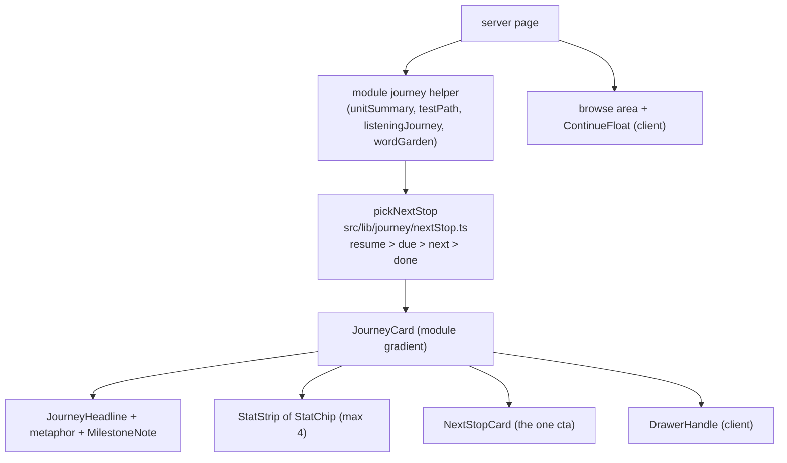
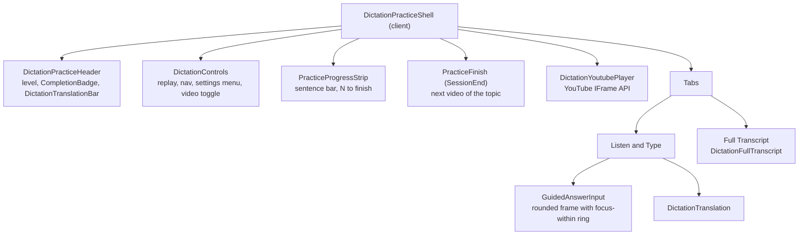
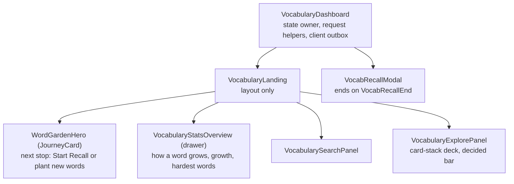

# 06 - Frontend

"English For Only Me" is a private, single-user English and IELTS study app built
on Next.js 16 (App Router), React 19, and Tailwind CSS v4. Its frontend is a "soft
pastel dashboard": every route renders a white rounded board floating on a
blush backdrop, with a dark icon rail on the left (a floating tab bar on phones),
pastel module tints, pill buttons, hairline borders, and a pastel pink brand
colour that matches the logo. A deliberate night theme remaps the same tokens.
All UI text goes through a typed EN / VI message catalogue chosen by a cookie;
Vietnamese lesson content stays data. This document maps the design system and
theming, motion, i18n, the shared chrome and primitives, the full route tree, and
the component trees for the home dashboard and the four shipped modules:
Dictation, Vocabulary, Grammar and IELTS. Writing Notes, AI Coach, Reading and
Speaking exist only as module records (`src/constants/modules.ts`); the IELTS
module covers reading, listening and writing practice. All claims are grounded in
the source files cited by their repo-relative paths.

---

## 1. Design system and visual theme

### 1.1 The soft pastel dashboard

The look is a white board on a soft backdrop: `PageShell` paints the board
(`bg-board rounded-shell shadow-shell`), blocks inside use hairline `border-line`
borders and at most the soft `shadow-card`, buttons and chips are pills
(`rounded-full`), and each module wears one pastel tint. There are no hard offset
shadows, no uppercase headings and no black-weight type. The rules for writing
new UI live in `.agents/rules/frontend-ui.md` (palette, corner roles, motion,
language).

| Primitive      | File                                     | Role                                                                                                                                                                                                                                                                                                                                                                                                                                        |
| -------------- | ---------------------------------------- | ------------------------------------------------------------------------------------------------------------------------------------------------------------------------------------------------------------------------------------------------------------------------------------------------------------------------------------------------------------------------------------------------------------------------------------------- |
| `PageShell`    | `src/components/common/PageShell.tsx`    | The board. A grid with the topbar spanning two columns, the rail (`AppSidebar`, md and up) beside `main`, an optional `footer` slot, then `AppCredits` and the phone `AppTabBar`. `fullHeight` locks it to one viewport for work screens (`true`) or from `lg` (`'lg'`); work screens get neither credits nor the tab bar. `main` carries `page-enter` (or `page-enter-quick` on work screens) so each navigation replays a short entrance. |
| `PageHeader`   | `src/components/common/PageHeader.tsx`   | The shared head of every module page: optional pastel icon circle, h1, one-line subtitle, optional eyebrow (breadcrumb or tag), and an `actions` slot. Same size and rhythm on every route. With `inTopbar` the title block hides from md (the topbar shows it) but the actions stay; with no actions the whole header hides from md.                                                                                                       |
| `ContentPanel` | `src/components/common/ContentPanel.tsx` | Bordered white card on the `Card` primitive with optional `eyebrow` (`PageTag`), `title` and `action` slot.                                                                                                                                                                                                                                                                                                                                 |
| `ActionButton` | `src/components/ui/ActionButton.tsx`     | The standard pill button / link. Tones: `primary` (soft brand pink), `paper` (outlined), `ink` (the one dark CTA, `bg-cta text-cta-fg`). Optional leading `icon`.                                                                                                                                                                                                                                                                           |
| `IconButton`   | `src/components/ui/IconButton.tsx`       | Round icon-only button / link with a required accessible `label`.                                                                                                                                                                                                                                                                                                                                                                           |
| `PageTag`      | `src/components/ui/PageTag.tsx`          | Small pill label; tone from `PAGE_TAG_TONES` in `src/constants/theme.ts` (default, red, ink, pale, plus achievement tones sky, yellow, copper, silver, gold, diamond used by completion medals).                                                                                                                                                                                                                                            |
| `QueueRow`     | `src/components/common/QueueRow.tsx`     | List row (title, meta, status tag, action slot); static, link or keyboard-activatable button.                                                                                                                                                                                                                                                                                                                                               |
| `ProgressRing` | `src/components/common/ProgressRing.tsx` | Circular progress with centred content (grammar unit badges and index).                                                                                                                                                                                                                                                                                                                                                                     |
| `Sparkline`    | `src/components/common/Sparkline.tsx`    | Tiny smoothed trend line in `currentColor`, drawn in with `motion-draw`; a faded placeholder wave when there are fewer than two values. Used by the home full view.                                                                                                                                                                                                                                                                         |
| `AudioPlayer`  | `src/components/common/AudioPlayer.tsx`  | One-line audio player (play, skip, speed, clock, meter) with Alt+K / J / L shortcuts and optional per-line markers; used by the IELTS `ListeningPane` and the editor's `AdminAudioPlayer`.                                                                                                                                                                                                                                                  |

### 1.2 Colour tokens

`src/app/globals.css` defines raw tokens on `:root` (also applied by the
`.day-palette` class), maps them onto the shadcn semantic names, and re-exports
everything as Tailwind colours inside `@theme inline` (Tailwind v4, no
`tailwind.config`). `src/constants/theme.ts` mirrors the day palette in
`THEME_COLORS` and holds `PAGE_TAG_TONES` and `MODULE_THEMES`.

| Token                                          | Day value                                   | Used for                                                                                                                               |
| ---------------------------------------------- | ------------------------------------------- | -------------------------------------------------------------------------------------------------------------------------------------- |
| `--canvas`                                     | `#f3eaf2`                                   | Backdrop behind the board (`html` background plus a fixed `html::before` layer with soft gradients and curved lines from `--html-bg`). |
| `--board` / `--surface`                        | `#ffffff`                                   | The board / cards.                                                                                                                     |
| `--surface-muted`                              | `#faf6f9`                                   | Quiet controls (theme and language buttons, search).                                                                                   |
| `--ink` / `--ink-soft`                         | `#25171f` / `#73636d`                       | Text / muted text.                                                                                                                     |
| `--line` / `--line-strong`                     | `#f0e7ed` / `#e2d6df`                       | Hairline borders / inputs and dashed locks.                                                                                            |
| `--brand` / `--brand-soft` / `--brand-ink`     | `#c93a74` / `#fde8f1` / `#a52c5e`           | Pastel pink brand: progress, current state, focus ring; soft fill; readable pink text.                                                 |
| `--cta` / `--cta-fg`                           | `#25171f` / `#ffffff`                       | The dark primary action (also shadcn `--primary`).                                                                                     |
| `--danger` / `--danger-soft`                   | `#c03810` / `#fdebe4`                       | Wrong answers, errors, delete only. Kept clearly apart from the pink brand.                                                            |
| `--lesson-correct`                             | `#1b7c44`                                   | Right answers. Right and wrong always also carry an icon and a word.                                                                   |
| `--tint` / `--tint-soft`                       | `#f8ebf2` / `#fcf6f9`                       | Selected / hovered and quiet grouping fills.                                                                                           |
| `--pastel-*`                                   | peach, lilac, rose, sky, mint, lemon, cream | Module and highlight tints.                                                                                                            |
| `--accent-*`                                   | blue, orange, purple, pink, green           | Text and icon colours that read on the pastels and on white.                                                                           |
| `--rail-bg` / `--rail-fg`                      | `#25171f` / `#ffffff`                       | The icon rail and phone tab bar, dark in both themes.                                                                                  |
| `--exam-surface`, `--exam-line`, `--exam-tint` | surface, line-strong, tint-soft             | IELTS exam panes (kept as their own names so the exam can diverge).                                                                    |

`MODULE_THEMES` (`src/constants/theme.ts`) gives each module a `tint`, `accent`
and `outline`: Dictation sky, Vocabulary mint, Grammar lilac, IELTS peach (Writing
Notes cream, AI Coach and Speaking mint, Reading lemon). Pink is the brand, so no
module wears it.

Corner roles (`--corner-*`, mapped to `rounded-shell` / `rounded-panel` /
`rounded-control` / `rounded-tag`): shell 36px (0 under 640px, where the board
fills the screen), panel 24px (20px on phones), control 14px, tag 8px.
`src/lib/utils.ts` extends tailwind-merge with these roles so `cn()` resolves
conflicts between them. Shadows come from `@theme inline`: `shadow-card`,
`shadow-float`, `shadow-shell`.

### 1.3 Night theme

The app has two themes: day `light` and night `lightup` (the stored value keeps
its old name so saved preferences still work). Night is not an inverted palette:
`:root[data-theme='lightup']` in `src/app/globals.css` remaps every token to a
deliberate dark set (`--canvas: #0f0d12`, `--board: #141118`,
`--surface: #1b171f`, `--ink: #f2ebf0`, `--brand: #ff8fbd`, softened pastels and
brighter accents) and adds depth with `--card-highlight` (a faint inset top edge)
and `--shell-ring`.

| Piece            | File                                      | Role                                                                                                                                                                                                                                                                                                   |
| ---------------- | ----------------------------------------- | ------------------------------------------------------------------------------------------------------------------------------------------------------------------------------------------------------------------------------------------------------------------------------------------------------ |
| Pure theme logic | `src/lib/theme/theme.ts`                  | `autoThemeForTime`, `nextThreshold`, `resolveTheme`, `manualState`, `parseStoredTheme`. Auto switches at 06:30 and 18:30; a manual choice wins until the next threshold. Stored under `efom-theme`.                                                                                                    |
| `ThemeProvider`  | `src/components/common/ThemeProvider.tsx` | Client store over localStorage plus the wall clock (`useSyncExternalStore`), re-checked on a timer and on focus / visibility. Syncs `data-theme` on `<html>`. `toggleTheme` wraps the flip in `document.startViewTransition` when available, so the whole page cross-fades once. Exposes `useTheme()`. |
| `ThemeToggle`    | `src/components/common/ThemeToggle.tsx`   | Round moon / sun button in the rail and, below md, in the topbar.                                                                                                                                                                                                                                      |
| No-flash script  | `src/app/layout.tsx`                      | Inline `THEME_INIT_SCRIPT` stamps `data-theme` before first paint.                                                                                                                                                                                                                                     |

Two exceptions stay dark or light on purpose: the rail and tab bar use
`--rail-bg`, and `.day-palette` pins the day tokens on a subtree that is designed
as a dark block on the day palette. IELTS Task 1 charts (`TaskVisual`) always sit
on white exam paper with their own ink and line values, because their strokes are
hard black and grey.

### 1.4 Fonts

`src/app/layout.tsx` loads Be Vietnam Pro with `next/font/google` (subsets `latin`,
`latin-ext`, `vietnamese`; weights 300 to 700) into `--font-app`, which
`globals.css` binds to both `--font-sans` and `--font-body`. The Vietnamese subset
matters: Vietnamese lesson data has stacked diacritics, and a font without it
falls back glyph by glyph. Headings use `font-medium`, body text the normal
weight.

### 1.5 Motion

All motion lives in `src/app/globals.css` and respects
`prefers-reduced-motion` (no movement, or opacity only).

| Utility                                           | Behaviour                                                                                                                            |
| ------------------------------------------------- | ------------------------------------------------------------------------------------------------------------------------------------ |
| `page-enter` / `page-enter-quick`                 | Route entrance on `main` (`soft-rise` 320ms, or a 140ms fade on work screens).                                                       |
| `motion-stagger`                                  | Children rise in one after another (cards, tiles, lists).                                                                            |
| `motion-grow-x` / `motion-grow-y` / `motion-draw` | Progress bars, bar charts and sparklines ease in.                                                                                    |
| `hover-pop`                                       | Everything clickable rises 2px with a soft shadow on hover; static blocks never get it (`hover-lift` was removed).                   |
| `soft-press`                                      | Pressable controls squish slightly on press; unlayered so it beats `transition-all` from `buttonVariants`.                           |
| View transitions                                  | `::view-transition-old/new(root)` cross-fade the theme switch in 320ms.                                                              |
| `ring-owned-focus`                                | Opts a field out of the global focus outline when its rounded wrapper draws the ring with `focus-within` (the dictation answer box). |
| `marker`                                          | Highlighter-pen background for an emphasised phrase ("made for you" on the home plan).                                               |

Primitive dialogs, sheets, dropdowns, selects, tabs, collapsibles and the
progress bar carry their own soft open / close transitions in
`src/components/ui/*`.

### 1.6 `cn()`, tailwind-merge, class-variance-authority

`src/lib/utils.ts` exports `cn(...inputs)` = `twMerge(clsx(inputs))` with the
corner roles registered. `class-variance-authority` defines the variant maps in
the shadcn primitives (`button.tsx` `buttonVariants`, `badge.tsx`, `tabs.tsx`);
`ActionButton` and `IconButton` layer their pill styling on `buttonVariants`.

---

## 2. Internationalisation (EN / VI)

Every user-visible UI string (labels, buttons, headings, hints, aria labels,
titles, metadata, toasts, learner-facing API errors) comes from a typed message
catalogue. English is the default and the source of truth for keys; a missing
Vietnamese key is a type error. Lesson and test data (grammar course content,
IELTS passages, transcripts, word meanings) is never translated.

| Piece         | File                                                     | Role                                                                                                                                                                                                                                                       |
| ------------- | -------------------------------------------------------- | ---------------------------------------------------------------------------------------------------------------------------------------------------------------------------------------------------------------------------------------------------------- |
| Config        | `src/i18n/config.ts`                                     | `LOCALES = ['en', 'vi']`, `DEFAULT_LOCALE`, cookie `efom-locale` (one year), `INTL_LOCALES` (`en-GB`, `vi-VN`), `resolveLocale`. Routes are the same in both languages.                                                                                    |
| Catalogues    | `src/i18n/messages/en/*.ts`, `src/i18n/messages/vi/*.ts` | One file per namespace: `common`, `home`, `dictation`, `vocabulary`, `grammar`, `ielts`, `ieltsEditor`, `admin`. `src/i18n/messages/index.ts` exports `MESSAGES` and the `Messages` type. `src/i18n/messages.test.ts` checks key parity.                   |
| Server        | `src/i18n/server.ts`                                     | `getLocale()` (cookie, cached per request) and `getMessages()` for server components, `generateMetadata`, route handlers and server actions.                                                                                                               |
| Client        | `src/i18n/client.tsx`                                    | `I18nProvider` (mounted in `src/app/layout.tsx`; English is bundled, so only the Vietnamese catalogue is passed down), `useMessages()`, `useLocale()`.                                                                                                     |
| Switching     | `src/i18n/actions.ts`                                    | `setLocaleAction(locale)` server action: sets the cookie and calls `refresh()` so server text re-renders without a reload.                                                                                                                                 |
| Formatting    | `src/i18n/format.ts`, `src/i18n/formatNodes.tsx`         | `format(template, values)` for `{name}` placeholders, `plural(forms, count)` for one / other (`PluralForms`; every journey headline unit is a one / other pair, so a count of 1 reads "1 step taken"), `formatNodes` for templates that embed React nodes. |
| Outside React | `src/i18n/active.ts`                                     | `getActiveMessages()` for plain client modules (the sync outbox) that need a fallback message.                                                                                                                                                             |
| Toggle        | `src/components/common/LocaleToggle.tsx`                 | `variant="round"`: one round button in the rail showing the current language with the other below, a click flips it. `variant="segmented"` (default): EN / VI pill in the phone menu. Optimistic via `useOptimistic`.                                      |

Server components that render inside client trees receive their text as props
(`labels={t.dictation.browse}` and similar) instead of calling the hook, so they
stay server components. Navigation labels come from `navItemLabel(item, t)` in
`src/constants/modules.ts`.

---

## 3. The `ui/` primitive library

`components.json` declares a shadcn setup with `style: "base-nova"`, `rsc: true`,
CSS variables and the lucide icon set. The primitives wrap `@base-ui/react/*`
(not Radix). Popups (dialog, sheet, select, dropdown, tooltip) render at
`z-[80]`, above the IELTS exam stage (`z-[70]`).

| Component                                                        | File                                              | Client? | Purpose                                                                                                                      |
| ---------------------------------------------------------------- | ------------------------------------------------- | ------- | ---------------------------------------------------------------------------------------------------------------------------- |
| `button`                                                         | `ui/button.tsx`                                   | server  | Base `Button` with `buttonVariants` (cva). Foundation for `ActionButton` / `IconButton`.                                     |
| `badge`                                                          | `ui/badge.tsx`                                    | server  | Label badge (cva variants).                                                                                                  |
| `card`                                                           | `ui/card.tsx`                                     | server  | `Card` / `CardHeader` / `CardContent` / `CardFooter`.                                                                        |
| `input`, `textarea`, `label`                                     | `ui/input.tsx`, `ui/textarea.tsx`, `ui/label.tsx` | mixed   | Form fields.                                                                                                                 |
| `checkbox`, `radio-group`, `switch`, `slider`                    | `ui/*.tsx`                                        | client  | Choice controls.                                                                                                             |
| `select`                                                         | `ui/select.tsx`                                   | client  | Select family (`SelectTrigger` / `Content` / `Item` / `Value`).                                                              |
| `tabs`                                                           | `ui/tabs.tsx`                                     | client  | Tabs family (practice Listen and Type / Full Transcript).                                                                    |
| `dialog`, `sheet`                                                | `ui/dialog.tsx`, `ui/sheet.tsx`                   | client  | Modal and side panel on the base-ui dialog.                                                                                  |
| `dropdown-menu`, `tooltip`                                       | `ui/dropdown-menu.tsx`, `ui/tooltip.tsx`          | client  | Menus (`UserMenu`) and tooltips.                                                                                             |
| `collapsible`                                                    | `ui/collapsible.tsx`                              | client  | Disclosure used by the grammar unit banners and dictation browse panels.                                                     |
| `progress`, `separator`, `skeleton`                              | `ui/*.tsx`                                        | mixed   | Progress bar, divider, pulsing placeholder.                                                                                  |
| `ActionButton`, `IconButton`, `PageTag`, `segmented`, `progress` | `ui/*.tsx`                                        | server  | App components (section 1.1); `Segmented` is the one segmented toggle (selected is `cta`), `Progress` takes a module `tone`. |

---

## 4. Shared layout chrome

Every route renders its own `PageShell` and passes an `AppTopbar` into the
`topbar` slot. The account comes from the root layout's `AccountProvider`
(`src/components/common/AccountProvider.tsx`), so the avatar never blinks
between routes. `src/app/(app)/layout.tsx` wraps all learner routes in
`OutboxOwnerProvider`, which hands the client outbox a hashed owner key for the
current user or guest so queued writes are stored per learner.

| Component                                          | File                                                                            | Client? | Role                                                                                                                                                                                                                                                                                                                                                                                                       |
| -------------------------------------------------- | ------------------------------------------------------------------------------- | ------- | ---------------------------------------------------------------------------------------------------------------------------------------------------------------------------------------------------------------------------------------------------------------------------------------------------------------------------------------------------------------------------------------------------------- |
| `AppTopbar`                                        | `common/AppTopbar.tsx`                                                          | client  | Logo, app name and a subtitle; with `page={{ module, title, subtitle?, breadcrumb? }}` it draws the page title block (module icon and tint resolved from `MODULE_ICONS` / `MODULE_THEMES`) on the right from md, and hides its own subtitle on phones so only the page's `PageHeader inTopbar` shows one. Home adds the account chip (`showAccount`). Below md: `ThemeToggle` and the `TopbarMenu` button. |
| `AppSidebar`                                       | `common/AppSidebar.tsx`                                                         | client  | The dark icon rail (md and up): module links from `PRIMARY_NAV_ITEMS` with a sliding highlight, labels unrolling on hover, then theme and language toggles and the squircle account avatar. `isActiveHref` matches `/` exactly and modules by subtree.                                                                                                                                                     |
| `AppTabBar`                                        | `common/AppTabBar.tsx`                                                          | client  | Below md: the same links as a floating dark pill (`shadow-tabbar`). Left out on full-height work screens.                                                                                                                                                                                                                                                                                                  |
| `TopbarMenu` / `TopbarMenuSheet`                   | `common/TopbarMenu.tsx`, `common/TopbarMenuSheet.tsx`                           | client  | Phone menu button; lazy-loads the Account sheet: the account control and the segmented `LocaleToggle`. It lists no modules (the tab bar has them).                                                                                                                                                                                                                                                         |
| `AccountControl`, `UserMenu`, `UserMenuPopup`      | `common/AccountControl.tsx`, `common/UserMenu.tsx`, `common/UserMenuPopup.tsx`  | client  | Sign in, or the identity menu (admin for admins, sign out behind a confirm; favorites moved to the dictation page). `variant="rail"` is the avatar alone at the rail foot (every page from md), `chip` the home topbar chip; nothing renders when auth is not configured. Server actions in `src/lib/auth/actions.ts`.                                                                                     |
| `AppCredits`                                       | `common/AppCredits.tsx`                                                         | client  | Last row of the board. Hidden on work screens.                                                                                                                                                                                                                                                                                                                                                             |
| `ThemeProvider`, `I18nProvider`, `AccountProvider` | `common/ThemeProvider.tsx`, `src/i18n/client.tsx`, `common/AccountProvider.tsx` | client  | Mounted once in `src/app/layout.tsx` (`I18nProvider` > `AccountProvider` > `ThemeProvider`); the layout reads the session once (`readAccount`) and `useAccount()` serves it.                                                                                                                                                                                                                               |

Page titles: a module page passes `page={{ module, title, subtitle?, breadcrumb? }}`
to `AppTopbar` and renders its own `PageHeader inTopbar` with the same title
and subtitle, so md and up show the title in the topbar and phones show it in
the header. Pages pass the subtitle to both (the topic description, the grammar
lesson summary, the IELTS track line, the result's mode line, the word count),
and header actions such as Redo this lesson or the admin Edit this test link
stay visible at every width.

Navigation source of truth: `APP_MODULES`, `PRIMARY_NAV_ITEMS` and
`MODULE_ICONS` in `src/constants/modules.ts`; pastel, accent and journey
`gradient` per module in `MODULE_THEMES` (`src/constants/theme.ts`).

### 4.1 Journey primitives and the page skeleton

Every module landing has the same shape, built from `src/components/journey/`
(server-safe unless marked): the title in the topbar, one `JourneyCard`, an
optional side drawer, then the browse area. Session ends share `SessionEnd`.
The rules and the above-the-fold budget are in `.agents/rules/frontend-ui.md`
("Page patterns"); `expectLandingBudget` (`src/test/landingBudget.ts`) checks
one next stop, one `cta`, at most 4 stat chips and pop on every clickable.

| Piece                                             | File                                 | Role                                                                                                                                                                                                                                                                                                                                                                                                                                                                                                                                                                                                   |
| ------------------------------------------------- | ------------------------------------ | ------------------------------------------------------------------------------------------------------------------------------------------------------------------------------------------------------------------------------------------------------------------------------------------------------------------------------------------------------------------------------------------------------------------------------------------------------------------------------------------------------------------------------------------------------------------------------------------------------ |
| `JourneyCard`, `JourneyHeadline`, `MilestoneNote` | `journey/JourneyCard.tsx`            | Slots in a fixed order: title, headline, metaphor, milestone, stats, next stop; `layout` `split`, `aside` (fixed next stop column, `asideWidth` `sm` 17rem or `lg` 26rem) or `stacked`; the left column is `@container/journey`, and under 56rem the stat chips show icon and number only; `statsPlacement` `below` or `top` (chips beside the headline); `nextStop` optional (IELTS leaves it out); `nextStopHidesWithDrawer` hides it on wide screens while a `DrawerRow` side card is open (vocabulary); room for a drawer handle. Callers pass the headline `unit` through `plural(forms, value)`. |
| `StatChip`, `StatStrip`                           | `journey/StatChip.tsx`               | A number with its icon in a pill; linked chips pop and show a chevron, static chips never do. Label visible from sm (`sr-only` below) unless `labelAlways` (home numbers, Writing criteria); `size` `md` or `lg`.                                                                                                                                                                                                                                                                                                                                                                                      |
| `NextStopCard`                                    | `journey/NextStopCard.tsx`           | Pin chip, detail, title and one `ink` button (`href`, or `onAction` for a modal); `done` all-clear state; `card` or `compact`; `size` `md` or `sm` (tighter card); `media` (a thumbnail left of the title, the pin on its corner; dictation); `id` observed by `ContinueFloat`.                                                                                                                                                                                                                                                                                                                        |
| `DrawerRow`, `DrawerHandle`                       | `journey/SideDrawer.tsx` (client)    | Side card folded by default; grid tracks animate; open handle is `cta`; the 32px handle pill has a 44px hit area. Open, the row carries `data-drawer-open` on `group/drawer`: from `lg` the stat chips show icon and number only.                                                                                                                                                                                                                                                                                                                                                                      |
| `ContinueFloat`                                   | `journey/ContinueFloat.tsx` (client) | Floating Continue to "you are here": scroll + resize + page height (ResizeObserver) + settle measuring, `fallbackId`, `onBeforeJump`, `nudge` (a small double bounce on arrival, `transform` only, none under reduced motion), hidden while the next stop is on screen unless `persistent` (IELTS, Grammar and a dictation topic: always shown).                                                                                                                                                                                                                                                       |
| `SessionEnd`                                      | `journey/SessionEnd.tsx`             | Wins, journey step, fix-up list (folded past 3 with a native disclosure), next stop, quiet secondary links, in that order. `focusTitle` focuses the heading on mount.                                                                                                                                                                                                                                                                                                                                                                                                                                  |
| `FocusOnMount`                                    | `journey/FocusOnMount.tsx` (client)  | Focuses an element by id once. End screens that replace a session in place (dictation finish, grammar result, vocabulary recall end) set `focusTitle` so focus does not fall to the body; the IELTS result page, a page load, does not.                                                                                                                                                                                                                                                                                                                                                                |
| `EmptyState`, `StepDots`                          | `journey/*.tsx`                      | Empty list with one action; a static row of step dots.                                                                                                                                                                                                                                                                                                                                                                                                                                                                                                                                                 |
| `InlineNotice`, `ConfirmDialog`, `Breadcrumb`     | `common/*.tsx`                       | Status / error banner (error is danger with an icon); leave / restart confirm; wayfinding used by `PageHeader breadcrumb` and `AppTopbar page`.                                                                                                                                                                                                                                                                                                                                                                                                                                                        |
| `SkeletonJourney`, `SkeletonPlayer`               | `common/PageSkeletons.tsx`           | The journey card shape; a full-height focus-screen skeleton with no topbar. `SkeletonPageShell page` keeps the topbar title stable.                                                                                                                                                                                                                                                                                                                                                                                                                                                                    |

Advance helpers apply a finished session to the loaded journey so the end
screen is not stale (a replay adds 0): `advanceTopicRecord`
(`dictation/browse/listeningJourney.ts`), `advanceGardenPosition`
(`vocabulary/wordGarden.ts`), `advanceUnitSummary`
(`src/modules/grammar/path/unitSummary.ts`).

Style guards in `src/lib/styleGuards.test.ts` keep it consistent: corner
roles, no `bg-ink` control, no raw palette, no heavy weights in learner
components, no `hover-lift`, no em dash, 44px touch targets; baselines only
shrink.

---

## 5. Route map

All pages set `runtime = 'nodejs'`; data pages set `dynamic = 'force-dynamic'`.
Most guard on `hasMongoDbUri()` (`src/constants/environments.ts`) and render a
"database not configured" state instead of crashing. Learner data is scoped by
`getPracticeActorId()` (signed-in user, else a guest cookie); see
`docs/07-auth-infra-testing.md`.

| URL                                           | File                                                    | Purpose                                                                                                                                             | Auth  |
| --------------------------------------------- | ------------------------------------------------------- | --------------------------------------------------------------------------------------------------------------------------------------------------- | ----- |
| `/`                                           | `src/app/page.tsx`                                      | Home (`HomeStudyDesk`): simple view (up next, next stop, numbers, buddy) or the full view.                                                          | Open  |
| `/dictation`                                  | `src/app/(app)/dictation/page.tsx`                      | Dictation landing: listening journey card, side drawer (recent, favorites), record shelves.                                                         | Open  |
| `/dictation/[topicSlug]`                      | `src/app/(app)/dictation/[topicSlug]/page.tsx`          | Topic record card, then sections (accordion) or filtered flat results.                                                                              | Open  |
| `/dictation/favorites`, `/dictation/no-topic` | `src/app/(app)/dictation/{favorites,no-topic}/page.tsx` | Favourites (sign-in required) and uncategorised lessons.                                                                                            | Mixed |
| `/dictation/videos/[videoId]/practice`        | `.../practice/page.tsx`                                 | Practice (`DictationPracticeShell`, full height).                                                                                                   | Open  |
| `/dictation/videos/[videoId]/results`         | `.../results/page.tsx`                                  | Per-video results, AI debrief, weak segments.                                                                                                       | Open  |
| `/dictation/review`                           | `src/app/(app)/dictation/review/page.tsx`               | Due review queue with one Start review.                                                                                                             | Open  |
| `/vocabulary`, `/vocabulary/words`            | `src/app/(app)/vocabulary/**`                           | Word garden landing; word list with search.                                                                                                         | Open  |
| `/grammar` and children                       | `src/app/(app)/grammar/**`                              | Grammar path, lesson player, notes, review, weak-spot practice, unit checkpoint.                                                                    | Open  |
| `/ielts` and children                         | `src/app/(app)/ielts/**`                                | IELTS catalogue, test page, runners (practice, mock, drill), attempt review.                                                                        | Open  |
| `/admin/**`                                   | `src/app/admin/**`                                      | Admin: dictation content, IELTS editor, vocabulary enrichment. `src/app/admin/layout.tsx` redirects anonymous users to sign-in and non-admins away. | Admin |
| `/zz-dev-ielts-editor`                        | `src/app/zz-dev-ielts-editor/page.tsx`                  | Development-only IELTS editor sandbox.                                                                                                              | Dev   |

Module sections below list each module's routes in detail.

---

## 6. The home dashboard

`src/app/page.tsx` (server) loads, for a signed-in user, dictation global stats,
vocabulary stats and grammar progress and passes them to `HomeStudyDesk`
(`src/components/home/HomeStudyDesk.tsx`). `HomeViewSwitch` flips between the
simple view (default, cookie-backed, `homeView.ts`) and the full view.

| Component                                       | File                      | Role                                                                                                                                                                                                                                                                                                                                                  |
| ----------------------------------------------- | ------------------------- | ----------------------------------------------------------------------------------------------------------------------------------------------------------------------------------------------------------------------------------------------------------------------------------------------------------------------------------------------------- |
| `HomeSimpleView`                                | `home/HomeSimpleView.tsx` | Up next rows per module (due chip, or a tick once nothing is due; the title wraps and the icon tile shrinks to 44px on phones), one `NextStopCard` picked by `pickNextStop` (most reviews due, else the next grammar lesson), three At a glance `StatChip`s (`size="lg"`, `labelAlways`, so phones still say what each number counts), and the buddy. |
| `HomeStudyDesk` full view                       | `home/HomeStudyDesk.tsx`  | Five blocks: learning progress tiles, `HomeModuleTiles`, weak words, today's plan (due counts as hints; the old schedule merged in) and the buddy.                                                                                                                                                                                                    |
| `HomeModuleNav`, `HomeModuleTiles`              | `home/*.tsx`              | Plain module name pills (no numbers in navigation); pastel module tiles.                                                                                                                                                                                                                                                                              |
| `HomeBuddyCard`, `HomeBuddyMascot`, `buddyMood` | `home/*.tsx`              | The study buddy whose mood follows the numbers (`public/buddy/*.png`).                                                                                                                                                                                                                                                                                |

---

## 7. The dictation feature UI

### 7.1 Landing and browse

`/dictation` (server) puts the title in the topbar and renders a `DrawerRow`:
`ListeningJourneyHero` (a short `JourneyCard`: the scrubber metaphor with no
inner panel, "N to go" beside the playhead and "Track N · target" at the end,
no milestone line; four chips in the top right; a small next stop
(`size="sm"`, `layout="aside"`, hidden while the side drawer is open) with
the video's thumbnail or the topic's image as `media` (then `asideWidth="lg"`)
from
`pickNextStop`: resume a half-done video, else due review
sentences, else the topic nearest gold) with `DictationSide` folded beside it
(recent unfinished videos, latest results, favorites). Below, the Topics
heading with a Favorites button beside it (signed-in learners only), then `RecordShelves`
shows topics as records (playing, new, gold).

`/dictation/[topicSlug]` passes the topic description to the topbar as the
subtitle and renders `TopicJourney` (the topic's `RecordDisc`, videos done,
videos to gold; no next stop row: the next video from `pickTopicNextVideo`
gets a pink ring on its card and an always-on `TopicContinueFloat`, which
opens its section if folded (`openBrowseDisclosure`), scrolls to the card
(`videoCardId`), focuses it and bounces it (`nudge="li"`)), then
`BrowseToolbar` (debounced search; the level filter folds behind a filter
button; no sort, course order only), then `SectionAccordion` (the section
holding the next video starts open; counts show to guests too) or, while
searching, `FlatResults` with `BrowseVideoList`, an `EmptyState` and
`BrowsePagination` (`buildBrowseHref` keeps a non-default sort).
`/dictation/no-topic` and `/dictation/favorites` share `VideoListPage`.

| Component                                                          | File                              | Client?         | Role                                                                                          |
| ------------------------------------------------------------------ | --------------------------------- | --------------- | --------------------------------------------------------------------------------------------- |
| `ListeningJourneyHero`                                             | `browse/ListeningJourneyHero.tsx` | server          | Listening journey card; playhead in the you-are-here pink.                                    |
| `DictationSide`                                                    | `browse/DictationSide.tsx`        | server          | The drawer's recent and favorites lists.                                                      |
| `RecordShelves`, `RecordDisc`                                      | `browse/RecordShelves.tsx`        | server          | Topic records whose ring fills with progress.                                                 |
| `TopicJourney`                                                     | `browse/TopicJourney.tsx`         | server          | Small stacked journey card for one topic or list; renders `TopicContinueFloat`.               |
| `VideoListPage`                                                    | `browse/VideoListPage.tsx`        | server          | Shared shell of the uncategorized and favorites lists.                                        |
| `BrowseVideoList` / `BrowseVideoListClient`                        | `browse/BrowseVideoList*.tsx`     | server / client | Video cards (whole card links to practice, a tick once done, no action pill).                 |
| `SectionAccordion`, `BrowseDisclosure`                             | `browse/*.tsx`                    | server / client | Folding sections whose closed bodies ship only records; a window event opens one by panel id. |
| `BrowseToolbar`, `BrowsePagination`, `FavoriteButton`, `TopicGrid` | `browse/*.tsx`                    | mixed           | Search and level, pager (44px), favorite star (44px), fallback topic grid.                    |

### 7.2 Practice

The practice page loads segments, session and translation tracks on the server
and hands them to `DictationPracticeShell` (client), inside a full-height
`PageShell`. The shell scores answers locally first (`src/modules/dictation/correction`),
so grading never waits on the network. It starts or resumes the session with
`startOrResumeDictationSessionApi` (`src/requests/dictationSessionsApi.ts`) and
queues every session update and attempt through the client outbox
(`useClientOutbox`, paths from `getDictationSessionApiPath` and
`getDictationAttemptsApiPath` in `src/requests/dictationAttemptsApi.ts`), which
delivers them in the session's lane with retries. Shortcuts: Enter checks, Esc reveals or
skips, Ctrl+[ / ] moves between segments, Alt or Cmd replays. Drafts persist
locally.

| Component                                                                                                | File                                                 | Client? | Role                                                                                                                                                                                                                                                                                                                                                                |
| -------------------------------------------------------------------------------------------------------- | ---------------------------------------------------- | ------- | ------------------------------------------------------------------------------------------------------------------------------------------------------------------------------------------------------------------------------------------------------------------------------------------------------------------------------------------------------------------- |
| `DictationPracticeShell`                                                                                 | `DictationPracticeShell.tsx`                         | client  | Orchestrator: session, attempts, preferences, shortcuts.                                                                                                                                                                                                                                                                                                            |
| `DictationPracticeHeader`                                                                                | `DictationPracticeHeader.tsx`                        | client  | Title, level, completion medal, translation language picker.                                                                                                                                                                                                                                                                                                        |
| `DictationYoutubePlayer`                                                                                 | `DictationYoutubePlayer.tsx`                         | client  | Segment-aware YouTube wrapper with a controller (replay, seek, play segment).                                                                                                                                                                                                                                                                                       |
| `DictationControls`, `DictationSettingsMenu`                                                             | `DictationControls.tsx`, `DictationSettingsMenu.tsx` | client  | Playback and navigation toolbar; speed and text-size settings.                                                                                                                                                                                                                                                                                                      |
| `GuidedAnswerInput`                                                                                      | `GuidedAnswerInput.tsx`                              | client  | Free typing over a transparent mirror with character-level correction (dotted orange for missing, solid red for wrong), hint chips (Tab fills), and a rounded frame whose `focus-within` ring replaces the square global outline (`ring-owned-focus`). Its `renderCorrectionWord` slot receives `QuickVocabWordButton` so corrected words open a vocabulary lookup. |
| `DictationTranslation`, `DictationTranslationBar`                                                        | `DictationTranslation*.tsx`                          | client  | After-effort translation caption; language picker.                                                                                                                                                                                                                                                                                                                  |
| `DictationFullTranscript`                                                                                | `DictationFullTranscript.tsx`                        | client  | Click-to-seek transcript with status badges.                                                                                                                                                                                                                                                                                                                        |
| `DictationCaptionManager`, `DictationSegmentEditor`, `DictationHintEditor`, `DictationTranslationEditor` | `Dictation*.tsx`                                     | client  | Authoring panels: captions and tracks, segments, hints, translations.                                                                                                                                                                                                                                                                                               |

`DictationSettingsMenu` holds speed, answer text and video size, the answer
preferences (show answer immediately, show full answer, shortcut hints) as
checkbox items, and rewind / restart (restart behind `ConfirmDialog`); its
items keep the 44px target. The ready state is one big Start or Continue
button. The finish screen is `practice/PracticeFinish.tsx`; its next video
comes from `findNextVideo` (`src/modules/dictation/practice/findNextVideo.ts`,
cached catalog only, pure `nextVideoInTopic`). With no next video it reads
`topicDone` ("This topic is done: pick the next record"), or `noTopicNext`
("Pick your next video from the topics") for a video outside any topic
(`hasTopic`). The `finishWins` line ("{correct} of {total} written right") shows only for a
run this visit covered from the first sentence (fresh start, restart or
rewind), not for a resumed run or a video already done on load; the finish
takes focus unless it was the state on load. The verdict word in `GuidedAnswerInput` is screen-reader
only. The practice and results pages render learner-safe setup states (no admin
links) when a transcript or segments are missing; practice loads with
`SkeletonPlayer`.

### 7.3 Results and review

`/dictation/videos/[videoId]/results` has a breadcrumb `PageHeader`, then
`DictationResultsSummary`: once there is practice it is a `SessionEnd` head
(first-try accuracy, done share, one next stop: review weak sentences when due,
else the next video of the topic; Practice again as the quiet link). Below,
`DictationStatsPanel` (overall and time in one line, hardest sentences, and
mistake map, missed words and recovery folded behind Details),
`DictationDebriefPanel` (paper button, notes on demand, `InlineNotice` errors)
and `DictationReviewQueue variant="embedded"`. The results next stop uses the
same no-topic fallback as the finish screen. `/dictation/review` renders
`DictationReviewQueue` with the due count and one Start review (rows past five
fold; empty is "All caught up"). The list is capped, so the head counts every
due item through `countDueReviewItemsForUser`
(`src/modules/dictation/review/reviewItemService.ts`), the same number as the
landing. `formatDuration`
(`src/components/dictation/formatDuration.ts`) is shared.

### 7.4 Admin

Admin pages (`src/app/admin/**`) share a breadcrumb `PageHeader` (the IELTS
editor keeps `EditorHeader`) and light no learner tab. Dictation admin pages are server components that load
content and hand it to client components; mutations go through server actions in
`src/modules/dictation/content/adminActions.ts`, except `DictationImportForm`, which
calls `importYouTubeVideoApi` (`src/requests/dictationImportsApi.ts`).

| Component                                                                               | File                    | Role                                                                                                                  |
| --------------------------------------------------------------------------------------- | ----------------------- | --------------------------------------------------------------------------------------------------------------------- |
| `AdminTopicList`, `AdminTopicCard`, `AdminCreateTopicForm`, `AdminTopicThumbnailFields` | `dictation/admin/*.tsx` | Topic board: drag-reorder topics and sections, edit, create, thumbnail upload.                                        |
| `AdminUnassignedPanel`, `AdminVideoRow`, `VideoAssignTable`, `VideoFilterBar`           | `dictation/admin/*.tsx` | Unassigned pool, shared video row (level select, edit, soft delete), list view with bulk assign and reorder, filters. |
| `AdminTrashPanel`, `AdminTrashVideoMenu`                                                | `dictation/admin/*.tsx` | Deleted videos with restore and permanent delete.                                                                     |
| `adminVideoDnd`, `ConfirmSubmitButton`                                                  | `dictation/admin/*.tsx` | Native HTML5 drag and drop primitives with MIME-typed payloads; confirm-then-submit button.                           |
| `DictationImportForm`, `AdminVideoTranscriptPreview`                                    | `dictation/*.tsx`       | Import or edit a video, then the caption manager; transcript preview.                                                 |

---

## 8. Vocabulary feature UI

### 8.1 Routes

| URL                 | File                                      | Type                   | Purpose                                                                                                                                                                                                                                                                                                                 |
| ------------------- | ----------------------------------------- | ---------------------- | ----------------------------------------------------------------------------------------------------------------------------------------------------------------------------------------------------------------------------------------------------------------------------------------------------------------------- |
| `/vocabulary`       | `src/app/(app)/vocabulary/page.tsx`       | Server + client island | Loads `getVocabularyDashboardData({ actorId })` (`src/modules/vocabulary/services/vocabDashboardService.ts`: stats, due recall tasks, Explore deck) when the database is configured, and renders `VocabularyDashboard initialData mongoConfigured`. A load failure is logged and the client then loads the data itself. |
| `/vocabulary/words` | `src/app/(app)/vocabulary/words/page.tsx` | Server                 | `parseVocabWordListQuery(searchParams)` (views `learning`, `dueToday`, `alreadyKnow`, `mastered`, `knownTotal`; invalid values fall back to `learning`) then `listVocabWordsForUser`, rendered by `VocabularyWordList`.                                                                                                 |
| `/admin/vocab`      | `src/app/admin/vocab/page.tsx`            | Server + client island | `getVocabAdminQueueSummary()` into `AdminVocabPanel`.                                                                                                                                                                                                                                                                   |

Each route has a `loading.tsx` skeleton shaped like its page.

### 8.2 `/vocabulary` landing tree

Every component below is a client component.

- `VocabularyDashboard` (`src/components/vocabulary/VocabularyDashboard.tsx`)
  reads through `src/requests/vocabularyApi.ts` and writes through the client
  outbox: word marks via `enqueueVocabItemStatus` (`vocabItemWrites.ts`, lane
  `vocab:items`, optimistic with rollback) and recall answers via
  `enqueueVocabRecallAnswer` (`vocabRecallSession.ts`, lane `vocab:recall`).
  Answers are graded in the browser first and the server's verdict wins. It
  prefetches the next due page while five cards remain and re-deals without
  listening tasks for 15 minutes after "I cannot listen now".
- `WordGardenHero`: a short card. The seven-stage garden vine as the metaphor,
  with the words to go written above each stage still ahead (the current one
  green, the rest quiet, the number alone on phones; no milestone line and no
  stage badge), three today chips in the top right (`statsPlacement="top"`),
  and a small next stop (`size="sm"`) in a narrow right column
  (`layout="aside"`) (`pickNextStop` in `VocabularyLanding`): due recall
  cards ("12 words due, Next: word", Start Recall opens the modal) or, with
  nothing due, Plant new words (scrolls to the explore deck).
- `VocabularySearchPanel`: the Words link to `/vocabulary/words` in its
  header (no row of its own on the landing); lookup and search in parallel; each result is a
  button that loads that word, with `VocabTermHeader inline` inside it (no
  nested speak button).
- `VocabularyExplorePanel`: frequency-ranked words as a card-stack deck with one
  mint "N of M decided" bar. Also used by the IELTS test page.

### 8.3 Recall popup

`VocabRecallModal` shows a mint `Progress` bar ("Card n of total" as its label)
and the recall step as `StepDots`. Task types: `listenChooseWord`,
`listenChooseDefinition`, `definitionChooseWord`, `wordChooseDefinition`,
`exampleRemember`. Every answer stops on the card with tick or cross (the word is
screen-reader only), the correct answer when wrong, the Vietnamese meaning,
definition and example, and the word's step moving (dots, or a trophy when
mastered). When the queue runs out the modal shows `VocabRecallEnd`
(`SessionEnd`): reviewed, right, moved and mastered (`tallyRecallSession`), the
garden step (`advanceGardenPosition`), unsaved cards as the fix-up list, Done and
Plant new words; it takes focus (`focusTitle`). Afterwards `VocabRecallSessionSummary` only lists unsaved cards.

### 8.4 Word list and admin

- `VocabularyWordList`: view pills, a search field (server-side term-prefix
  filter, `q` param, matched inside the entry join in
  `buildVocabWordListPipeline`), one fixed page size with the pager at the
  bottom, rows with `StepDots` for the recall step and only the move that
  changes something (learning: Already know; known: Learn it). Due today offers
  Start recall; empty and no-match states offer one action. The page keys the
  list on view, page and page size only (not `q`), so a search never remounts
  it and the search box keeps focus. The word count also goes to the topbar
  subtitle, and the pager nav has its own name (`pagerNav`).
- `AdminVocabPanel`: a `StatStrip` of the queue counts (enrichable, ready,
  failed, not found, stale locks), refresh, and `Enrich N`.

### 8.5 Shared vocabulary pieces

| Component                                   | File                              | Role                                                                                                                                                                                                                                                  |
| ------------------------------------------- | --------------------------------- | ----------------------------------------------------------------------------------------------------------------------------------------------------------------------------------------------------------------------------------------------------- |
| `VocabTermHeader`                           | `vocabulary/VocabTermHeader.tsx`  | Term, pronunciation and a speak button; sizes `md` / `lg` / `xl`. `inline` renders spans and no speak button, for use inside a button or link.                                                                                                        |
| `QuickVocabLookup` / `QuickVocabWordButton` | `vocabulary/QuickVocabLookup.tsx` | Click-to-look-up word buttons and dialog (meaning, definition, marks). Used by `DictationPracticeShell` through `GuidedAnswerInput.renderCorrectionWord` and by the IELTS `TextHighlighter`. Results cached for five minutes (`vocabLookupCache.ts`). |

---

## 9. Grammar feature UI

### 9.1 Routes

All pages are server components backed by `loadGrammarPageData()`
(`src/modules/grammar/services/grammarPageData.ts`: progress, the path from
`buildGrammarPath`, and `canSave`). Player routes pass `buildPlayerJourney`
(`src/modules/grammar/path/playerJourney.ts`) for the session end. `/grammar`
has a journey skeleton, the player routes `SkeletonPlayer`, notes their own,
and `grammar/error.tsx` renders `RouteError`.

| URL                                  | File                                      | Renders                                                                                                                                  | Guards                                                                                                          |
| ------------------------------------ | ----------------------------------------- | ---------------------------------------------------------------------------------------------------------------------------------------- | --------------------------------------------------------------------------------------------------------------- |
| `/grammar`                           | `src/app/(app)/grammar/page.tsx`          | `PageShell` + `AppTopbar` + `GrammarPath`                                                                                                | none                                                                                                            |
| `/grammar/lessons/[lessonId]`        | `.../lessons/[lessonId]/page.tsx`         | `GrammarPlayerPage mode="lesson"`                                                                                                        | `notFound()` for unknown ids; canonical id redirect; `/grammar` when the lesson is locked (`isLessonUnlocked`). |
| `/grammar/lessons/[lessonId]/notes`  | `.../notes/page.tsx`                      | `PageHeader inTopbar` (Redo this lesson action, summary as subtitle) + the lesson's explain cards (`ExplainCardView` in `ContentPanel`s) | `/grammar` unless the lesson is passed.                                                                         |
| `/grammar/lessons/[lessonId]/review` | `.../review/page.tsx`                     | `GrammarPlayerPage mode="review"` (`buildReviewSet`)                                                                                     | `/grammar` unless the lesson is due.                                                                            |
| `/grammar/practice`                  | `src/app/(app)/grammar/practice/page.tsx` | `GrammarPlayerPage mode="weak"` (`buildWeakSet`)                                                                                         | `/grammar` when there are no weak cards.                                                                        |
| `/grammar/units/[unitId]/checkpoint` | `.../checkpoint/page.tsx`                 | `GrammarPlayerPage mode="checkpoint"`, checkpoint or test-out intro                                                                      | `/grammar` when the unit is complete.                                                                           |

### 9.2 The path page

`GrammarPath` (`src/components/grammar/path/GrammarPath.tsx`, client) puts the
title in the topbar, then `GrammarJourneyHero` (the CEFR staircase on a
short `JourneyCard`: a flag on top of every step, a tick once the level is
done, the pink "you are here" pin with "N to go" on the step being climbed and
a quiet "N to go" on the steps ahead; stars / lessons / review due / weak spots
chips in the top right via `statsPlacement="top"`; a sync line under the
headline while sessions replay; no milestone line and no next stop card), then
the winding path of `UnitTrail`s.

- Nodes: round 3D buttons (`id="node-{lessonId}"`) along `ZIGZAG`; colour and
  icon follow the state. Units fold; `initialOpenUnitIds` opens the current one.
- The shared `ContinueFloat` (`persistent`, always on screen while there is a
  next node) scrolls to the next node, unfolding its unit first
  (`onBeforeJump`, `fallbackId="unit-{id}"`).
- Next-step href and label helpers live in `path/pathNext.ts` (used by the
  session end and notes).
- Sync: `useSyncExternalStore` watches the outbox for pending grammar sessions
  and calls `router.refresh()` when they land.

### 9.3 The lesson player

| Component           | File                           | Client? | Role                                                                                                                                                                                                                                                                                                                                                                                                                                                                                                                                                                                                                        |
| ------------------- | ------------------------------ | ------- | --------------------------------------------------------------------------------------------------------------------------------------------------------------------------------------------------------------------------------------------------------------------------------------------------------------------------------------------------------------------------------------------------------------------------------------------------------------------------------------------------------------------------------------------------------------------------------------------------------------------------- |
| `GrammarPlayerPage` | `player/GrammarPlayerPage.tsx` | server  | Shuffles the cards once per request (`preparePlayCards` with a fresh `randomSeed`) and renders a full-height `PageShell` with `LessonPlayer` keyed on that seed, so a refresh remounts the player on a new draw.                                                                                                                                                                                                                                                                                                                                                                                                            |
| `LessonPlayer`      | `player/LessonPlayer.tsx`      | client  | `useReducer(createPlayerReducer)` (`playerReducer.ts`: first answer counts, a miss is requeued once, combo and best combo). Progress bar, combo badge and milestone flashes, sound toggle, leave dialog once anything is answered, `beforeunload` guard. Enter checks or continues; 1 to 4 pick a choice. A feedback panel shows the expected answer with `SpeakButton` and the card's explanation; the Correct / Not quite word is announced in an `aria-live` region and the step count uses `sr-only` text.                                                                                                              |
| `PlayerCard`        | `player/PlayerCard.tsx`        | client  | `ExplainCardView` (also used by notes) and `PracticeCardView` for `choice`, `fill` (tiles or input), `order` (tap or drag tiles via `useTileDrag.ts`, pointer events) and `fix` (tap the wrong word). Wrong states use `danger`, right states `lesson-correct`.                                                                                                                                                                                                                                                                                                                                                             |
| `PlayerResult`      | `player/PlayerResult.tsx`      | client  | `SessionEnd`: stars or pass mark, first-try accuracy (streak and time as a quiet line), the journey step from `advanceUnitSummary`, misses folded, one next step (unlocked lesson, checkpoint, the new unit's first lesson, else the path's next step); Redo / Retry call `router.refresh()` inside a transition (button disabled meanwhile), so a retry draws a fresh session with current journey data. The heading takes focus (`focusTitle`). Saves once through the outbox (`buildGrammarSessionWrite`, lane `grammar`, POST `/api/grammar/sessions`) with states saving, queued, saved, retryable, rejected, offline. |
| `SpeakButton`       | `grammar/SpeakButton.tsx`      | client  | `speechSynthesis` (en-US, rate 0.92); renders nothing when unsupported.                                                                                                                                                                                                                                                                                                                                                                                                                                                                                                                                                     |

`lessonProgress` (`player/playerReducer.ts`) measures first-pass cards over the
lesson's own cards, so a miss adds a retry pip instead of shrinking the bar, and
the step count (3 / 9) never goes back. Notes end with one next stop. The player sits on `.lesson-stage`, a soft brand and peach glow behind the card
column.

---

## 10. IELTS feature UI

### 10.1 Routes

No learner IELTS route requires sign-in: `AttemptLoader` mints a guest identity
when needed, and attempt pages only load attempts the current actor owns.

| URL                                     | File                                             | Renders                                                                                                                                                                    | Notes                                                         |
| --------------------------------------- | ------------------------------------------------ | -------------------------------------------------------------------------------------------------------------------------------------------------------------------------- | ------------------------------------------------------------- |
| `/ielts`                                | `src/app/(app)/ielts/page.tsx`                   | `IeltsHome` (data from `loadIeltsHomeData()`)                                                                                                                              | Catalogue; admins get links to `/admin/ielts`.                |
| `/ielts/[slug]`                         | `src/app/(app)/ielts/[slug]/page.tsx`            | `PageHeader inTopbar` (track line as subtitle, admin Edit this test action), `TestJourney`, `TestLaunchers` (one mode switch, folding skill rows), folded `TestVocabPanel` | Slug validated; mock blocked when listening audio is missing. |
| `/ielts/[slug]/[skill]`                 | `.../[skill]/page.tsx`                           | `.ielts-exam` stage + `AttemptLoader mode="practice"`                                                                                                                      | `?part=`; previous / next skill links.                        |
| `/ielts/[slug]/[skill]/mock`            | `.../mock/page.tsx`                              | Stage + `AttemptLoader mode="mock"`                                                                                                                                        | Never ships the listening transcript.                         |
| `/ielts/drill/[attemptId]`              | `src/app/(app)/ielts/drill/[attemptId]/page.tsx` | Stage + `IeltsRunner`                                                                                                                                                      | Redirects to the attempt once it is finished.                 |
| `/ielts/attempts/[attemptId]`           | `.../attempts/[attemptId]/page.tsx`              | Breadcrumb `PageHeader`, `IeltsResultHead`, `ObjectiveResult` or `WritingResult`                                                                                           | Redirects back to the runner while in progress.               |
| `/admin/ielts`, `/admin/ielts/[testId]` | `src/app/admin/ielts/**`                         | `AdminTestCatalogue` + `CreateTestPanel`; `TestEditor`                                                                                                                     | Admin guard (proxy and admin layout).                         |
| `/zz-dev-ielts-editor`                  | `src/app/zz-dev-ielts-editor/page.tsx`           | `TestEditor` with a sample test                                                                                                                                            | Development only (`notFound()` otherwise).                    |

`src/app/(app)/ielts/loading.tsx` (journey card and metro lines), `[slug]/loading.tsx`,
`[skill]/loading.tsx` and `drill/[attemptId]/loading.tsx` (`RunnerSkeleton` in
`ExamFrame`), `attempts/[attemptId]/loading.tsx`, `error.tsx` and `not-found.tsx`
(both `RouteError`) cover the module.

### 10.2 Catalogue and test page (`src/components/ielts/catalogue/`)

`IeltsHome` (server) renders `DrawerRow` with `JourneyHero` (the trail of Camp,
Ridge, Peak, Summit on a stacked `JourneyCard`; above each stage, as plain
text with no lines, the steps left in it, from `journeySegments` in `testPath.ts`, a
tick once the stage is done and the number alone on phones; four chips in the
card's top right corner via `statsPlacement="top"`; no milestone line and no
next stop card; on phones the trail circles are 44px and only the milestone
ahead keeps a visible label) and `ProgressTabs` folded beside it (recent
attempts, weak spots), then `TestPath` (books as metro lines of test stations)
and a `persistent` `ContinueFloat` that is always on screen and scrolls to the
next test station. The test page renders `TestJourney` (skills banded N of 3 with
`SkillPips`, best band / target / attempts chips, the next skill from
`nextSkillOf`) and `TestLaunchers` (`SkillLauncher.tsx`: one Practice / Mock
`Segmented` for the test, one folding row per skill, the recommended one open,
minutes only on the full test, Go as a paper button; the trigger is named by
its own text, so the part count and latest band are read too). Skill names come from
`t.ielts.skills`.

### 10.3 Runners (`src/components/ielts/runner/`)

The runner pages wrap everything in `ExamFrame` (`ielts/ui.tsx`): a
full-screen stage outside `PageShell` that paints its own surface
(`.ielts-exam` in `globals.css`). Exam panes use the `--exam-*` tokens.

| Component                                            | Role                                                                                                                                                                                                                                                                                                                                                      |
| ---------------------------------------------------- | --------------------------------------------------------------------------------------------------------------------------------------------------------------------------------------------------------------------------------------------------------------------------------------------------------------------------------------------------------- |
| `AttemptLoader`                                      | Starts or resumes the attempt (`startIeltsAttemptApi`, idempotency key in sessionStorage, one retry on 409); renders `WritingRunner` or `IeltsRunner`; exports `RunnerSkeleton`.                                                                                                                                                                          |
| `IeltsRunner`                                        | Listening and Reading: `RunnerToolbar`, a resizable split (`useResizableSplit`, 30 to 75 percent, saved per runner) between the material (`PassagePane`, or `ListeningPlayer` + `ListeningMaterial`) and the questions (`GroupBlock`s + `CheckPartPanel`), then `TextHighlighter` and `QuestionNavigator`. Alt+Q swaps panes; below lg reading uses tabs. |
| `WritingRunner`                                      | Task pane (`WritingPrompt`, `TaskVisual`, `SampleAnswerPanel`) beside the essay editor; `RunnerFooter` + `PartSwitcher`; practice "check task" via `checkIeltsTaskApi`.                                                                                                                                                                                   |
| `PassagePane`, `ListeningPane`                       | Paper-style passage (evidence marks via `highlightText`); listening player, parts and material (mock: one start button, no seek, no transcript, audio events posted).                                                                                                                                                                                     |
| `RunnerToolbar`, `RunnerFooter`, `QuestionNavigator` | Exit, title, mode, toggles, clock (announced at 10, 5 and 1 minutes), theme toggle, Submit; bottom bar with part switcher (44px on phones, 32px from md) and skill links.                                                                                                                                                                                 |
| `TextHighlighter`                                    | Selection menu: highlight, clear, clear all, look up (`QuickVocabDialog`). Paints with the CSS Custom Highlight API (`::highlight(ielts-user)`) inside `data-highlight-scope` elements; highlights last for the visit.                                                                                                                                    |
| `useAttemptAnswers`, `useMockDeadline`               | Answers in state with a localStorage snapshot and debounced outbox autosave; mock countdown with a five-minute warning.                                                                                                                                                                                                                                   |

Practice adds Guided mode, evidence, check part / task, reset part, the
transcript and skill links; mock adds the countdown, a leave warning and forces
spell check off; drill has neither set of extras.

### 10.4 Review, widgets, visuals and editor

- Review (`review/`): `IeltsResultHead` (`SessionEnd`: band or score, target and
  change since last time, the test step, one next stop into the next skill or
  back to the list; the page passes `writingBand` for Writing and
  `result.band` otherwise, and the score reads `-` when there is none),
  `ObjectiveResult` (opens on wrong answers when there are any, else on all;
  weak-type drill, filterable review with `ReviewMark`, `LineDictation`,
  `SaveWordButton`, `DrillButton`) and `WritingResult` (grading via
  `gradeIeltsWritingApi`, then `router.refresh()` so the server head shows the
  band; the four criteria chips keep their labels on phones; exports
  `WritingFeedbackDetails`).
- Widgets (`widgets/`): `GroupBlock` (one question group in the paper layout),
  `IeltsMarkdown` (safe Markdown subset with answer slots), `SlotInput`,
  `QuestionNumberBadge`, `EvidenceIconButton`, `ReviewMark` (colour always with an
  icon and a word), `SampleAnswerPanel`, `WritingPrompt`, and the
  `IeltsAnswerContext`.
- `visual/TaskVisual.tsx`: Task 1 line, bar and pie charts as plain SVG, tables
  and images, always on white exam paper (`EXAM_PAPER`) so they read in the night
  theme.
- `ui.tsx`: thin wrappers over the app primitives (`ExamButton`, `ExamIconButton`,
  `ExamCard`, `ExamBadge`, `ExamSheet`, `ExamFrame`, `segmentClass`). Runner selected
  states use `cta`, notices use the `notice` / `notice-soft` / `highlight` tokens.
- Editor (`editor/`, admin): `TestEditor` (Edit, Split and Preview views, Ctrl or
  Cmd+S saves) with `EditorHeader`, `SectionPicker`, `SectionForm`,
  `SectionPreview` (reuses the runner widgets), `ChecksPanel`, `GenerationLog`,
  `AssistMenu`, `TestDetailsDialog`, `TestVocabDialog`; `AdminTestCatalogue`,
  `AdminTestRow`, `CreateTestPanel` (manual or AI-generated).

Request helpers: `src/requests/ieltsApi.ts` (attempts, drills, evidence, audio
events, checks, grading, outbox writes) and `src/requests/ieltsAdminApi.ts`
(editor). There are no IELTS server actions; pages read through
`src/modules/ielts/services/*PageData.ts`.

---

## 11. Loading and error states

- Route skeletons: `loading.tsx` files render `SkeletonPageShell` (with `page`
  so the topbar title is stable) and the shape of the page:
  `SkeletonJourney` on landings, `SkeletonPlayer` on focus screens (dictation
  practice, grammar player), rows and panels elsewhere
  (`src/components/common/PageSkeletons.tsx`).
- Error boundaries: `src/app/error.tsx` (root) and `error.tsx` under dictation,
  vocabulary, grammar, IELTS and admin render `RouteError`
  (`src/components/common/RouteError.tsx`): the mascot, what went wrong, retry
  via `unstable_retry()` (optional) and the way back to the module.
  `src/app/(app)/ielts/not-found.tsx` uses it without a retry.
- Configuration-absent states: data pages render a "database not configured"
  panel when `hasMongoDbUri()` is false.
- Pending UI: favourites, debrief generation, admin forms, grammar saves and
  vocabulary decisions use `useTransition` or local state with disabled buttons and
  inline errors; queued writes replay from the client outbox
  (`OutboxOwnerProvider`) when the network returns.
