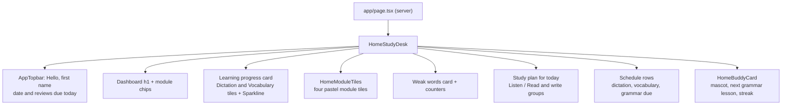
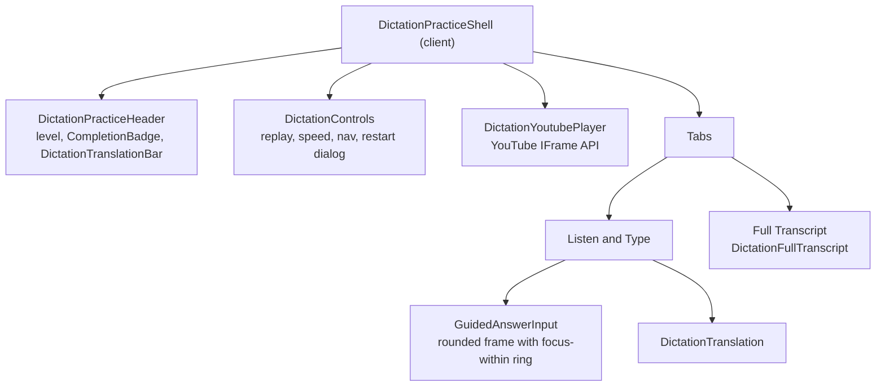
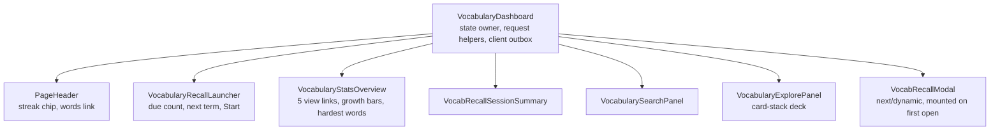
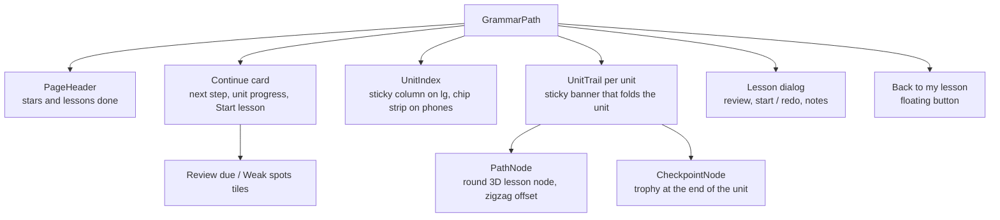

# 06 - Frontend

"English For Only Me" is a private, single-user English and IELTS study app built
on Next.js 16 (App Router), React 19, and Tailwind CSS v4. Its frontend is a "soft
pastel dashboard": every route renders a white rounded board floating on a
blush backdrop, with a dark icon rail on the left (a floating tab bar on phones),
pastel module tints, pill buttons, hairline borders, and a pastel pink brand
colour that matches the logo. A deliberate night theme remaps the same tokens.
All UI text goes through a typed EN / VI message catalogue chosen by a cookie;
Vietnamese lesson content stays data. This document maps the design system and
theming, motion, i18n, the shared chrome and primitives, the full route tree, and
the component trees for the home dashboard and the four shipped modules:
Dictation, Vocabulary, Grammar and IELTS. Writing Notes, AI Coach, Reading and
Speaking exist only as module records (`src/constants/modules.ts`); the IELTS
module covers reading, listening and writing practice. All claims are grounded in
the source files cited by their repo-relative paths.

---

## 1. Design system and visual theme

### 1.1 The soft pastel dashboard

The look is a white board on a soft backdrop: `PageShell` paints the board
(`bg-board rounded-shell shadow-shell`), blocks inside use hairline `border-line`
borders and at most the soft `shadow-card`, buttons and chips are pills
(`rounded-full`), and each module wears one pastel tint. There are no hard offset
shadows, no uppercase headings and no black-weight type. The rules for writing
new UI live in `.agents/rules/frontend-ui.md` (palette, corner roles, motion,
language).

| Primitive      | File                                     | Role                                                                                                                                                                                                                                                                                                                                                                                                                                        |
| -------------- | ---------------------------------------- | ------------------------------------------------------------------------------------------------------------------------------------------------------------------------------------------------------------------------------------------------------------------------------------------------------------------------------------------------------------------------------------------------------------------------------------------- |
| `PageShell`    | `src/components/common/PageShell.tsx`    | The board. A grid with the topbar spanning two columns, the rail (`AppSidebar`, md and up) beside `main`, an optional `footer` slot, then `AppCredits` and the phone `AppTabBar`. `fullHeight` locks it to one viewport for work screens (`true`) or from `lg` (`'lg'`); work screens get neither credits nor the tab bar. `main` carries `page-enter` (or `page-enter-quick` on work screens) so each navigation replays a short entrance. |
| `PageHeader`   | `src/components/common/PageHeader.tsx`   | The shared head of every module page: optional pastel icon circle, h1, one-line subtitle, optional eyebrow (breadcrumb or tag), and an `actions` slot. Same size and rhythm on every route.                                                                                                                                                                                                                                                 |
| `ContentPanel` | `src/components/common/ContentPanel.tsx` | Bordered white card on the `Card` primitive with optional `eyebrow` (`PageTag`), `title` and `action` slot.                                                                                                                                                                                                                                                                                                                                 |
| `ActionButton` | `src/components/ui/ActionButton.tsx`     | The standard pill button / link. Tones: `primary` (soft brand pink), `paper` (outlined), `ink` (the one dark CTA, `bg-cta text-cta-fg`). Optional leading `icon`.                                                                                                                                                                                                                                                                           |
| `IconButton`   | `src/components/ui/IconButton.tsx`       | Round icon-only button / link with a required accessible `label`.                                                                                                                                                                                                                                                                                                                                                                           |
| `PageTag`      | `src/components/ui/PageTag.tsx`          | Small pill label; tone from `PAGE_TAG_TONES` in `src/constants/theme.ts` (default, red, ink, pale, plus achievement tones sky, yellow, copper, silver, gold, diamond used by completion medals).                                                                                                                                                                                                                                            |
| `MetricTile`   | `src/components/common/MetricTile.tsx`   | Stat tile (label, big value, detail, optional trend and icon), tones `red` / `paper` / `ink`.                                                                                                                                                                                                                                                                                                                                               |
| `QueueRow`     | `src/components/common/QueueRow.tsx`     | List row (title, meta, status tag, action slot); static, link or keyboard-activatable button.                                                                                                                                                                                                                                                                                                                                               |
| `ProgressRing` | `src/components/common/ProgressRing.tsx` | Circular progress with centred content (grammar unit badges and index).                                                                                                                                                                                                                                                                                                                                                                     |
| `Sparkline`    | `src/components/common/Sparkline.tsx`    | Tiny smoothed trend line in `currentColor`, drawn in with `motion-draw`; a faded placeholder wave when there are fewer than two values.                                                                                                                                                                                                                                                                                                     |
| `SketchChart`  | `src/components/common/SketchChart.tsx`  | Simple SVG line chart used by the dictation stats.                                                                                                                                                                                                                                                                                                                                                                                          |
| `ModuleCard`   | `src/components/ui/ModuleCard.tsx`       | Generic module launcher card (kept for reuse; the home page uses `HomeModuleTiles`).                                                                                                                                                                                                                                                                                                                                                        |

### 1.2 Colour tokens

`src/app/globals.css` defines raw tokens on `:root` (also applied by the
`.day-palette` class), maps them onto the shadcn semantic names, and re-exports
everything as Tailwind colours inside `@theme inline` (Tailwind v4, no
`tailwind.config`). `src/constants/theme.ts` mirrors the day palette in
`THEME_COLORS` and holds `PAGE_TAG_TONES` and `MODULE_THEMES`.

| Token                                          | Day value                                   | Used for                                                                                                                               |
| ---------------------------------------------- | ------------------------------------------- | -------------------------------------------------------------------------------------------------------------------------------------- |
| `--canvas`                                     | `#f3eaf2`                                   | Backdrop behind the board (`html` background plus a fixed `html::before` layer with soft gradients and curved lines from `--html-bg`). |
| `--board` / `--surface`                        | `#ffffff`                                   | The board / cards.                                                                                                                     |
| `--surface-muted`                              | `#faf6f9`                                   | Quiet controls (theme and language buttons, search).                                                                                   |
| `--ink` / `--ink-soft`                         | `#25171f` / `#73636d`                       | Text / muted text.                                                                                                                     |
| `--line` / `--line-strong`                     | `#f0e7ed` / `#e2d6df`                       | Hairline borders / inputs and dashed locks.                                                                                            |
| `--brand` / `--brand-soft` / `--brand-ink`     | `#c93a74` / `#fde8f1` / `#a52c5e`           | Pastel pink brand: progress, current state, focus ring; soft fill; readable pink text.                                                 |
| `--cta` / `--cta-fg`                           | `#25171f` / `#ffffff`                       | The dark primary action (also shadcn `--primary`).                                                                                     |
| `--danger` / `--danger-soft`                   | `#c03810` / `#fdebe4`                       | Wrong answers, errors, delete only. Kept clearly apart from the pink brand.                                                            |
| `--lesson-correct`                             | `#1b7c44`                                   | Right answers. Right and wrong always also carry an icon and a word.                                                                   |
| `--tint` / `--tint-soft`                       | `#f8ebf2` / `#fcf6f9`                       | Selected / hovered and quiet grouping fills.                                                                                           |
| `--pastel-*`                                   | peach, lilac, rose, sky, mint, lemon, cream | Module and highlight tints.                                                                                                            |
| `--accent-*`                                   | blue, orange, purple, pink, green           | Text and icon colours that read on the pastels and on white.                                                                           |
| `--rail-bg` / `--rail-fg`                      | `#25171f` / `#ffffff`                       | The icon rail and phone tab bar, dark in both themes.                                                                                  |
| `--exam-surface`, `--exam-line`, `--exam-tint` | surface, line-strong, tint-soft             | IELTS exam panes (kept as their own names so the exam can diverge).                                                                    |

`MODULE_THEMES` (`src/constants/theme.ts`) gives each module a `tint`, `accent`
and `outline`: Dictation sky, Vocabulary mint, Grammar lilac, IELTS peach (Writing
Notes cream, AI Coach and Speaking mint, Reading lemon). Pink is the brand, so no
module wears it.

Corner roles (`--corner-*`, mapped to `rounded-shell` / `rounded-panel` /
`rounded-control` / `rounded-tag`): shell 36px (0 under 640px, where the board
fills the screen), panel 24px (20px on phones), control 14px, tag 8px.
`src/lib/utils.ts` extends tailwind-merge with these roles so `cn()` resolves
conflicts between them. Shadows come from `@theme inline`: `shadow-card`,
`shadow-float`, `shadow-shell`.

### 1.3 Night theme

The app has two themes: day `light` and night `lightup` (the stored value keeps
its old name so saved preferences still work). Night is not an inverted palette:
`:root[data-theme='lightup']` in `src/app/globals.css` remaps every token to a
deliberate dark set (`--canvas: #0f0d12`, `--board: #141118`,
`--surface: #1b171f`, `--ink: #f2ebf0`, `--brand: #ff8fbd`, softened pastels and
brighter accents) and adds depth with `--card-highlight` (a faint inset top edge)
and `--shell-ring`.

| Piece            | File                                      | Role                                                                                                                                                                                                                                                                                                   |
| ---------------- | ----------------------------------------- | ------------------------------------------------------------------------------------------------------------------------------------------------------------------------------------------------------------------------------------------------------------------------------------------------------ |
| Pure theme logic | `src/lib/theme/theme.ts`                  | `autoThemeForTime`, `nextThreshold`, `resolveTheme`, `manualState`, `parseStoredTheme`. Auto switches at 06:30 and 18:30; a manual choice wins until the next threshold. Stored under `efom-theme`.                                                                                                    |
| `ThemeProvider`  | `src/components/common/ThemeProvider.tsx` | Client store over localStorage plus the wall clock (`useSyncExternalStore`), re-checked on a timer and on focus / visibility. Syncs `data-theme` on `<html>`. `toggleTheme` wraps the flip in `document.startViewTransition` when available, so the whole page cross-fades once. Exposes `useTheme()`. |
| `ThemeToggle`    | `src/components/common/ThemeToggle.tsx`   | Round moon / sun button in the rail and, below md, in the topbar.                                                                                                                                                                                                                                      |
| No-flash script  | `src/app/layout.tsx`                      | Inline `THEME_INIT_SCRIPT` stamps `data-theme` before first paint.                                                                                                                                                                                                                                     |

Two exceptions stay dark or light on purpose: the rail and tab bar use
`--rail-bg`, and `.day-palette` pins the day tokens on a subtree that is designed
as a dark block on the day palette. IELTS Task 1 charts (`TaskVisual`) always sit
on white exam paper with their own ink and line values, because their strokes are
hard black and grey.

### 1.4 Fonts

`src/app/layout.tsx` loads Be Vietnam Pro with `next/font/google` (subsets `latin`,
`latin-ext`, `vietnamese`; weights 300 to 700) into `--font-app`, which
`globals.css` binds to both `--font-sans` and `--font-body`. The Vietnamese subset
matters: Vietnamese lesson data has stacked diacritics, and a font without it
falls back glyph by glyph. Headings use `font-medium`, body text the normal
weight.

### 1.5 Motion

All motion lives in `src/app/globals.css` and respects
`prefers-reduced-motion` (no movement, or opacity only).

| Utility                                           | Behaviour                                                                                                                            |
| ------------------------------------------------- | ------------------------------------------------------------------------------------------------------------------------------------ |
| `page-enter` / `page-enter-quick`                 | Route entrance on `main` (`soft-rise` 320ms, or a 140ms fade on work screens).                                                       |
| `motion-stagger`                                  | Children rise in one after another (cards, tiles, lists).                                                                            |
| `motion-grow-x` / `motion-grow-y` / `motion-draw` | Progress bars, bar charts and sparklines ease in.                                                                                    |
| `hover-lift`                                      | Clickable cards lift slightly on hover (hover-capable pointers only).                                                                |
| `soft-press`                                      | Pressable controls squish slightly on press; unlayered so it beats `transition-all` from `buttonVariants`.                           |
| View transitions                                  | `::view-transition-old/new(root)` cross-fade the theme switch in 320ms.                                                              |
| `ring-owned-focus`                                | Opts a field out of the global focus outline when its rounded wrapper draws the ring with `focus-within` (the dictation answer box). |
| `marker`                                          | Highlighter-pen background for an emphasised phrase ("made for you" on the home plan).                                               |

Primitive dialogs, sheets, dropdowns, selects, tabs, collapsibles and the
progress bar carry their own soft open / close transitions in
`src/components/ui/*`.

### 1.6 `cn()`, tailwind-merge, class-variance-authority

`src/lib/utils.ts` exports `cn(...inputs)` = `twMerge(clsx(inputs))` with the
corner roles registered. `class-variance-authority` defines the variant maps in
the shadcn primitives (`button.tsx` `buttonVariants`, `badge.tsx`, `tabs.tsx`);
`ActionButton` and `IconButton` layer their pill styling on `buttonVariants`.

---

## 2. Internationalisation (EN / VI)

Every user-visible UI string (labels, buttons, headings, hints, aria labels,
titles, metadata, toasts, learner-facing API errors) comes from a typed message
catalogue. English is the default and the source of truth for keys; a missing
Vietnamese key is a type error. Lesson and test data (grammar course content,
IELTS passages, transcripts, word meanings) is never translated.

| Piece         | File                                                     | Role                                                                                                                                                                                                                                     |
| ------------- | -------------------------------------------------------- | ---------------------------------------------------------------------------------------------------------------------------------------------------------------------------------------------------------------------------------------- |
| Config        | `src/i18n/config.ts`                                     | `LOCALES = ['en', 'vi']`, `DEFAULT_LOCALE`, cookie `efom-locale` (one year), `INTL_LOCALES` (`en-GB`, `vi-VN`), `resolveLocale`. Routes are the same in both languages.                                                                  |
| Catalogues    | `src/i18n/messages/en/*.ts`, `src/i18n/messages/vi/*.ts` | One file per namespace: `common`, `home`, `dictation`, `vocabulary`, `grammar`, `ielts`, `ieltsEditor`, `admin`. `src/i18n/messages/index.ts` exports `MESSAGES` and the `Messages` type. `src/i18n/messages.test.ts` checks key parity. |
| Server        | `src/i18n/server.ts`                                     | `getLocale()` (cookie, cached per request) and `getMessages()` for server components, `generateMetadata`, route handlers and server actions.                                                                                             |
| Client        | `src/i18n/client.tsx`                                    | `I18nProvider` (mounted in `src/app/layout.tsx`; English is bundled, so only the Vietnamese catalogue is passed down), `useMessages()`, `useLocale()`.                                                                                   |
| Switching     | `src/i18n/actions.ts`                                    | `setLocaleAction(locale)` server action: sets the cookie and calls `refresh()` so server text re-renders without a reload.                                                                                                               |
| Formatting    | `src/i18n/format.ts`, `src/i18n/formatNodes.tsx`         | `format(template, values)` for `{name}` placeholders, `plural(forms, count)` for one / other, `formatNodes` for templates that embed React nodes.                                                                                        |
| Outside React | `src/i18n/active.ts`                                     | `getActiveMessages()` for plain client modules (the sync outbox) that need a fallback message.                                                                                                                                           |
| Toggle        | `src/components/common/LocaleToggle.tsx`                 | `variant="round"`: one round button in the rail showing the current language with the other below, a click flips it. `variant="segmented"` (default): EN / VI pill in the phone menu. Optimistic via `useOptimistic`.                    |

Server components that render inside client trees receive their text as props
(`labels={t.dictation.browse}` and similar) instead of calling the hook, so they
stay server components. Navigation labels come from `navItemLabel(item, t)` in
`src/constants/modules.ts`.

---

## 3. The `ui/` primitive library

`components.json` declares a shadcn setup with `style: "base-nova"`, `rsc: true`,
CSS variables and the lucide icon set. The primitives wrap `@base-ui/react/*`
(not Radix). Popups (dialog, sheet, select, dropdown, tooltip) render at
`z-[80]`, above the IELTS exam stage (`z-[70]`).

| Component                                             | File                                              | Client? | Purpose                                                                                  |
| ----------------------------------------------------- | ------------------------------------------------- | ------- | ---------------------------------------------------------------------------------------- |
| `button`                                              | `ui/button.tsx`                                   | server  | Base `Button` with `buttonVariants` (cva). Foundation for `ActionButton` / `IconButton`. |
| `badge`                                               | `ui/badge.tsx`                                    | server  | Label badge (cva variants).                                                              |
| `card`                                                | `ui/card.tsx`                                     | server  | `Card` / `CardHeader` / `CardContent` / `CardFooter`.                                    |
| `input`, `textarea`, `label`                          | `ui/input.tsx`, `ui/textarea.tsx`, `ui/label.tsx` | mixed   | Form fields.                                                                             |
| `checkbox`, `radio-group`, `switch`, `slider`         | `ui/*.tsx`                                        | client  | Choice controls.                                                                         |
| `select`                                              | `ui/select.tsx`                                   | client  | Select family (`SelectTrigger` / `Content` / `Item` / `Value`).                          |
| `tabs`                                                | `ui/tabs.tsx`                                     | client  | Tabs family (practice Listen and Type / Full Transcript).                                |
| `dialog`, `sheet`                                     | `ui/dialog.tsx`, `ui/sheet.tsx`                   | client  | Modal and side panel on the base-ui dialog.                                              |
| `dropdown-menu`, `tooltip`                            | `ui/dropdown-menu.tsx`, `ui/tooltip.tsx`          | client  | Menus (`UserMenu`) and tooltips.                                                         |
| `collapsible`                                         | `ui/collapsible.tsx`                              | client  | Disclosure used by the grammar unit banners and dictation browse panels.                 |
| `progress`, `separator`, `skeleton`                   | `ui/*.tsx`                                        | mixed   | Progress bar, divider, pulsing placeholder.                                              |
| `ActionButton`, `IconButton`, `PageTag`, `ModuleCard` | `ui/*.tsx`                                        | server  | App components (section 1.1).                                                            |

---

## 4. Shared layout chrome

Every route renders its own `PageShell` and passes an `AppTopbar` into the
`topbar` slot (server pages inject `<AuthControl />` into its `authControl` slot).
`src/app/(app)/layout.tsx` wraps all learner routes in `OutboxOwnerProvider`,
which hands the client outbox a hashed owner key for the current user or guest
(never the raw guest id) so queued writes are stored per learner.

| Component                        | File                                                  | Client? | Role                                                                                                                                                                                                                                                                                     |
| -------------------------------- | ----------------------------------------------------- | ------- | ---------------------------------------------------------------------------------------------------------------------------------------------------------------------------------------------------------------------------------------------------------------------------------------- |
| `AppTopbar`                      | `common/AppTopbar.tsx`                                | client  | Logo above the rail, a greeting-style title and subtitle (both default to the catalogue), the auth slot, and below md a `ThemeToggle` plus the `TopbarMenu` button. Takes the auth control as a slot so client error boundaries never import the auth chain.                             |
| `AppSidebar`                     | `common/AppSidebar.tsx`                               | client  | The dark icon rail (md and up): one pill of module links from `PRIMARY_NAV_ITEMS` (disabled modules are skipped) with a pill highlight that slides to the active item, then `ThemeToggle` and `LocaleToggle variant="round"`. `isActiveHref` matches `/` exactly and modules by subtree. |
| `AppTabBar`                      | `common/AppTabBar.tsx`                                | client  | Below md: the same links as a floating dark pill at the bottom of the screen with icon and label. Left out on full-height work screens.                                                                                                                                                  |
| `TopbarMenu` / `TopbarMenuSheet` | `common/TopbarMenu.tsx`, `common/TopbarMenuSheet.tsx` | client  | Phone menu button; lazy-loads a right `Sheet` with the nav links (disabled ones tagged "Soon"), the segmented `LocaleToggle`, and the auth control.                                                                                                                                      |
| `AuthControl`                    | `common/AuthControl.tsx`                              | server  | Nothing when Google auth is unconfigured, a "Sign in" `ActionButton` when signed out, `UserMenu` when signed in.                                                                                                                                                                         |
| `UserMenu` / `UserMenuPopup`     | `common/UserMenu.tsx`, `common/UserMenuPopup.tsx`     | client  | Identity chip as a dropdown trigger: Favorites, Admin (admins only), and Sign out behind a confirm dialog. The sign-out action arrives as a prop.                                                                                                                                        |
| `AppCredits`                     | `common/AppCredits.tsx`                               | client  | Last row of the board: "(c) 2026 English For Only Me. All rights reserved." and "Developed by Nguyen Anh Khoa" (links to `https://anhkhoa.info`). Hidden on work screens.                                                                                                                |
| `ThemeProvider`, `I18nProvider`  | `common/ThemeProvider.tsx`, `src/i18n/client.tsx`     | client  | Mounted once in `src/app/layout.tsx`.                                                                                                                                                                                                                                                    |

Navigation source of truth: `APP_MODULES` and `PRIMARY_NAV_ITEMS` in
`src/constants/modules.ts`. The nav shows Home plus every module except Writing
Notes, Reading and Speaking (the IELTS module covers them); non-active modules
(AI Coach) are `disabled`.

---

## 5. Route map

All pages set `runtime = 'nodejs'`; data pages set `dynamic = 'force-dynamic'`.
Most guard on `hasMongoDbUri()` (`src/constants/environments.ts`) and render a
"database not configured" state instead of crashing. Learner data is scoped by
`getPracticeActorId()` (signed-in user, else a guest cookie); see
`docs/07-auth-infra-testing.md`.

| URL                                           | File                                                    | Purpose                                                                                                                                             | Auth  |
| --------------------------------------------- | ------------------------------------------------------- | --------------------------------------------------------------------------------------------------------------------------------------------------- | ----- |
| `/`                                           | `src/app/page.tsx`                                      | Home dashboard (`HomeStudyDesk`) with dictation, vocabulary and grammar stats for a signed-in user.                                                 | Open  |
| `/dictation`                                  | `src/app/(app)/dictation/page.tsx`                      | Dictation landing: stats strip, in-progress shelf, topic grid.                                                                                      | Open  |
| `/dictation/[topicSlug]`                      | `src/app/(app)/dictation/[topicSlug]/page.tsx`          | Topic sections (accordion) or filtered flat results.                                                                                                | Open  |
| `/dictation/favorites`, `/dictation/no-topic` | `src/app/(app)/dictation/{favorites,no-topic}/page.tsx` | Favourites (sign-in required) and uncategorised lessons.                                                                                            | Mixed |
| `/dictation/videos/[videoId]/practice`        | `.../practice/page.tsx`                                 | Practice (`DictationPracticeShell`, full height).                                                                                                   | Open  |
| `/dictation/videos/[videoId]/results`         | `.../results/page.tsx`                                  | Per-video results, AI debrief, weak segments.                                                                                                       | Open  |
| `/dictation/review`, `/dictation/stats`       | `src/app/(app)/dictation/{review,stats}/page.tsx`       | Due review queue; full stats dashboard.                                                                                                             | Open  |
| `/vocabulary`, `/vocabulary/words`            | `src/app/(app)/vocabulary/**`                           | Vocabulary dashboard; filtered word list.                                                                                                           | Open  |
| `/grammar` and children                       | `src/app/(app)/grammar/**`                              | Grammar path, lesson player, notes, review, weak-spot practice, unit checkpoint.                                                                    | Open  |
| `/ielts` and children                         | `src/app/(app)/ielts/**`                                | IELTS catalogue, test page, runners (practice, mock, drill), attempt review.                                                                        | Open  |
| `/admin/**`                                   | `src/app/admin/**`                                      | Admin: dictation content, IELTS editor, vocabulary enrichment. `src/app/admin/layout.tsx` redirects anonymous users to sign-in and non-admins away. | Admin |
| `/zz-dev-ielts-editor`                        | `src/app/zz-dev-ielts-editor/page.tsx`                  | Development-only IELTS editor sandbox.                                                                                                              | Dev   |

Module sections below list each module's routes in detail.

---

## 6. The home dashboard

`src/app/page.tsx` (server) loads, for a signed-in user, dictation global stats,
vocabulary stats and grammar progress (`buildGrammarPath` for the next lesson
title and due count) and passes them with the user's name to `HomeStudyDesk`
(`src/components/home/HomeStudyDesk.tsx`, server). Anonymous visitors, or a
missing database, get the same layout with zeros.

| Component         | File                       | Role                                                                                                                                                                               |
| ----------------- | -------------------------- | ---------------------------------------------------------------------------------------------------------------------------------------------------------------------------------- |
| `HomeStudyDesk`   | `home/HomeStudyDesk.tsx`   | Bento layout: three columns on xl (progress, modules and counters / today's plan and schedule / buddy card), two on md, one on phones. Accepts `now` for a testable greeting date. |
| `HomeModuleTiles` | `home/HomeModuleTiles.tsx` | The four active modules as pastel tiles with a lucide icon and one fact each; exports `MODULE_ICONS`.                                                                              |
| `HomeBuddyCard`   | `home/HomeBuddyCard.tsx`   | Lemon highlight card: the logo mascot, the next grammar lesson, the streak, minutes this month and videos done.                                                                    |

---

## 7. The dictation feature UI

### 7.1 Landing and browse

`/dictation` (server) renders `PageHeader` (latest results and favourites
actions), then `DictationStatsStrip`, `InProgressSection` and the `TopicGrid`
under a "Topics" heading. The landing page keeps to one screen on a desktop: the
full stats dashboard lives on `/dictation/stats`.

`/dictation/[topicSlug]` (server) renders `PageHeader` with `BrowseBreadcrumb`,
`BrowseToolbar`, then either `TopicAccordion` / `SectionAccordion` (collapsible
sections) or, when `isBrowseQueryActive` (search, level or sort), `FlatResults`
with `BrowseVideoList` and `BrowsePagination`.

| Component                                    | File                                                             | Client?         | Role                                                                                                                                                                                                                                                                                                                             |
| -------------------------------------------- | ---------------------------------------------------------------- | --------------- | -------------------------------------------------------------------------------------------------------------------------------------------------------------------------------------------------------------------------------------------------------------------------------------------------------------------------------- |
| `DictationStatsStrip`                        | `browse/DictationStatsStrip.tsx`                                 | server          | Four headline numbers (completed videos, completed segments, this week, active streak) with pastel icons and a "Full stats" link; two columns on phones. Labels arrive as props.                                                                                                                                                 |
| `InProgressSection`                          | `browse/InProgressSection.tsx`                                   | server          | Collapsible "In Progress" shelf of unfinished videos, rendered as `BrowseVideoList layout="rail"` (one horizontally scrolling row). Renders nothing when empty.                                                                                                                                                                  |
| `TopicGrid`                                  | `browse/TopicGrid.tsx`                                           | server          | Compact topic cards (thumbnail tile, title, "Levels: X · N lessons"), up to four columns, plus a muted "Uncategorized" card when topic-less videos exist.                                                                                                                                                                        |
| `BrowseVideoList` / `BrowseVideoListClient`  | `browse/BrowseVideoList.tsx`, `browse/BrowseVideoListClient.tsx` | server / client | Video cards: thumbnail with `FavoriteButton`, two-line title, level tag, `CompletionBadge`, and a status chip (Continue in pink, Practice again in green with a tick, Practice). The whole card links to practice. `layout="grid"` (2 to 5 columns) or `"rail"`. The client wrapper lets a closed section ship only its records. |
| `SectionAccordion`                           | `browse/SectionAccordion.tsx`                                    | server          | Per-section `BrowseDisclosure`s whose bodies are `BrowseVideoListClient`, so a closed section ships only its video records.                                                                                                                                                                                                      |
| `BrowseDisclosure`                           | `browse/BrowseDisclosure.tsx`                                    | client          | Shared disclosure shell (header + panel).                                                                                                                                                                                                                                                                                        |
| `BrowseToolbar`                              | `browse/BrowseToolbar.tsx`                                       | client          | Debounced search (300ms) and level / sort `Select`s written to the query string.                                                                                                                                                                                                                                                 |
| `BrowsePagination`, `BrowseBreadcrumb`       | `browse/*.tsx`                                                   | server          | Link pagination; "All topics / current" breadcrumb.                                                                                                                                                                                                                                                                              |
| `FavoriteButton`                             | `browse/FavoriteButton.tsx`                                      | client          | Optimistic star toggle through `toggleFavoriteAction`; sends anonymous users to sign-in.                                                                                                                                                                                                                                         |
| `DictationVideoThumbnail`, `CompletionBadge` | `dictation/*.tsx`                                                | server          | Safe YouTube thumbnail with fallback; tiered completion medal.                                                                                                                                                                                                                                                                   |

`/dictation/favorites` and `/dictation/no-topic` reuse `BrowseVideoList` and
`BrowseBreadcrumb`.

### 7.2 Practice

The practice page loads segments, session and translation tracks on the server
and hands them to `DictationPracticeShell` (client), inside a full-height
`PageShell`. The shell scores answers locally first (`src/modules/dictation/correction`),
so grading never waits on the network. It starts or resumes the session with
`startOrResumeDictationSessionApi` (`src/requests/dictationSessionsApi.ts`) and
queues every session update and attempt through the client outbox
(`useClientOutbox`, paths from `getDictationSessionApiPath` and
`getDictationAttemptsApiPath` in `src/requests/dictationAttemptsApi.ts`), which
delivers them in the session's lane with retries. Shortcuts: Enter checks, Esc reveals or
skips, Ctrl+[ / ] moves between segments, Alt or Cmd replays. Drafts persist
locally.

| Component                                                                                                | File                                                           | Client? | Role                                                                                                                                                                                                                                                                                                                                                                |
| -------------------------------------------------------------------------------------------------------- | -------------------------------------------------------------- | ------- | ------------------------------------------------------------------------------------------------------------------------------------------------------------------------------------------------------------------------------------------------------------------------------------------------------------------------------------------------------------------- |
| `DictationPracticeShell`                                                                                 | `DictationPracticeShell.tsx`                                   | client  | Orchestrator: session, attempts, preferences, shortcuts.                                                                                                                                                                                                                                                                                                            |
| `DictationPracticeHeader`                                                                                | `DictationPracticeHeader.tsx`                                  | client  | Title, level, completion medal, translation language picker.                                                                                                                                                                                                                                                                                                        |
| `DictationYoutubePlayer`                                                                                 | `DictationYoutubePlayer.tsx`                                   | client  | Segment-aware YouTube wrapper with a controller (replay, seek, play segment).                                                                                                                                                                                                                                                                                       |
| `DictationControls`, `DictationSettingsMenu`                                                             | `DictationControls.tsx`, `DictationSettingsMenu.tsx`           | client  | Playback and navigation toolbar; speed and text-size settings.                                                                                                                                                                                                                                                                                                      |
| `GuidedAnswerInput`                                                                                      | `GuidedAnswerInput.tsx`                                        | client  | Free typing over a transparent mirror with character-level correction (dotted orange for missing, solid red for wrong), hint chips (Tab fills), and a rounded frame whose `focus-within` ring replaces the square global outline (`ring-owned-focus`). Its `renderCorrectionWord` slot receives `QuickVocabWordButton` so corrected words open a vocabulary lookup. |
| `DictationTranslation`, `DictationTranslationBar`                                                        | `DictationTranslation*.tsx`                                    | client  | After-effort translation caption; language picker.                                                                                                                                                                                                                                                                                                                  |
| `DictationFullTranscript`, `DictationTranscriptDrawer`                                                   | `DictationFullTranscript.tsx`, `DictationTranscriptDrawer.tsx` | client  | Click-to-seek transcript with status badges; a sheet variant.                                                                                                                                                                                                                                                                                                       |
| `DictationCaptionManager`, `DictationSegmentEditor`, `DictationHintEditor`, `DictationTranslationEditor` | `Dictation*.tsx`                                               | client  | Authoring panels: captions and tracks, segments, hints, translations.                                                                                                                                                                                                                                                                                               |

The practice and results pages render `PracticeSetupState` / `ResultsSetupState`
(defined in the page files) when a transcript or segments are missing.

### 7.3 Results, review and stats

`/dictation/videos/[videoId]/results` composes `DictationResultsSummary`, then,
once there is practice, `DictationStatsPanel`, `DictationDebriefPanel` (client,
generates an AI debrief through `src/requests/dictationDebriefsApi.ts`) and a
`DictationReviewQueue` of weak segments. `/dictation/review` renders the due
`DictationReviewQueue`; `/dictation/stats` renders `DictationGlobalStats` (client:
metric tiles, `SketchChart` first-try trend, repeated mistake types, weak words,
next steps). `formatDuration` (`src/components/dictation/formatDuration.ts`) is
shared by the stats dashboard and the landing strip.

### 7.4 Admin

Admin pages (`src/app/admin/dictation/**`) are server components that load
content and hand it to client components; mutations go through server actions in
`src/modules/dictation/content/adminActions.ts`, except `DictationImportForm`, which
calls `importYouTubeVideoApi` (`src/requests/dictationImportsApi.ts`).

| Component                                                                               | File                    | Role                                                                                                                  |
| --------------------------------------------------------------------------------------- | ----------------------- | --------------------------------------------------------------------------------------------------------------------- |
| `AdminTopicList`, `AdminTopicCard`, `AdminCreateTopicForm`, `AdminTopicThumbnailFields` | `dictation/admin/*.tsx` | Topic board: drag-reorder topics and sections, edit, create, thumbnail upload.                                        |
| `AdminUnassignedPanel`, `AdminVideoRow`, `VideoAssignTable`, `VideoFilterBar`           | `dictation/admin/*.tsx` | Unassigned pool, shared video row (level select, edit, soft delete), list view with bulk assign and reorder, filters. |
| `AdminTrashPanel`, `AdminTrashVideoMenu`                                                | `dictation/admin/*.tsx` | Deleted videos with restore and permanent delete.                                                                     |
| `adminVideoDnd`, `ConfirmSubmitButton`                                                  | `dictation/admin/*.tsx` | Native HTML5 drag and drop primitives with MIME-typed payloads; confirm-then-submit button.                           |
| `DictationImportForm`, `AdminVideoTranscriptPreview`                                    | `dictation/*.tsx`       | Import or edit a video, then the caption manager; transcript preview.                                                 |

---

## 8. Vocabulary feature UI

### 8.1 Routes

| URL                 | File                                      | Type                   | Purpose                                                                                                                                                                                                                                                                                                                 |
| ------------------- | ----------------------------------------- | ---------------------- | ----------------------------------------------------------------------------------------------------------------------------------------------------------------------------------------------------------------------------------------------------------------------------------------------------------------------- |
| `/vocabulary`       | `src/app/(app)/vocabulary/page.tsx`       | Server + client island | Loads `getVocabularyDashboardData({ actorId })` (`src/modules/vocabulary/services/vocabDashboardService.ts`: stats, due recall tasks, Explore deck) when the database is configured, and renders `VocabularyDashboard initialData mongoConfigured`. A load failure is logged and the client then loads the data itself. |
| `/vocabulary/words` | `src/app/(app)/vocabulary/words/page.tsx` | Server                 | `parseVocabWordListQuery(searchParams)` (views `learning`, `dueToday`, `alreadyKnow`, `mastered`, `knownTotal`; invalid values fall back to `learning`) then `listVocabWordsForUser`, rendered by `VocabularyWordList`.                                                                                                 |
| `/admin/vocab`      | `src/app/admin/vocab/page.tsx`            | Server + client island | `getVocabAdminQueueSummary()` into `AdminVocabPanel`.                                                                                                                                                                                                                                                                   |

Each route has a `loading.tsx` skeleton shaped like its page.

### 8.2 `/vocabulary` dashboard tree

Every component below is a client component.

- `VocabularyDashboard` (`src/components/vocabulary/VocabularyDashboard.tsx`)
  reads through `src/requests/vocabularyApi.ts` (`getVocabStatsApi`,
  `getDueVocabRecallApi`, `getExploreVocabApi`, `lookupVocabEntryApi`,
  `searchVocabApi`) and writes through the client outbox: word marks via
  `enqueueVocabItemStatus` (`vocabItemWrites.ts`, lane `vocab:items`, last press
  per word wins, optimistic with rollback) and recall answers via
  `enqueueVocabRecallAnswer` (`vocabRecallSession.ts`, lane `vocab:recall`,
  idempotency key `vocab-recall:{taskId}`). Answers are graded in the browser
  first and the server's verdict replaces the local one. It prefetches the next
  due page while five cards remain, auto-opens recall once per day, and re-deals
  without listening tasks for 15 minutes after "I cannot listen now".
- `VocabularyStatsOverview`: five links to `/vocabulary/words?view=...`, daily
  growth bars, known share, hardest words.
- `VocabularyRecallLauncher`: due count, the next term and up to six upcoming
  chips with their stage; a pastel lilac panel.
- `VocabularySearchPanel`: lookup and search in parallel; Vietnamese meaning,
  definitions, synonyms; Should Learn / Already Know disabled until a Vietnamese
  meaning exists.
- `VocabularyExplorePanel`: frequency-ranked words as a card-stack deck with
  prev / next, a dot map and Left / Right keys. Also used by the IELTS test page
  (`TestVocabPanel`).

### 8.3 Recall popup

`VocabRecallModal` (`src/components/vocabulary/VocabRecallModal.tsx`) is a light,
token-based dialog: a pink progress bar with "Review n/total", a mint stage chip,
the instruction, the prompt on a mint card (`VocabTermHeader` with a speak
button), and numbered option cards. Task types: `listenChooseWord`,
`listenChooseDefinition` (the term auto-plays after 250ms), `definitionChooseWord`,
`wordChooseDefinition`, `exampleRemember` (Look Up / I Remember).

Every answer, right or wrong, stops on the card: options turn green with a tick
(the correct one) or red with a cross (a wrong pick), and a verdict panel shows
"Correct!" or "Not quite", the correct answer when wrong, the **Vietnamese
meaning** (`getVietnameseMeaning`, falling back to "needs a meaning"), the
English definition (`getEnglishDefinition`) and the example sentence. Continue
(or Enter) moves to the next card; closing the dialog during a verdict also
advances. Keys 1 to 4 pick an option. WebAudio tones mark right and wrong. A
"Not Sure" footer action submits `notSure`.

### 8.4 Word list and admin

- `VocabularyWordList` (`src/components/vocabulary/VocabularyWordList.tsx`): view
  tabs (pastel per view), per-page select (5 to 200) plus a custom size, rows
  with term, meaning, definition, source-video link and mark buttons. Marks are
  optimistic through the outbox; a word that leaves the view triggers a refill
  (`router.refresh()` after the outbox is idle).
- `AdminVocabPanel` (`src/components/vocabulary/AdminVocabPanel.tsx`): five
  `MetricTile`s (enrichable, ready, failed, not found, stale locks), refresh, and
  `Enrich N` through `enrichVocabularyAdminApi` (server caps at 10).

### 8.5 Shared vocabulary pieces

| Component                                   | File                              | Role                                                                                                                                                                                                                                                  |
| ------------------------------------------- | --------------------------------- | ----------------------------------------------------------------------------------------------------------------------------------------------------------------------------------------------------------------------------------------------------- |
| `VocabTermHeader`                           | `vocabulary/VocabTermHeader.tsx`  | Term, pronunciation and a speak button; sizes `md` / `lg` / `xl`.                                                                                                                                                                                     |
| `QuickVocabLookup` / `QuickVocabWordButton` | `vocabulary/QuickVocabLookup.tsx` | Click-to-look-up word buttons and dialog (meaning, definition, marks). Used by `DictationPracticeShell` through `GuidedAnswerInput.renderCorrectionWord` and by the IELTS `TextHighlighter`. Results cached for five minutes (`vocabLookupCache.ts`). |

---

## 9. Grammar feature UI

### 9.1 Routes

All pages are server components backed by `loadGrammarPageData()`
(`src/modules/grammar/services/grammarPageData.ts`: progress, the path from
`buildGrammarPath`, and `canSave`). Only `/grammar` has a `loading.tsx`.

| URL                                  | File                                      | Renders                                                                          | Guards                                                                                                          |
| ------------------------------------ | ----------------------------------------- | -------------------------------------------------------------------------------- | --------------------------------------------------------------------------------------------------------------- |
| `/grammar`                           | `src/app/(app)/grammar/page.tsx`          | `PageShell` + `AppTopbar` + `GrammarPath`                                        | none                                                                                                            |
| `/grammar/lessons/[lessonId]`        | `.../lessons/[lessonId]/page.tsx`         | `GrammarPlayerPage mode="lesson"`                                                | `notFound()` for unknown ids; canonical id redirect; `/grammar` when the lesson is locked (`isLessonUnlocked`). |
| `/grammar/lessons/[lessonId]/notes`  | `.../notes/page.tsx`                      | `PageHeader` + the lesson's explain cards (`ExplainCardView` in `ContentPanel`s) | `/grammar` unless the lesson is passed.                                                                         |
| `/grammar/lessons/[lessonId]/review` | `.../review/page.tsx`                     | `GrammarPlayerPage mode="review"` (`buildReviewSet`)                             | `/grammar` unless the lesson is due.                                                                            |
| `/grammar/practice`                  | `src/app/(app)/grammar/practice/page.tsx` | `GrammarPlayerPage mode="weak"` (`buildWeakSet`)                                 | `/grammar` when there are no weak cards.                                                                        |
| `/grammar/units/[unitId]/checkpoint` | `.../checkpoint/page.tsx`                 | `GrammarPlayerPage mode="checkpoint"`, checkpoint or test-out intro              | `/grammar` when the unit is complete.                                                                           |

### 9.2 The path page

`GrammarPath` (`src/components/grammar/path/GrammarPath.tsx`, client) is a
Duolingo-style winding path that stays easy to navigate:

- Nodes: round 3D buttons (`id="node-{lessonId}"`) offset along `ZIGZAG`; colour
  and icon follow the state (open Play in brand pink with a bouncing "Start"
  bubble and a pulsing ring, passed Check in the unit colour, mastered Crown,
  due RotateCcw, locked Lock). Each unit cycles a tone from `UNIT_TONES`
  (lilac, sky, mint, peach). Stars or "Tested out" sit under finished nodes.
- Folding: `initialOpenUnitIds` (`src/modules/grammar/path/unitSummary.ts`) opens
  only the current unit; a refresh that moves the learner on also opens the new
  current unit and keeps what the learner opened. Banners stick to the top while
  their lessons scroll. A locked unit shows a Test out button.
- Navigation aids: the unit index unfolds and scrolls to a unit; the floating
  "Back to my lesson" button appears while the next node is folded away or off
  screen (measured on scroll, resize and fold changes) and scrolls it to the
  centre. All scrolling respects reduced motion.
- Sync: `useSyncExternalStore` watches the outbox for pending grammar sessions
  (`hasPendingGrammarSessions` in `src/requests/grammarSessionsApi.ts`) and calls
  `router.refresh()` when they land.

### 9.3 The lesson player

| Component           | File                           | Client? | Role                                                                                                                                                                                                                                                                                                                                                                                                |
| ------------------- | ------------------------------ | ------- | --------------------------------------------------------------------------------------------------------------------------------------------------------------------------------------------------------------------------------------------------------------------------------------------------------------------------------------------------------------------------------------------------- |
| `GrammarPlayerPage` | `player/GrammarPlayerPage.tsx` | server  | Shuffles the cards once per request (`preparePlayCards`) and renders a full-height `PageShell` with `LessonPlayer`.                                                                                                                                                                                                                                                                                 |
| `LessonPlayer`      | `player/LessonPlayer.tsx`      | client  | `useReducer(createPlayerReducer)` (`playerReducer.ts`: first answer counts, a miss is requeued once, combo and best combo). Progress bar, combo badge and milestone flashes, sound toggle, leave dialog once anything is answered, `beforeunload` guard. Enter checks or continues; 1 to 4 pick a choice. A feedback panel shows the expected answer with `SpeakButton` and the card's explanation. |
| `PlayerCard`        | `player/PlayerCard.tsx`        | client  | `ExplainCardView` (also used by notes) and `PracticeCardView` for `choice`, `fill` (tiles or input), `order` (tap or drag tiles via `useTileDrag.ts`, pointer events) and `fix` (tap the wrong word). Wrong states use `danger`, right states `lesson-correct`.                                                                                                                                     |
| `PlayerResult`      | `player/PlayerResult.tsx`      | client  | Stars or pass / fail, accuracy, best streak, time, unlocked banner, misses recap. Saves once through the outbox (`buildGrammarSessionWrite`, lane `grammar`, POST `/api/grammar/sessions`) with states saving, queued, saved, retryable, rejected, offline.                                                                                                                                         |
| `SpeakButton`       | `grammar/SpeakButton.tsx`      | client  | `speechSynthesis` (en-US, rate 0.92); renders nothing when unsupported.                                                                                                                                                                                                                                                                                                                             |

The player sits on `.lesson-stage`, a soft brand and peach glow behind the card
column.

---

## 10. IELTS feature UI

### 10.1 Routes

No learner IELTS route requires sign-in: `AttemptLoader` mints a guest identity
when needed, and attempt pages only load attempts the current actor owns.

| URL                                     | File                                             | Renders                                                           | Notes                                                         |
| --------------------------------------- | ------------------------------------------------ | ----------------------------------------------------------------- | ------------------------------------------------------------- |
| `/ielts`                                | `src/app/(app)/ielts/page.tsx`                   | `IeltsHome` (data from `loadIeltsHomeData()`)                     | Catalogue; admins get links to `/admin/ielts`.                |
| `/ielts/[slug]`                         | `src/app/(app)/ielts/[slug]/page.tsx`            | `PageHeader`, one `SkillLauncher` per skill, `TestVocabPanel`     | Slug validated; mock blocked when listening audio is missing. |
| `/ielts/[slug]/[skill]`                 | `.../[skill]/page.tsx`                           | `.ielts-exam` stage + `AttemptLoader mode="practice"`             | `?part=`; previous / next skill links.                        |
| `/ielts/[slug]/[skill]/mock`            | `.../mock/page.tsx`                              | Stage + `AttemptLoader mode="mock"`                               | Never ships the listening transcript.                         |
| `/ielts/drill/[attemptId]`              | `src/app/(app)/ielts/drill/[attemptId]/page.tsx` | Stage + `IeltsRunner`                                             | Redirects to the attempt once it is finished.                 |
| `/ielts/attempts/[attemptId]`           | `.../attempts/[attemptId]/page.tsx`              | `ExamSheet` + `PageHeader` + `ObjectiveResult` or `WritingResult` | Redirects back to the runner while in progress.               |
| `/admin/ielts`, `/admin/ielts/[testId]` | `src/app/admin/ielts/**`                         | `AdminTestCatalogue` + `CreateTestPanel`; `TestEditor`            | Admin guard (proxy and admin layout).                         |
| `/zz-dev-ielts-editor`                  | `src/app/zz-dev-ielts-editor/page.tsx`           | `TestEditor` with a sample test                                   | Development only (`notFound()` otherwise).                    |

`src/app/(app)/ielts/loading.tsx`, `[skill]/loading.tsx` (`RunnerSkeleton` in the
stage), `attempts/[attemptId]/loading.tsx`, `error.tsx` (`RouteError`) and
`not-found.tsx` cover the module.

### 10.2 Catalogue and test page (`src/components/ielts/catalogue/`)

`IeltsHome` (server) composes `OverviewPanel` (foldable band progress),
`TestCards` (series "books" of test cards with `CatalogueToolbar` search, sort and
filters, grouped by `catalogueGroups.ts`), `DrillButton` (starts a question-type
drill through `startIeltsDrillApi`) and `AttemptHistory` (server, with
`DeleteAttemptButton`). On the test page `SkillLauncher` offers Practice or Mock,
a part or the full test, then Go (`launchHref`), and `TestVocabPanel` lists the
test's words with outbox-backed marks.

### 10.3 Runners (`src/components/ielts/runner/`)

The runner pages wrap everything in `div.ielts-exam fixed inset-0 z-[70]`: a
full-screen stage outside `PageShell` that paints its own surface
(`.ielts-exam` in `globals.css`). Exam panes use the `--exam-*` tokens.

| Component                                            | Role                                                                                                                                                                                                                                                                                                                                                      |
| ---------------------------------------------------- | --------------------------------------------------------------------------------------------------------------------------------------------------------------------------------------------------------------------------------------------------------------------------------------------------------------------------------------------------------- |
| `AttemptLoader`                                      | Starts or resumes the attempt (`startIeltsAttemptApi`, idempotency key in sessionStorage, one retry on 409); renders `WritingRunner` or `IeltsRunner`; exports `RunnerSkeleton`.                                                                                                                                                                          |
| `IeltsRunner`                                        | Listening and Reading: `RunnerToolbar`, a resizable split (`useResizableSplit`, 30 to 75 percent, saved per runner) between the material (`PassagePane`, or `ListeningPlayer` + `ListeningMaterial`) and the questions (`GroupBlock`s + `CheckPartPanel`), then `TextHighlighter` and `QuestionNavigator`. Alt+Q swaps panes; below lg reading uses tabs. |
| `WritingRunner`                                      | Task pane (`WritingPrompt`, `TaskVisual`, `SampleAnswerPanel`) beside the essay editor; `RunnerFooter` + `PartSwitcher`; practice "check task" via `checkIeltsTaskApi`.                                                                                                                                                                                   |
| `PassagePane`, `ListeningPane`                       | Paper-style passage (evidence marks via `highlightText`); listening player, parts and material (mock: one start button, no seek, no transcript, audio events posted).                                                                                                                                                                                     |
| `RunnerToolbar`, `RunnerFooter`, `QuestionNavigator` | Exit, title, mode, toggles, clock (announced at 10, 5 and 1 minutes), theme toggle, Submit; bottom bar with part switcher and skill links.                                                                                                                                                                                                                |
| `TextHighlighter`                                    | Selection menu: highlight, clear, clear all, look up (`QuickVocabDialog`). Paints with the CSS Custom Highlight API (`::highlight(ielts-user)`) inside `data-highlight-scope` elements; highlights last for the visit.                                                                                                                                    |
| `useAttemptAnswers`, `useMockDeadline`               | Answers in state with a localStorage snapshot and debounced outbox autosave; mock countdown with a five-minute warning.                                                                                                                                                                                                                                   |

Practice adds Guided mode, evidence, check part / task, reset part, the
transcript and skill links; mock adds the countdown, a leave warning and forces
spell check off; drill has neither set of extras.

### 10.4 Review, widgets, visuals and editor

- Review (`review/`): `ObjectiveResult` (band row, next actions, filterable review
  with `ReviewMark`, `LineDictation`, `SaveWordButton`, `DrillButton`) and
  `WritingResult` (grading via `gradeIeltsWritingApi`, exports
  `WritingFeedbackDetails`).
- Widgets (`widgets/`): `GroupBlock` (one question group in the paper layout),
  `IeltsMarkdown` (safe Markdown subset with answer slots), `SlotInput`,
  `QuestionNumberBadge`, `EvidenceIconButton`, `ReviewMark` (colour always with an
  icon and a word), `SampleAnswerPanel`, `WritingPrompt`, and the
  `IeltsAnswerContext`.
- `visual/TaskVisual.tsx`: Task 1 line, bar and pie charts as plain SVG, tables
  and images, always on white exam paper (`EXAM_PAPER`) so they read in the night
  theme.
- `ui.tsx`: thin wrappers over the app primitives (`ExamButton`, `ExamIconButton`,
  `ExamCard`, `StatTile`, `ExamBadge`, `ExamSheet`, `segmentClass`).
- Editor (`editor/`, admin): `TestEditor` (Edit, Split and Preview views, Ctrl or
  Cmd+S saves) with `EditorHeader`, `SectionPicker`, `SectionForm`,
  `SectionPreview` (reuses the runner widgets), `ChecksPanel`, `GenerationLog`,
  `AssistMenu`, `TestDetailsDialog`, `TestVocabDialog`; `AdminTestCatalogue`,
  `AdminTestRow`, `CreateTestPanel` (manual or AI-generated).

Request helpers: `src/requests/ieltsApi.ts` (attempts, drills, evidence, audio
events, checks, grading, outbox writes) and `src/requests/ieltsAdminApi.ts`
(editor). There are no IELTS server actions; pages read through
`src/modules/ielts/services/*PageData.ts`.

---

## 11. Loading and error states

- Route skeletons: `loading.tsx` files under `src/app/(app)/**` and `src/app/admin/**`
  render `SkeletonPageShell` and friends from `src/components/common/PageSkeletons.tsx`
  (`SkeletonHero`, `SkeletonPanel`, `SkeletonTileRow`, `SkeletonVideoGrid`,
  `SkeletonRows`), shaped like the page they precede so content fades in without a
  jump.
- Error boundaries: `src/app/(app)/dictation/error.tsx` and
  `src/app/(app)/ielts/error.tsx` (client) render `RouteError`
  (`src/components/common/RouteError.tsx`): the mascot, what went wrong, and two
  ways out (retry via `unstable_retry()`, or back to the module). It uses plain
  elements and tokens so the error bundle stays small. `src/app/(app)/ielts/not-found.tsx`
  handles unknown tests.
- Configuration-absent states: data pages render a "database not configured"
  panel when `hasMongoDbUri()` is false.
- Pending UI: favourites, debrief generation, admin forms, grammar saves and
  vocabulary decisions use `useTransition` or local state with disabled buttons and
  inline errors; queued writes replay from the client outbox
  (`OutboxOwnerProvider`) when the network returns.
