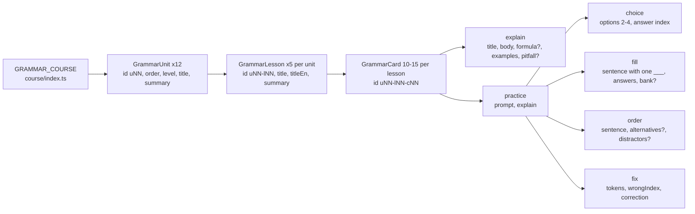
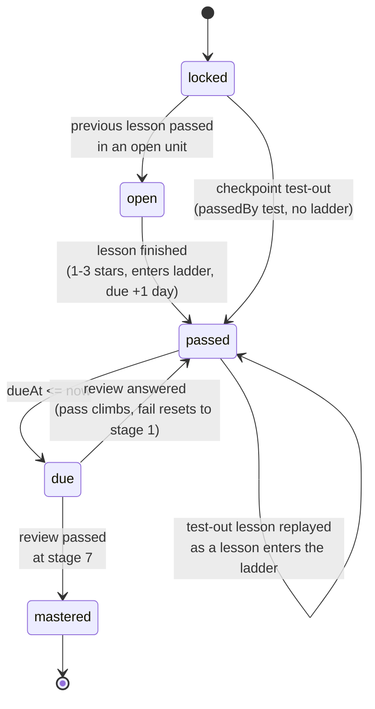
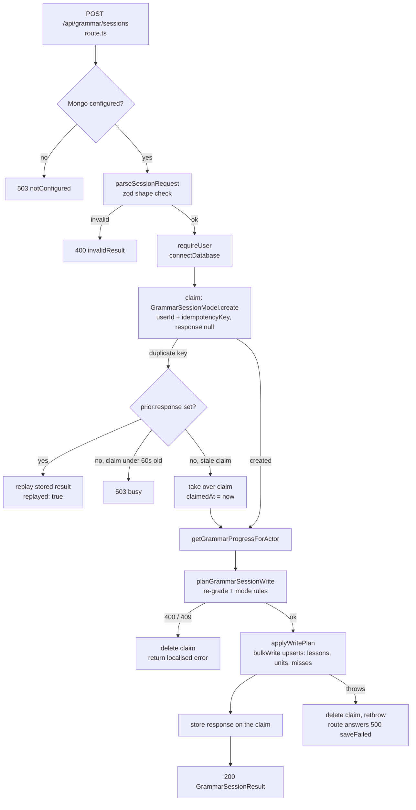

# 08 - Grammar

The Grammar module (`src/modules/grammar/**`) is a Duolingo-style course path:
12 CEFR-levelled units of 5 lessons each, every lesson a short deck of
Vietnamese-explained "explain" cards followed by practice cards (choice, fill,
order, fix). The course is content-as-code (typed objects in
`course/units/u01..u12.ts`, never stored in the database); only learner
progress lives in MongoDB. Almost every rule is a pure function: the path view
(`buildGrammarPath`), the card sets for review / checkpoint / weak-spot
sessions (`buildPracticeSet`), grading (`gradeCard`), and the per-session write
plan (`planGrammarSessionWrite`). A single `server-only` service
(`grammarProgressService.ts`) reads progress rows, hands them to the planner,
upserts the result, and makes each submission idempotent. Passed lessons are
scheduled for review on the shared 7-stage recall ladder
(`src/modules/learning/recall/recallLadder.ts`). All paths below are
repo-relative.

Neighbours, not repeated here:

- Mongoose models `src/models/grammar/*` (lesson progress, unit progress, card
  misses, sessions): [03-data-model.md](./03-data-model.md).
- The `POST /api/grammar/sessions` route handler
  (`src/app/api/grammar/sessions/route.ts`) and its client helper
  (`src/requests/grammarSessionsApi.ts`): [04-api-reference.md](./04-api-reference.md).
- The path page, lesson player and outbox save:
  [06-frontend.md section 9](./06-frontend.md#9-grammar-feature-ui).
- Design notes, review decisions and the test plan for this "Grammar v3"
  course: [grammar/README.md](./grammar/README.md).

---

## 1. File map

| Path                                 | Role                                                                                                                             | Pure?            |
| ------------------------------------ | -------------------------------------------------------------------------------------------------------------------------------- | ---------------- |
| `constants.ts`                       | Thresholds, sizes, session modes, `GRAMMAR_SESSIONS_URL`                                                                         | yes              |
| `course/types.ts`                    | Course, unit, lesson and card types; `CardAnswer`; `isPracticeCard`                                                              | yes              |
| `course/units/u01.ts` .. `u12.ts`    | The lesson data (`UNIT_01` .. `UNIT_12`)                                                                                         | yes              |
| `course/index.ts`                    | `GRAMMAR_COURSE`, `COURSE_ID_ALIASES`, the app-wide `grammarCourse` lookup                                                       | `server-only`    |
| `course/courseLookup.ts`             | `buildCourseLookup`: O(1) unit / lesson / card index with alias resolution                                                       | yes              |
| `course/validateCourse.ts`           | Structural checks for hand-written content                                                                                       | yes              |
| `path/buildGrammarPath.ts`           | The whole path page view model; `isLessonUnlocked`, `isUnitOpen`, `countOpenMisses`                                              | yes              |
| `path/unitSummary.ts`                | Small derived views on top of the path (unit rows, open units, first due lesson, levels, level progress, post-session unit step) | yes              |
| `path/playerJourney.ts`              | `buildPlayerJourney`: the path data a session end needs (unit, path `next`, next unit's first lesson)                            | yes              |
| `session/parseSessionRequest.ts`     | Zod shape check of the POST body                                                                                                 | yes              |
| `session/planGrammarSessionWrite.ts` | Re-grade + mode rules -> rows to write + response                                                                                | yes              |
| `session/buildPracticeSet.ts`        | Card selection for review, checkpoint and weak-spot sessions                                                                     | yes (seeded rng) |
| `session/preparePlayCards.ts`        | Shuffles option / tile display order for the player                                                                              | yes (seeded rng) |
| `session/scoring.ts`                 | `starsForAccuracy`                                                                                                               | yes              |
| `grading/gradeCard.ts`               | Normalisation, grading, `parseCardAnswer`, tile / sentence helpers                                                               | yes              |
| `progress/types.ts`                  | Persistence-agnostic `LessonProgress`, `UnitProgress`, `CardMiss`; `isLessonPassed`                                              | yes              |
| `rng.ts`                             | Seedable mulberry32 `createRng`, `randomSeed`, `shuffle`, `sample`                                                               | yes              |
| `services/grammarPageData.ts`        | `loadGrammarPageData`: progress + path for the current learner                                                                   | `server-only`    |
| `services/grammarProgressService.ts` | The only Mongo reader/writer for progress; `recordGrammarSession` (idempotent)                                                   | `server-only`    |
| `testing/fixtureCourse.ts`           | A 3-unit fixture course and progress helpers for unit tests                                                                      | yes              |
| `grammarPath.e2e.ts`                 | Playwright smoke flow: a new signed-in learner finishes lesson 1                                                                 | e2e              |

Consumers outside the module:

| Consumer                                                   | Uses                                                                                                                                      |
| ---------------------------------------------------------- | ----------------------------------------------------------------------------------------------------------------------------------------- |
| `src/app/(app)/grammar/page.tsx`                           | `loadGrammarPageData` (path page)                                                                                                         |
| `src/app/(app)/grammar/lessons/[lessonId]/page.tsx`        | `loadGrammarPageData`, `isLessonUnlocked`, `buildPlayerJourney`; redirects an aliased id to the current id, a locked lesson to `/grammar` |
| `src/app/(app)/grammar/lessons/[lessonId]/review/page.tsx` | `buildReviewSet`, `buildPlayerJourney`; redirects unless the lesson node is `due`                                                         |
| `src/app/(app)/grammar/lessons/[lessonId]/notes/page.tsx`  | `loadGrammarPageData`; shows a done lesson's explain cards, redirects if `locked` / `open`                                                |
| `src/app/(app)/grammar/units/[unitId]/checkpoint/page.tsx` | `buildCheckpointSet`, `buildPlayerJourney`; redirects only when the unit is already `complete`                                            |
| `src/app/(app)/grammar/practice/page.tsx`                  | `buildWeakSet`, `buildPlayerJourney`; redirects when there are no open misses                                                             |
| `src/components/grammar/player/GrammarPlayerPage.tsx`      | `preparePlayCards` (server wrapper of every player route)                                                                                 |
| `src/components/grammar/player/PlayerResult.tsx`           | `PlayerJourney`, `advanceUnitSummary` (session end journey line and next step)                                                            |
| `src/components/grammar/path/GrammarJourneyHero.tsx`       | `levelProgress`, `currentLevel` (level staircase on the path page)                                                                        |
| `src/app/api/grammar/sessions/route.ts`                    | `parseSessionRequest`, `recordGrammarSession`                                                                                             |
| `src/app/page.tsx`                                         | `buildGrammarPath(...).next` and `.review` (the "N due" link) for the home dashboard                                                      |
| `src/modules/ielts/writing/gradeWritingService.ts`         | Lesson ids and English titles, so the IELTS examiner can link a correction to a lesson                                                    |

---

## 2. Course content model

Types live in `src/modules/grammar/course/types.ts`. Vietnamese is used for the
explanation fields (`title`, `summary`, `body`, `prompt`, `explain`, example
`vi`); English for `titleEn`, sentences, options and example `en`.

| Card kind | Learner action                                    | `CardAnswer` value               |
| --------- | ------------------------------------------------- | -------------------------------- |
| `explain` | Read only, never graded                           | -                                |
| `choice`  | Pick one option (optional gapped `sentence`)      | `number` (original option index) |
| `fill`    | Type, or tap a tile from `bank`, into the `___`   | `string`                         |
| `order`   | Arrange word tiles (sentence words + distractors) | `string[]`                       |
| `fix`     | Tap the one wrong token                           | `number` (token index)           |

### 2.1 The shipped units

Each `course/units/uNN.ts` exports `UNIT_NN: GrammarUnit`. Levels come from the
`level` field; card counts are approximate (counted from `kind:` fields in the
files at the time of writing), roughly 750 cards in total, about 190 explain
and 560 practice. `course/index.ts` notes "~700 cards" and keeps the course
`server-only` so this text never ships in the client bundle: pages pass one
lesson's cards (or the path view) as props.

| Unit  | Level | Topic (English gloss of the Vietnamese title) |
| ----- | ----- | --------------------------------------------- |
| `u01` | A1    | The verb to be and basic sentences            |
| `u02` | A1    | Present simple and continuous                 |
| `u03` | A2    | Nouns and articles                            |
| `u04` | A2    | The past                                      |
| `u05` | A2    | The future                                    |
| `u06` | B1    | Present perfect                               |
| `u07` | B1    | Adjectives, adverbs and comparison            |
| `u08` | B1    | Modal verbs                                   |
| `u09` | B1    | Conditionals                                  |
| `u10` | B1    | Passive, V-ing and to V                       |
| `u11` | B2    | Relative clauses and reported speech          |
| `u12` | C1    | Advanced IELTS grammar                        |

### 2.2 Ids are permanent

Progress and miss rows are keyed on lesson and card ids, so ids must never be
renamed silently. A rename goes through `COURSE_ID_ALIASES` (old -> new) in
`course/index.ts` (currently empty). `buildCourseLookup` resolves aliases in
`getLesson` / `getCard` / `resolveId`, `buildGrammarPath` re-keys progress rows
through it, and the planner's `bumpMisses` keeps the stored (old) id so it
updates the existing row instead of creating a second one.

### 2.3 Course lookup (`course/courseLookup.ts`)

`buildCourseLookup(units, aliases)` sorts units by `order`, indexes units,
lessons and cards once, and returns `units`, `resolveId`, `getUnit`,
`getLesson` (returns `{ lesson, unit }`), `getCard` (returns
`{ card, lesson, unit }`), `practiceCards(lesson)` and
`unitPracticeCards(unit)`. The app uses one instance, `grammarCourse`; tests
build their own from `testing/fixtureCourse.ts`.

### 2.4 Content validation (`course/validateCourse.ts`)

`validateCourse(units)` returns a list of error strings (empty = valid) so a
bad content edit fails CI with a precise list. It runs in
`course/validateCourse.test.ts` against `GRAMMAR_COURSE` and in
`scripts/checkGrammarUnits.ts` (`bun run grammar:check src/modules/grammar/course/units/u05.ts`),
which also feeds every card's canonical answer back through the grader.

| Scope    | Rule                                                                                                                                  |
| -------- | ------------------------------------------------------------------------------------------------------------------------------------- |
| Unit     | id matches `uNN`; unique id and `order`; exactly `LESSONS_PER_UNIT` (5) lessons; non-empty title and summary                          |
| Lesson   | id matches `<unitId>-lNN`; title, titleEn, summary set; 10-15 cards; at least 3 explain and 8 practice cards; first card is `explain` |
| Card     | id matches `<lessonId>-cNN`, unique course-wide; no string contains an em dash                                                        |
| explain  | title and body set; body at most 420 chars; at least one example                                                                      |
| practice | prompt and explain set                                                                                                                |
| choice   | 2-4 options, no duplicates after normalisation, `answer` index in range                                                               |
| fill     | exactly one `___`; non-empty answers; optional bank of 2-6 unique tiles that contains `answers[0]`                                    |
| order    | 3-14 words; every alternative uses the same word bag; no distractor equals a sentence word                                            |
| fix      | 3+ tokens; `wrongIndex` in range; `correction` differs from the wrong token                                                           |

The test file also checks unit orders run 1..n with no gaps and that every
canonical answer grades as correct.

---

## 3. Constants (`constants.ts`)

| Constant                              | Value                                        | Used for                                                         |
| ------------------------------------- | -------------------------------------------- | ---------------------------------------------------------------- |
| `THREE_STAR_ACCURACY`                 | `0.95`                                       | 3 stars on a lesson                                              |
| `TWO_STAR_ACCURACY`                   | `0.8`                                        | 2 stars on a lesson (finishing always earns 1)                   |
| `PASS_ACCURACY`                       | `0.8`                                        | Passing a checkpoint, a test-out, or a review                    |
| `CHECKPOINT_SIZE`                     | `12`                                         | Cards in a checkpoint (pass mark shown as `ceil(12 * 0.8)` = 10) |
| `REVIEW_MIN_SIZE` / `REVIEW_MAX_SIZE` | `6` / `8`                                    | Review session size bounds                                       |
| `WEAK_MAX_SIZE`                       | `12`                                         | Max cards in a weak-spot session                                 |
| `LESSONS_PER_UNIT`                    | `5`                                          | Content validation                                               |
| `GRAMMAR_SESSION_MODES`               | `['lesson', 'review', 'checkpoint', 'weak']` | `GrammarSessionMode`, request schema                             |
| `GRAMMAR_SESSIONS_URL`                | `'/api/grammar/sessions'`                    | Client save endpoint                                             |

---

## 4. Progress shapes (`progress/types.ts`)

The Mongo service maps documents to these plain shapes; every pure function
works on them alone.

| Type             | Key fields                                                                                                                                                                                                                                          |
| ---------------- | --------------------------------------------------------------------------------------------------------------------------------------------------------------------------------------------------------------------------------------------------- |
| `LessonProgress` | `lessonId`, `stars` (0-3), `bestAccuracy`, `passedBy` (`'lesson' \| 'test' \| null`), `completedAt`, `attempts`, ladder fields `recallStage` (null until completed as a lesson), `dueAt`, `reviewCount`, `correctCount`, `wrongCount`, `masteredAt` |
| `UnitProgress`   | `unitId`, `completedAt`, `passedBy` (`'checkpoint' \| 'test'`). A row exists only for a completed unit.                                                                                                                                             |
| `CardMiss`       | `cardId`, `lessonId`, `missCount`, `lastMissedAt`, `clearedAt` (null = open weak spot)                                                                                                                                                              |

`isLessonPassed(row)` is true when `stars >= 1` or `passedBy === 'test'`.
`emptyLessonProgress(lessonId)` is the zero row used before a first write.

---

## 5. The path view (`path/buildGrammarPath.ts`)

`buildGrammarPath({ course, lessonProgress, unitProgress, misses, now })`
returns `GrammarPathView` (`units`, `next`, `review`, `currentUnitId`,
`totals`). It is
the single place every path state is derived, covered by
`path/buildGrammarPath.test.ts`. Progress rows whose lesson no longer exists
(after alias resolution) are ignored; so are unit rows for unknown units.

### 5.1 Unit and lesson unlocking

- **Unit open** (`isUnitOpen`): the first unit always; any other unit when the
  previous unit has a `UnitProgress` row.
- **Lesson unlocked**: already passed, or (unit open and the previous lesson in
  the same unit passed; the first lesson of an open unit is always unlocked).
- `isLessonUnlocked(input, lessonId)` applies the same rule for one lesson; the
  lesson page and the session planner both call it.

### 5.2 Lesson states

| State      | Condition (checked in this order)                                                    |
| ---------- | ------------------------------------------------------------------------------------ |
| `locked`   | Not passed and not unlocked                                                          |
| `open`     | Not passed and unlocked                                                              |
| `mastered` | Passed and `masteredAt` set                                                          |
| `due`      | Passed, on the ladder (`recallStage !== null`), and `dueAt <= now`                   |
| `passed`   | Passed otherwise (including a test-out lesson, which has no ladder and is never due) |

A failed review resets the ladder to stage 1 with `dueAt = now`, so the node
stays `due` immediately (see section 8).

Per lesson node (`PathLesson`): `id`, `title`, `summary`, `state`, `stars`,
`dueAt` (ISO string or null), and `passedByTest` (true when
`passedBy === 'test'` and `stars === 0`, i.e. skipped by a test-out and never
played).

### 5.3 Unit and checkpoint states

| Unit state | Condition                         |
| ---------- | --------------------------------- |
| `complete` | A `UnitProgress` row exists       |
| `active`   | Not complete and the unit is open |
| `locked`   | Otherwise                         |

| Checkpoint state | Condition                                                                                  |
| ---------------- | ------------------------------------------------------------------------------------------ |
| `passed`         | Unit complete                                                                              |
| `open`           | Unit open and every lesson is done (`passed`, `due` or `mastered`)                         |
| `locked`         | Otherwise. The checkpoint page still lets the learner take it as a test-out (section 6.3). |

### 5.4 `next`, `currentUnitId` and totals

`next` (the Continue card and the home dashboard) is chosen by priority:

| Priority | `next.kind`  | Chosen when                                      | Payload                  |
| -------- | ------------ | ------------------------------------------------ | ------------------------ |
| 1        | `lesson`     | The first `open` lesson in path order            | `lessonId`, `title`      |
| 2        | `checkpoint` | The first `open` checkpoint                      | `unitId`, `title` (unit) |
| 3        | `review`     | The most overdue `due` lesson (smallest `dueAt`) | `lessonId`, `title`      |
| 4        | `weak`       | Open misses exist (`countOpenMisses` > 0)        | `count`                  |
| 5        | `done`       | Nothing else                                     | -                        |

`review` is the most overdue `due` lesson (`{ kind: 'review', lessonId, title }`)
whatever `next` is, or `null` when nothing is due. It exists because `next`
prefers an open lesson: the home dashboard's grammar "N due" link opens
`review`, so it lands on the overdue review instead of the next new lesson.

`countOpenMisses` counts distinct cards with `clearedAt === null` that still
exist in the course and are not explain cards.

`currentUnitId` is the unit of whichever comes first in path order: the first
open lesson or the first open checkpoint. Without either it falls back to the
last non-locked unit, else `null`.

`totals`: `stars`, `maxStars` (`totalLessons * 3`), `passedLessons`,
`totalLessons`, `dueCount`, `weakCount`.

### 5.5 Derived views (`path/unitSummary.ts`)

| Function                                     | Returns                                                                                                                                     |
| -------------------------------------------- | ------------------------------------------------------------------------------------------------------------------------------------------- |
| `isLessonDone(lesson)`                       | State is not `open` or `locked`                                                                                                             |
| `summarizeUnit(unit)`                        | `UnitSummary`: `done`, `total`, `percent` (rounded), `stars`, `maxStars`, `dueCount`, plus unit id, order, level, title, state              |
| `initialOpenUnitIds(path)`                   | `[currentUnitId]`, or the first unit when there is no current unit                                                                          |
| `firstDueLesson(units)`                      | The first `due` lesson in path order (the "Review due" entry point)                                                                         |
| `pathLevels(units)`                          | Distinct CEFR levels in path order (level filter chips)                                                                                     |
| `unitOfNext(path, next?)`                    | The unit `next` lives in; for `weak` / `done` the current unit                                                                              |
| `levelProgress(units)`                       | `LevelProgress[]` (`level`, `done`, `total`): lessons done (same rule as `isLessonDone`) and lessons in total per CEFR level, in path order |
| `currentLevel(levels)`                       | The first level with `done < total` (the level being climbed), or `null` when every level is finished                                       |
| `advanceUnitSummary(unit, lessonId, passed)` | `summarizeUnit(unit)` after one finished session, plus `gained` and `left` (lessons not done)                                               |

`advanceUnitSummary` is an optimistic client-side step, not stored state:
`gained` is 1 only when `passed` is true and the lesson was not yet done
(`open` / `locked`); a replay of a done lesson, a review or a failed session
gains 0. `done` is capped at `total` and `percent` is recomputed. The next
server render reconciles with the stored progress.

### 5.6 Player journey (`path/playerJourney.ts`)

`buildPlayerJourney(path, mode, targetId)` runs on the server in each player
page and returns plain `PlayerJourney` data for the session end screen:

| Field                   | Value                                                                                                                                  |
| ----------------------- | -------------------------------------------------------------------------------------------------------------------------------------- |
| `unit`                  | The unit containing the target (the unit itself for `checkpoint`, the lesson's unit otherwise); `null` for `weak` or an unknown target |
| `next`                  | `path.next` as loaded before the session (the fallback next step when a session unlocks nothing)                                       |
| `nextUnitFirstLessonId` | The first lesson of the unit after the target's unit (opened after a passed checkpoint), else `null`                                   |

The session end only calls `advanceUnitSummary` on `journey.unit` for
`lesson` mode.

---

## 6. Sessions

A session is one played deck submitted as a whole. Four modes exist; each has
a page that builds the card set on the server and a planner branch that
re-validates the submitted set.

| Mode         | Target id | Page                                 | Cards served                                                                                                               |
| ------------ | --------- | ------------------------------------ | -------------------------------------------------------------------------------------------------------------------------- |
| `lesson`     | lesson id | `/grammar/lessons/[lessonId]`        | Every card of the lesson, explain cards included, in authored order                                                        |
| `review`     | lesson id | `/grammar/lessons/[lessonId]/review` | `buildReviewSet`: `min(8, max(6, practiceCount))` practice cards of the lesson, open-miss cards first, each group shuffled |
| `checkpoint` | unit id   | `/grammar/units/[unitId]/checkpoint` | `buildCheckpointSet`: 12 practice cards dealt round-robin across the unit's 5 shuffled lesson pools, then shuffled         |
| `weak`       | (any)     | `/grammar/practice`                  | `buildWeakSet`: up to 12 distinct open-miss cards, most recently missed first                                              |

Only practice cards are submitted (explain cards are never graded).

### 6.1 Randomness and card preparation (`rng.ts`, `session/preparePlayCards.ts`)

Every shuffle takes an injected `Rng` so tests are deterministic and a reported
card set could be replayed from its seed. `createRng(seed)` is mulberry32;
pages call `createRng(randomSeed())` per request. `shuffle` is Fisher-Yates on
a copy; `sample(items, n, rng)` is a shuffled slice.

`preparePlayCards(cards, rng)` (called in `GrammarPlayerPage.tsx`, a server
component) returns `PlayCard[]`, so the client hydrates exactly the server's
arrangement:

| Card     | Added field                                                                                                                      |
| -------- | -------------------------------------------------------------------------------------------------------------------------------- |
| `choice` | `optionOrder`: shuffled ORIGINAL indexes, so the submitted answer is still the original index                                    |
| `fill`   | `tiles`: shuffled `bank` (absent when the card has no bank and the learner types)                                                |
| `order`  | `tiles`: shuffled `getOrderTiles(card)` (sentence words + distractors), reshuffled up to 5 times if it came out already in order |
| others   | none                                                                                                                             |

### 6.2 Request parsing (`session/parseSessionRequest.ts`)

Zod schema for the POST body; it only bounds the payload, all semantics are
the planner's job.

| Field            | Rule                                                     |
| ---------------- | -------------------------------------------------------- |
| `answers`        | 1-20 items of `{ cardId: string 1-60, answer: unknown }` |
| `idempotencyKey` | string, 8-100 chars                                      |
| `mode`           | one of `GRAMMAR_SESSION_MODES`                           |
| `targetId`       | string, 1-40 chars                                       |

Failure returns `{ ok: false, message }` (the route answers 400 with a
localised "invalid result" message). Success returns the `idempotencyKey` and a
`GrammarSessionSubmission { mode, targetId, answers }`.

### 6.3 The write planner (`session/planGrammarSessionWrite.ts`)

`planGrammarSessionWrite({ course, progress, submission, now })` is pure and
returns either `{ ok: true, plan }` with
`{ lessonWrites, unitWrites, missWrites, response }`, or
`{ ok: false, status: 400 | 409, code, message }`.

Common first step (`gradeAnswers`): every `cardId` must resolve to a practice
card, appear once, and its raw `answer` must parse with `parseCardAnswer`;
otherwise the whole submission is rejected 400 `stale` ("This lesson was just
updated..."). Each answer is then re-graded server-side, and
`accuracy = correct / total`.

| Mode         | Extra validation (400 `stale` unless noted)                                                                                    | Writes on success                                                                                                                                                                                                                           | Response                                                                                        |
| ------------ | ------------------------------------------------------------------------------------------------------------------------------ | ------------------------------------------------------------------------------------------------------------------------------------------------------------------------------------------------------------------------------------------- | ----------------------------------------------------------------------------------------------- |
| `lesson`     | Lesson exists; submitted set equals exactly the lesson's practice cards; 409 `locked` if `isLessonUnlocked` is false           | One lesson row: `attempts + 1`, `bestAccuracy` max, `completedAt` kept or now, `passedBy: 'lesson'`, `stars` max of old and new. If `recallStage` was null, one correct ladder answer (stage 2, due +1 day). Misses bumped for wrong cards. | `passed: true`, `stars` (1-3), `unlocked` next lesson or the checkpoint, only on the first pass |
| `review`     | Lesson exists; 6-8 cards, all from that lesson; 409 `notDue` unless the row is on the ladder, not mastered, and `dueAt <= now` | One ladder answer with `isCorrect = accuracy >= 0.8`. Misses bumped.                                                                                                                                                                        | `passed`, `stars: null`, `unlocked: null`                                                       |
| `checkpoint` | Unit exists; exactly 12 cards, all from that unit; 409 `unitComplete` if already complete                                      | See below                                                                                                                                                                                                                                   | `passed`, `stars: null`, `testOut`, `unlocked` next unit when passed                            |
| `weak`       | At most 12 cards; every card has an existing, still open miss row                                                              | Correct cards: miss row gets `clearedAt = now`. Wrong cards: miss bumped.                                                                                                                                                                   | `passed: true`, `stars: null`, `unlocked: null`                                                 |

`bumpMisses` writes, per wrong card, `missCount + 1`, `lastMissedAt = now`,
`clearedAt = null`, reusing the stored `cardId` / `lessonId` when the row
exists under an alias.

**Checkpoint and test-out.** The attempt is `regular` when the unit is open
and all its lessons are passed; otherwise it is a test-out (`testOut: true`),
which the checkpoint page allows from any non-complete unit, including a
locked one.

- Pass (`accuracy >= 0.8`): for every not-yet-complete unit up to and including
  the target, write a `UnitProgress` row (`passedBy: 'checkpoint'` only for the
  target unit on a regular attempt, else `'test'`), and mark each of their
  unpassed lessons `passedBy: 'test'`, `completedAt: now` (no stars, no
  ladder).
- Fail: no lesson or unit writes.
- Misses are bumped only on a regular attempt: a test-out learner has never
  seen these lessons, so their misses are not weak spots yet.

Rejection codes (`GrammarSessionErrorCode`); the route maps each to text in
the UI language (`messages.grammar.api.errors[code]`):

| Code           | Status | Source                                          |
| -------------- | ------ | ----------------------------------------------- |
| `stale`        | 400    | Planner: unknown / mismatched / malformed cards |
| `locked`       | 409    | Planner: lesson not unlocked                    |
| `notDue`       | 409    | Planner: review not due                         |
| `unitComplete` | 409    | Planner: checkpoint on a completed unit         |
| `busy`         | 503    | Service: same idempotency key still being saved |

### 6.4 Stars (`session/scoring.ts`)

`starsForAccuracy(accuracy)`: 3 at `>= 0.95`, 2 at `>= 0.8`, else 1. A
finished lesson always earns at least one star, so finishing always passes.

---

## 7. Grading (`grading/gradeCard.ts`)

Pure and deterministic, shared by the browser (instant feedback) and the
planner (the stored verdict), so a client bug can never write a wrong result.

`normalizeGrammarAnswer` folds curly quotes to ASCII, lowercases, collapses
whitespace, trims, strips trailing `.`, `!`, `?`, and removes spaces before
`,`, `;`, `:`. Contractions are deliberately NOT expanded ("he's" could be "he
is" or "he has"); a card that accepts both lists both.

| Card     | Correct when                                                                     | `expected` (display string)                                           |
| -------- | -------------------------------------------------------------------------------- | --------------------------------------------------------------------- |
| `choice` | Answer is the integer `card.answer`                                              | The gapped sentence filled with the right option, else the option     |
| `fill`   | Normalised answer equals any normalised entry of `answers` (empty never matches) | `fillSentence(card, answers[0])` (drops a bracketed hint after `___`) |
| `order`  | Tiles joined with spaces match `sentence` or any `alternatives`, normalised      | `sentence`                                                            |
| `fix`    | Tapped index equals `wrongIndex`                                                 | `correctedFixSentence(card)`                                          |

`parseCardAnswer(card, value)` narrows untrusted JSON into a `CardAnswer` or
`null`: integers for choice / fix, a string up to 200 chars for fill, an array
of at most 40 strings of at most 40 chars for order. Helpers `splitWords`,
`getOrderTiles` and `fillSentence` are reused by validation, the player and
`scripts/checkGrammarUnits.ts`.

---

## 8. Spaced review (shared recall ladder)

Grammar schedules per lesson on `applyRecallAnswer` from
`src/modules/learning/recall/recallLadder.ts` (shared with Vocabulary). The
planner's `withLadderAnswer` maps `LessonProgress` counters to the ladder
(`recallStage ?? 1`) and copies back `recallStage`, `dueAt`, `masteredAt`,
`reviewCount`, `correctCount`, `wrongCount`. Grammar never passes a
difficulty, so the `medium` scale (x1) applies.

| Event                                  | Effect                                                           |
| -------------------------------------- | ---------------------------------------------------------------- |
| First real lesson completion           | Treated as a correct answer at stage 1: stage 2, due +1 day      |
| Review pass at stage 2 / 3 / 4 / 5 / 6 | Next stage, due +1 / +4 / +7 / +14 / +17 days                    |
| Review pass at stage 7                 | `masteredAt = now`, `dueAt = null`, never due again              |
| Review fail at any stage               | Stage 1, `dueAt = now` (due again immediately), `wrongCount + 1` |
| Test-out pass                          | No ladder (`recallStage` stays null) until played as a lesson    |

---

## 9. Services and persistence flow

### 9.1 `loadGrammarPageData(now?)` (`services/grammarPageData.ts`)

Returns `{ progress, path, canSave }`. `canSave` is `hasMongoDbUri()`. It
identifies the learner with `requirePageUser()` (`src/lib/auth/currentUser.ts`;
a signed-out visitor is redirected to the login page): a learner with no
grammar rows yet gets empty progress and a path with lesson 1 open.

### 9.2 `recordGrammarSession` (`services/grammarProgressService.ts`)

The only file that reads and writes grammar progress in Mongo.
`getGrammarProgressForActor(actorId)` loads the three progress collections in
parallel (after `assertOwnerKey`) and maps them to the shapes in section 4.
`recordGrammarSession` applies one submission at most once per
`(userId, idempotencyKey)` (unique index on `GrammarSessionModel`):

Claiming before reading means a retry racing the original (or the path page
replaying a pending outbox save) can never plan and write twice: the loser gets
a retryable 503 and later replays the stored result. A claim left by a crash
expires after `STALE_CLAIM_MS` (60 s). Upserts are keyed on
`(userId, lessonId)`, `(userId, unitId)` and `(userId, cardId)`.

`GrammarSessionResult` fields: `mode`, `targetId`, `total`, `correctCount`,
`accuracy`, `passed`, `stars` (lesson only), `results[]`
(`{ cardId, correct, expected }`), `unlocked`
(`{ kind: 'lesson' | 'checkpoint' | 'unit', ... }` or null), `testOut`.

---

## 10. Testing

Unit tests run with `bun run test` (Vitest). They use the fixture in
`testing/fixtureCourse.ts`: a 3-unit course (`u01`..`u03`, level A1) where each
lesson has 1 explain card and 8 choice cards whose correct option is always
index 0, plus the alias `old-u01-l01 -> u01-l01`. Helpers: `NOW`
(`2026-10-24T12:00:00.000Z`), `daysFrom(date, days)`,
`passedLesson(lessonId, overrides)` (3 stars, stage 2, due in 2 days) and
`lessonAnswers(lessonId, wrongIds)` (answer 0 for right, 1 for wrong).

| Test file                                 | Covers                                                                     |
| ----------------------------------------- | -------------------------------------------------------------------------- |
| `course/validateCourse.test.ts`           | The shipped course passes validation; canonical answers grade correct      |
| `grading/gradeCard.test.ts`               | Normalisation and per-kind grading                                         |
| `path/buildGrammarPath.test.ts`           | Lesson / unit / checkpoint states, `next`, aliases                         |
| `path/unitSummary.test.ts`                | Derived unit views, `levelProgress` / `currentLevel`, `advanceUnitSummary` |
| `path/playerJourney.test.ts`              | `buildPlayerJourney` unit lookup per mode, `next`, next unit start         |
| `session/parseSessionRequest.test.ts`     | Request shape bounds                                                       |
| `session/planGrammarSessionWrite.test.ts` | Mode rules, rejections, test-out, ladder and miss writes                   |
| `rng.test.ts`                             | Seeded determinism of `createRng` / `shuffle` / `sample`                   |

`grammarPath.e2e.ts` is a Playwright smoke flow (`playwright.config.ts`
matches `**/*.e2e.ts`), skipped unless `PLAYWRIGHT_BASE_URL` and `MONGODB_URI`
are set. As the seeded e2e learner (signed in by the global setup, which also
resets their grammar progress; `src/e2e/globalSetup.ts`) it opens `/grammar`,
follows "Continue: am, is, are" to `/grammar/lessons/u01-l01`, answers every
card blindly (first option or token, types "is", or taps every order tile),
expects the "Lesson done!" result with a star rating and the lesson 2 unlock,
then checks on the path that lesson 2 is open and lesson 1 is done. Run it with
`bunx playwright test src/modules/grammar/grammarPath.e2e.ts` against a running
server (no dedicated `package.json` script exists).

Related scripts: `bun run grammar:check <unit files>` (content validation,
section 2.4) and `bun run grammar:drop-legacy` (dry-run by default; drops the
old v2 grammar collections only with `--apply --i-am-sure`).
