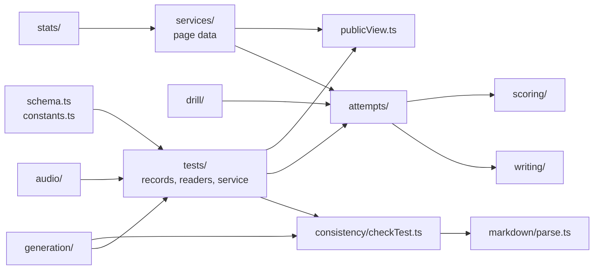
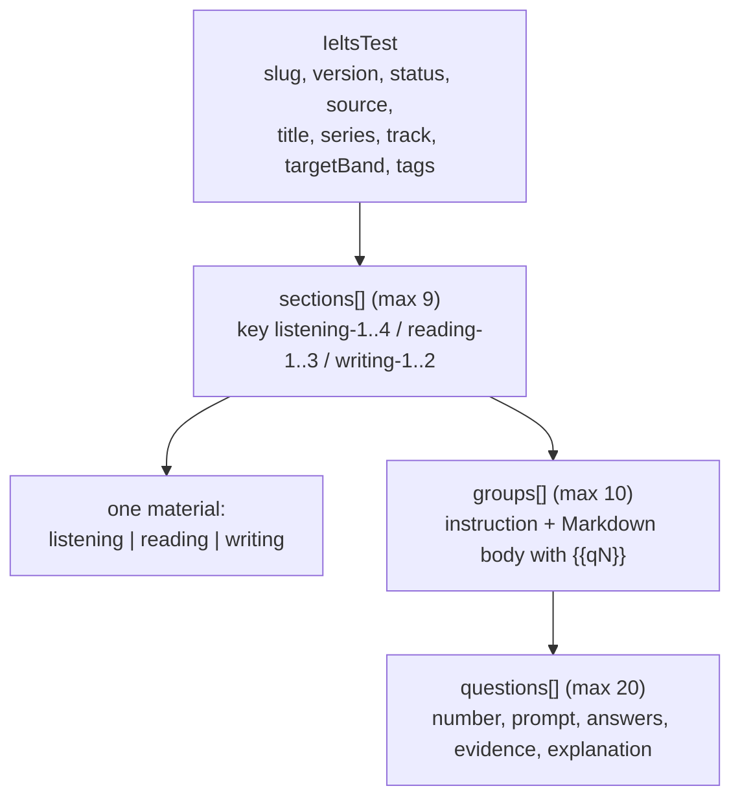
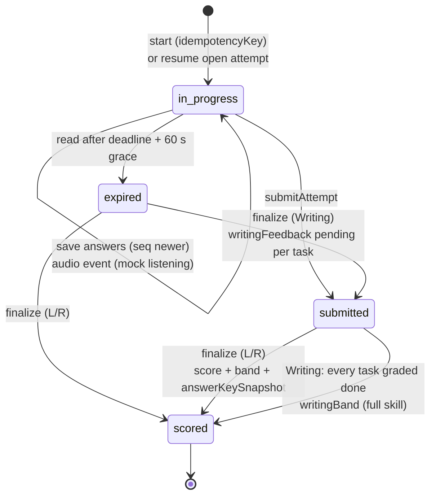
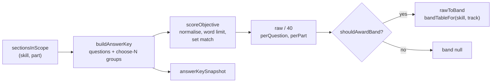
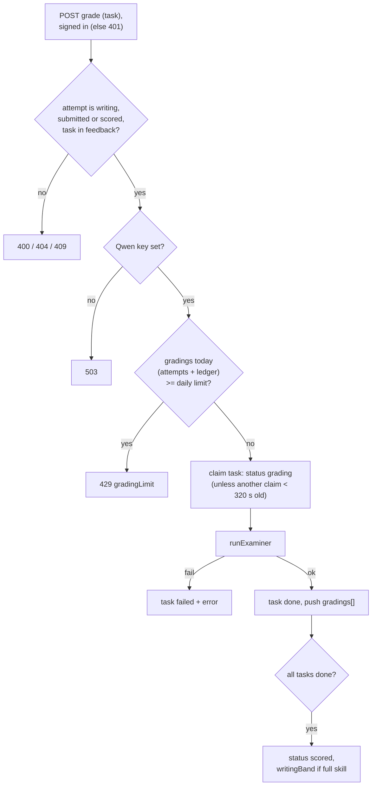
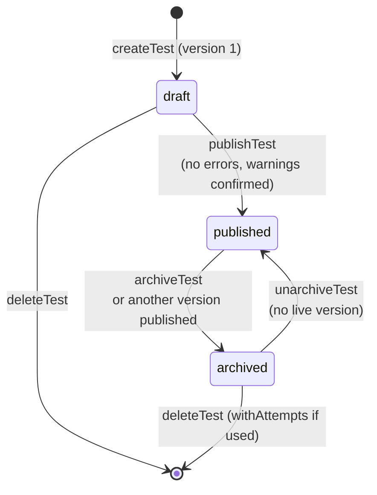
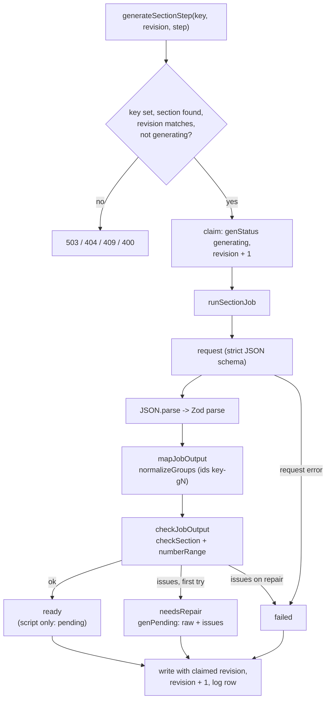

# 09 - IELTS

This document describes the IELTS module's domain logic under
`src/modules/ielts/**`: the Zod content schema that every test, editor save and
AI output is validated against, the public view that decides what a learner's
browser may see, the attempt lifecycle (practice, mock and drill), objective
scoring and band conversion, Writing grading by an AI examiner with a daily
limit, admin authoring (revision-guarded section saves, AI generation with a
repair step, text-to-speech audio, a consistency gate on publish), per-test
vocabulary, the page-data loaders, and the small pure helpers that lay a group
out the way the Cambridge paper does. The module follows the same split as the
dictation layer: pure, unit-tested decision and shaping functions next to thin
`server-only` services that talk to MongoDB, Qwen and Cloudinary. Every path
is repo-relative.

Neighbouring docs (not repeated here):

- Mongoose models `src/models/ielts/*` (`IeltsTestModel`, `IeltsAttemptModel`,
  `IeltsGradingLedgerModel`, `IeltsTestVocabModel`) -> [03 - Data model](./03-data-model.md).
- Route handlers `/api/ielts/**` and `/api/admin/ielts/**` and the client
  request helpers (`src/requests/ieltsApi.ts`) -> [04 - API reference](./04-api-reference.md).
- Catalogue, runners, review pages and the admin editor -> [06 - Frontend, section 10](./06-frontend.md#10-ielts-feature-ui).
- Qwen client, TTS, Cloudinary upload and env keys -> [07 - Auth, infra and testing](./07-auth-infra-testing.md).

---

## 1. Module map

| Folder / file                     | Kind                 | Responsibility                                                                                |
| --------------------------------- | -------------------- | --------------------------------------------------------------------------------------------- |
| `schema.ts`                       | pure (Zod)           | Authority for test content shape; the model mirrors it.                                       |
| `constants.ts`                    | pure                 | Enums, question types and widgets, timers, limits, voices, API paths.                         |
| `publicView.ts`                   | pure                 | Allow-list copy of a test for learners (no keys before submit).                               |
| `attempts/`                       | pure + `server-only` | Start/resume, autosave, submit, expiry, audio clock, evidence, part check, history queries.   |
| `scoring/`                        | pure                 | Answer key, normalisation, word limits, raw score, band tables, overall and writing rounding. |
| `stats/`                          | pure + aggregate     | Accuracy per (skill, question type), weakest three.                                           |
| `drill/`                          | pure + `server-only` | One-question-type drills assembled from published tests.                                      |
| `writing/`                        | pure + `server-only` | Prompt box parsing, sample answer split, AI examiner, grading with a daily cap.               |
| `generation/`                     | pure + `server-only` | Prompt builders, strict AI schemas, one-step section jobs with repair, admin assist.          |
| `audio/`                          | pure + `server-only` | TTS per script line, WAV assembly with exact line offsets, Cloudinary upload.                 |
| `consistency/checkTest.ts`        | pure                 | Deterministic rules: errors block publish, warnings need confirmation.                        |
| `markdown/parse.ts`               | pure                 | Small Markdown subset AST with `{{qN}}` slots, never emits HTML.                              |
| `tests/`                          | pure + `server-only` | Lean doc mappers, cached readers, admin CRUD, publish/archive/unarchive/delete.               |
| `vocab/`                          | pure + `server-only` | Ordered word list per test slug, learner state overlay.                                       |
| `services/`                       | `server-only`        | Page loaders (home, runner, result) for the signed-in learner.                                |
| Paper-layout helpers (section 13) | pure                 | `instructionText`, `judgementInstruction`, `listeningContext`, `passageIntro`, and five more. |
| `http.ts`                         | route plumbing       | `IeltsDecision` -> `NextResponse`, localized messages, JSON body, auth failures.              |
| `fixtures/sampleTest.ts`          | fixture              | `IELTS_SAMPLE_TEST`, an original Academic test that passes `checkTest` with no errors.        |

---

## 2. Content schema (`schema.ts`)

The file comment states it is the authority: the Mongoose model mirrors it, the
editor validates against it, and every AI output is mapped into it before the
consistency check runs.

### 2.1 Test level

| Field        | Rule                                                       |
| ------------ | ---------------------------------------------------------- |
| `slug`       | kebab-case, max 80 (`/^[a-z0-9]+(?:-[a-z0-9]+)*$/`)        |
| `version`    | int >= 1                                                   |
| `status`     | `draft` / `published` / `archived` (`IELTS_TEST_STATUSES`) |
| `source`     | `ai` / `assisted` / `manual` (`IELTS_TEST_SOURCES`)        |
| `title`      | 1-160                                                      |
| `series`     | catalogue group such as "IELTS 21"; empty groups by title  |
| `track`      | `academic` / `general`                                     |
| `targetBand` | 4-9 (editor offers `IELTS_TARGET_BANDS`, half bands)       |
| `tags`       | max 10                                                     |
| `sections`   | max 9                                                      |

`ieltsTestMetaSchema` is the editable subset (title, series, track,
targetBand, tags, description).

### 2.2 Section level

| Field                      | Notes                                                                                                                             |
| -------------------------- | --------------------------------------------------------------------------------------------------------------------------------- |
| `key`, `skill`, `order`    | Stable id `<skill>-<order>` (`IELTS_SECTION_KEYS`); parts per skill `IELTS_PART_COUNTS` = L4, R3, W2.                             |
| `revision`                 | Optimistic concurrency counter, bumped by every save, AI claim and audio write.                                                   |
| `genStatus`                | `pending` / `generating` / `needsRepair` / `ready` / `failed` / `manual`.                                                         |
| `genStartedAt`, `genError` | Job bookkeeping. A `generating` section older than 320 s reads as `failed` (`effectiveGenStatus`).                                |
| `listening`                | `context`, `lines[]` (`speaker`, `voice`, `text`, max 120), `audio` (`url`, `publicId`, `durationSec`, `lineOffsetsSec`) or null. |
| `reading`                  | `title`, `subtitle` (standfirst), `paragraphs[]` (`label` such as "A", `text`, max 20).                                           |
| `writing`                  | `task` 1 or 2, `prompt`, `minWords` 50-400, `visual`, `sampleAnswer`.                                                             |
| `groups`                   | Question groups, max 10.                                                                                                          |

`ieltsSectionInputSchema` is the section as the editor sends it: it omits the
server-owned fields (`key`, `skill`, `order`, `revision`, `genStatus`,
`genStartedAt`, `genError`) and is `.strict()`.

### 2.3 Question groups and types

A group has `id`, `type`, `from`/`to`, `instruction`, `wordLimit`
(`maxWords` 1-5, `allowNumber`), `title`, `body` (Markdown, max 6000),
`options[]` (`key`, `text`, max 12), `correctKeys[]` (only for choose-TWO/THREE),
`imageUrl` (diagram or map) and `questions[]`. A question has `number` 1-40,
`prompt`, `answers[]` (accepted variants, max 8), `evidence` (`quote`,
`blockIndex` into paragraphs or script lines) and `explanation`.

`IELTS_QUESTION_TYPES` is a closed list (16 types). The comment in
`constants.ts` says adding one needs a widget mapping and a generation prompt
line. `IELTS_QUESTION_WIDGETS` picks the runner input:

| Widget     | Types                                                                                                               | Answer stored as                          |
| ---------- | ------------------------------------------------------------------------------------------------------------------- | ----------------------------------------- |
| `slot`     | table, note, summary, sentence, flow-chart, form completion; short-answer                                           | text in a `{{qN}}` slot                   |
| `radio`    | `multiple-choice`, `true-false-not-given`, `yes-no-not-given`                                                       | one letter / TRUE / YES / NOT GIVEN       |
| `checkbox` | `multiple-choice-multi`                                                                                             | letter set under the group's first number |
| `dropdown` | `matching-information`, `matching-features`, `matching-headings`, `matching-sentence-endings`, `plan-map-labelling` | option key                                |

### 2.4 Visuals (Writing Task 1)

`ieltsVisualSchema` is a union of a chart (`kind` `line` / `bar` / `pie` /
`table`, `title`, axis labels, `unit`, up to 24 `categories`, up to 8 `series`
of numbers) and an image (`kind: 'image'`, `imageUrl`, `alt`). AI generation
only produces the chart form (`writingTaskOutput.visual` is
`ieltsChartVisualSchema.nullable()`).

### 2.5 Status and versions

- `draft` is admin-only; `published` is on the catalogue; `archived` is off the
  catalogue but still readable for in-progress attempts and old reviews
  (`readIeltsTestVersion` accepts `published` or `archived`, never `draft`).
- Tests are edited in place in every status (`tests/testService.ts` header
  comment).
- `version` is part of the identity (`slug` + `version` unique; at most one
  `published` per slug via a partial unique index, see
  [03](./03-data-model.md)). Attempts pin `testSlug` + `testVersion`. No code
  path in `src/modules/ielts` increments `version` (`createTest` writes 1);
  versions above 1 would have to come from scripts or older data, which this
  doc did not verify.

---

## 3. Constants (`constants.ts`)

| Constant                                             | Value / meaning                                                                                                                              |
| ---------------------------------------------------- | -------------------------------------------------------------------------------------------------------------------------------------------- |
| `IELTS_ATTEMPT_MODES`                                | `practice`, `mock`, `drill`                                                                                                                  |
| `IELTS_ATTEMPT_STATUSES`                             | `in_progress`, `submitted`, `scored`, `expired`                                                                                              |
| `IELTS_TIMERS`                                       | Reading 60 min (part 20); Writing 60 min (T1 20, T2 40); Listening transfer 120 s, part preview 30 s, part transfer 30 s; `graceSeconds` 60  |
| `IELTS_MAX_AUDIO_INTERRUPTIONS` / `_EVENTS`          | 2 interruptions counted, 10 audio events stored                                                                                              |
| `IELTS_GENERATING_STALE_SECONDS`                     | 320 (route max is 300 s)                                                                                                                     |
| `IELTS_OBJECTIVE_TOTAL`                              | 40                                                                                                                                           |
| `IELTS_WEAKNESS_MIN_QUESTIONS`                       | 5 (below this, accuracy is null)                                                                                                             |
| `IELTS_DRILL_MAX_GROUPS`                             | 4                                                                                                                                            |
| `IELTS_GENERATION_LOG_LIMIT`                         | 50 rows kept in `generationLog`                                                                                                              |
| `IELTS_ANSWER_MAX_LENGTH` / `IELTS_ESSAY_MAX_LENGTH` | 300 chars per objective answer, 20,000 per essay                                                                                             |
| `LISTENING_VOICES`                                   | 9 logical voice ids (`alloy` ... `shimmer`, stored in tests and named in the prompt) with a gender hint and the `qwenVoice` that speaks them |
| `IELTS_API_PATHS`                                    | Client paths for learner and admin routes                                                                                                    |
| `IELTS_OUTBOX_LANE_PREFIX`                           | `ielts:` (outbox lane per attempt, used by `src/requests/ieltsApi.ts`)                                                                       |
| `IELTS_TEST_VOCAB_MAX`                               | 150 words per test                                                                                                                           |

Also: `TFNG_OPTIONS`, `YNNG_OPTIONS`, `NOT_GIVEN`, and English labels for
types and skills.

---

## 4. Public view (`publicView.ts`)

The learner copy is built by copying allowed fields, never by deleting
forbidden ones, so a new schema field stays server-side until it is added
here.

| Removed before submit                               | When                                                              |
| --------------------------------------------------- | ----------------------------------------------------------------- |
| `answers`, `correctKeys`, `evidence`, `explanation` | always                                                            |
| listening `lines` (the transcript)                  | `includeTranscript: false` (mock, drill, in-progress result page) |
| audio `publicId`, `lineOffsetsSec`                  | always (only `url`, `durationSec` ship)                           |
| writing `sampleAnswer`                              | unless `includeSampleAnswer: true` and non-empty                  |

Call sites:

| Caller                                                     | `includeTranscript`        | `includeSampleAnswer`                                                    |
| ---------------------------------------------------------- | -------------------------- | ------------------------------------------------------------------------ |
| `services/runnerPageData.ts`                               | `mode === 'practice'`      | `true` (closed until opened, practice and mock)                          |
| `services/resultPageData.ts` (also used by the drill page) | `status !== 'in_progress'` | default `false` (the review gets the sample from its own `writing` rows) |
| `components/ielts/editor/SectionPreview.tsx`               | `true`                     | n/a                                                                      |

Extra shaping per group (`toPublicGroup`):

- `options` falls back to `optionsInBody(body)` when the group stores its word
  box as `- **A** text` lines in the body.
- `pickLetter` is true when a `slot` group's every question has an answer that
  is one of the option keys, so the runner shows a letter dropdown instead of
  free text. It reveals nothing the instruction does not already say.
- `bodyWithoutOptions` strips word-box lines in any stored format (`- **A** x`,
  `A. x`, `A) x`, several per line, or a table row) so the box can render on
  its own above the summary.

`toPublicTest` sorts sections by skill name then `order`.

---

## 5. Attempts (`attempts/**`)

### 5.1 Modes and scope

| Mode       | Started by                           | Deadline                | Band                              | Transcript | Extras                                                 |
| ---------- | ------------------------------------ | ----------------------- | --------------------------------- | ---------- | ------------------------------------------------------ |
| `practice` | `startOrResumeAttempt`               | none                    | full skill with 40 questions only | yes        | guided evidence, part check, Writing task check        |
| `mock`     | `startOrResumeAttempt`               | `computeDeadline` (5.3) | same rule                         | no         | Listening needs audio on every part (`mockNeedsAudio`) |
| `drill`    | `drill/drillService.ts` `startDrill` | none                    | never                             | no         | groups from several tests, renumbered 1..N             |

Scope is `{ kind: 'skill' }` or `{ kind: 'part', part }` (validated against
`IELTS_PART_COUNTS`). `shouldAwardBand` returns true only when the mode is not
`drill`, scope is `skill` and the key total is 40.

### 5.2 Lifecycle

Key behaviours in `attempts/attemptService.ts`:

- **Ownership.** Every query filters by `ownerId` (no IDOR).
- **Start / resume.** A replayed `idempotencyKey` returns the same attempt
  (`idempotent`), except an in-progress replay pinned to an older test version
  gets `409 staleStart`. Otherwise an open `in_progress` attempt with the same
  test, version, skill, mode and scope is resumed; else a new one is created.
  A duplicate-key race returns the winner.
- **Autosave** (`saveAttemptAnswers`). Set-desired-state: the update matches
  only `status: 'in_progress'`, `savedSeq < seq` and deadline + grace not past.
  A stale `seq` or an already-submitted attempt is a 200 with
  `applied: false` so the client outbox never rolls back; only time-up is
  `409 timeUp`.
- **Submit.** One write stores the final snapshot and flips to `submitted` when
  the snapshot is newer and in time; otherwise the status flips and the server
  keeps what it holds. Listening mock refuses an empty submit before audio has
  started (`startAudioFirst`). Then `finalizeAttempt` runs.
- **Finalize.** Guarded by `status in (submitted, expired)` so a double call
  scores once. Listening / Reading: build the key, score, maybe band, set
  `scored`, store `answerKeySnapshot` so a later edit never changes an old
  result. Writing: stays `submitted` with `writingFeedback[task] = pending`.
- **Self-healing reads** (`readAttemptForOwner`). An in-progress attempt past
  deadline + grace is flipped to `expired` and finalized on read, so a closed
  tab still gets a result; a submit that failed half way is finalized on the
  next read (`needsFinalize`).
- **Delete** (`deleteAttemptForOwner`). Copies today's gradings into
  `IeltsGradingLedgerModel` first so deleting never resets the daily cap.
- **Answers validation** (`validateAnswerLengths`). Writing answers use keys
  `"1"` and `"2"` and must be text; objective answers max 300 chars; arrays max
  3 letters (`answersSchema` in `attemptRouteDecisions.ts`).
- **Practice only.** `readPracticeEvidence` returns one question's evidence and
  whether it is NOT GIVEN (`403 guidedPracticeOnly` otherwise);
  `checkPracticePart` scores one part from the answers on screen and stores
  nothing (`403 checkPracticeOnly`; Writing uses the task check in section 8).

### 5.3 Mock deadlines (`attempts/deadline.ts`)

| Skill / scope           | Deadline                                                                                                                                     |
| ----------------------- | -------------------------------------------------------------------------------------------------------------------------------------------- |
| Reading skill / part    | `startedAt` + 60 min / 20 min                                                                                                                |
| Writing skill / T1 / T2 | `startedAt` + 60 / 20 / 40 min                                                                                                               |
| Listening skill         | null until the first `part-started`; then latest part start + its duration + sum over later parts (30 s preview + duration) + 120 s transfer |
| Listening part          | first part start + duration + 30 s                                                                                                           |
| Listening, both         | + the gap of each interruption, at most 2 counted                                                                                            |

`recordAudioEvent` appends a `part-started`, `interrupted` or `resumed` event
(max 10, one start per part) with an optimistic `$size` guard and up to 3
retries, recomputing `deadlineAt` each time. Re-anchoring at every part start
means a slow load between parts never eats the learner's time.

### 5.4 Drills (`drill/**`, `attempts/attemptSections.ts`)

`startDrill` collects every group of the requested type and skill from all
published tests, then `selectDrillGroups` (pure) shuffles, puts groups not
seen in the owner's last 5 drills first, and picks up to 4 groups without
exceeding 40 questions. `planDrillNumbers` renumbers questions 1..N and the
plan is stored on the attempt as `items[].numberMap`. When loading,
`buildDrillSections` turns each item into its own one-group section (original
material kept, so evidence block indexes still point at the right paragraph)
and rewrites `{{qN}}` slots and prompts through `renumberGroup`. Drill
attempts have `testId: null`, `testVersion: 0` and a title
`Drill · <type label>`.

### 5.5 Queries (`attempts/attemptQueries.ts`, `testBands.ts`)

- `listIeltsAttempts` - newest 30 summaries (no answers, no key).
- `readIeltsOverall` - last 60 full-skill, banded practice/mock attempts fed to
  `overallEstimate` (section 6.4).
- `readIeltsTestBands` - best band per test and skill (`bestBandsByTest`) so
  the catalogue can mark tests done.

---

## 6. Scoring (`scoring/**`)

### 6.1 Answer key (`answerKey.ts`)

`buildAnswerKey` produces `questions[]` (number, part, type, accepted,
`isText` for slot widgets, `wordLimit`) and, for `multiple-choice-multi`,
`groups[]` (numbers, `correctKeys`). `answerKeyTotal` counts both.

### 6.2 Matching rules (`normalize.ts`, `wordCount.ts`, `scoreObjective.ts`)

- **Text answers.** `normalizeIeltsAnswer`: NFKC, lowercase, curly quotes and
  dash variants unified, leading/trailing punctuation dropped, a leading
  currency sign before a digit dropped (`$199` matches `199`), spaces around
  `-` and `/` removed. Deliberately not the dictation normaliser (no
  contraction expansion). Numbers and words are never converted: tests list
  both spellings.
- **Word limit.** `countIeltsWords` treats a token like `25`, `3.5` or `9:30` as
  a number. With `allowNumber`, up to `maxWords` words plus one number;
  otherwise numbers count as words. A right answer over the limit scores 0 and
  sets `overLimit`.
- **Letter answers.** `normalizeIeltsKey` (NFKC, trim, uppercase).
- **Choose TWO/THREE.** The letter set is stored under the group's first
  number, deduped and capped; each correct letter earns one point, order never
  matters.
- Outcomes are `correct` / `wrong` / `blank`.

### 6.3 Band tables (`bandTables.ts`)

Raw scores are out of 40; `rawToBand` floors and clamps raw then takes the
first row whose minimum it reaches.

| Band | Listening | Academic Reading | General Reading |
| ---- | --------- | ---------------- | --------------- |
| 9    | 39        | 39               | 40              |
| 8    | 35        | 35               | 37              |
| 7    | 30        | 30               | 34              |
| 6    | 23        | 23               | 30              |
| 5    | 16        | 15               | 23              |
| 4    | 10        | 10               | 15              |

(Half bands are in the file.)

### 6.4 Rounding and overall (`roundBand.ts`, `overall.ts`)

- `roundOverallBand`: fraction < .25 rounds down, .25 to < .75 to .5, >= .75 up.
- `roundTaskBand`: mean of four Writing criteria floored to a half band.
- `writingBand(t1, t2)`: `roundOverallBand((t1 + 2 * t2) / 3)` (Task 2 weighs double).
- `overallEstimate`: prefers the newest mock session (`sessionId`) with 2+
  skills (`basis: 'session'`), then the newest test version with 2+ skills
  (`'test'`), else the latest band per skill across tests (`'mixed'`).

---

## 7. Stats (`stats/**`)

`readWeaknessStats` aggregates the owner's last 200 `scored` Listening/Reading
attempts by `(skill, result.perQuestion.type)`. Nothing derived is stored.
`shapeWeaknessStats` (pure) sets accuracy null below 5 questions, sorts
weakest first, and returns the top 3 with enough data as `weakest`.

---

## 8. Writing (`writing/**`)

| File                     | Role                                                                                                                                                                                                                                                                                                                                                          |
| ------------------------ | ------------------------------------------------------------------------------------------------------------------------------------------------------------------------------------------------------------------------------------------------------------------------------------------------------------------------------------------------------------- |
| `promptBlocks.ts`        | `parseWritingPrompt`: lines starting with `> ` form the bordered task box; `plainWritingPrompt` strips them.                                                                                                                                                                                                                                                  |
| `sampleAnswer.ts`        | `splitSampleAnswer`: optional `# Title` first line, paragraphs split on blank lines.                                                                                                                                                                                                                                                                          |
| `examinerPrompt.ts`      | Builds messages; the essay is wrapped as data and instructions inside it are ignored; criteria paraphrased. `ExaminerInput.language` (the app locale) names the language of `summary` and every `reason` through `LANGUAGE_NAMES` (`src/lib/ai/languageNames.ts`); `suggestion` and `improved` stay English. `EXAMINER_PROMPT_VERSION` (`ielts-examiner-v2`). |
| `examinerSchema.ts`      | Strict output: four criteria 0-9, summary, up to 12 corrections (quote, suggestion, reason, `grammarLessonId`), `improved`.                                                                                                                                                                                                                                   |
| `runExaminer.ts`         | One Qwen structured call (low reasoning, 6000 output tokens, 240 s timeout); drops corrections whose quote is not in the essay and lesson ids that do not exist; computes the task band; stamps `language` and `promptVersion` on the feedback. A failure returns `code` (`providerFailed` or `invalidOutput`) plus the raw `message` for the log.            |
| `gradeWritingService.ts` | `gradeWritingTask` (graded results) and `checkPracticeWriting` (practice check before submit); both take `language` (the grade and check routes pass `getLocale()`).                                                                                                                                                                                          |

Grading ledger limits:

- The daily limit is `getIeltsWritingDailyLimit()` (env
  `IELTS_WRITING_DAILY_LIMIT`, default 10), counted per UTC day.
- Only successful runs count: `gradings[]` is pushed after a `done` result, and
  `checkPracticeWriting` pushes one too, so practice checks share the cap.
- Deleted attempts keep counting through `IeltsGradingLedgerModel` (TTL index
  of 2 days on `at`).
- Grammar lesson ids for corrections come from `grammarCourse` in
  `src/modules/grammar/course`.

Language and failures:

- `IeltsWritingTaskFeedback` (`attempts/attemptRecords.ts`; `writingFeedback`
  is `Mixed` in the model) carries `language` and `promptVersion`. Feedback
  without `language` was written in Vietnamese; the result page offers "Grade
  again" in the app language when they differ (never automatic, it spends a
  grading).
- A failed task stores an `IeltsGradingErrorCode` in `error` (`missingTask`,
  `emptyEssay`, `invalidOutput`, `providerFailed`); the learner sees
  `ielts.writingResult.gradingErrors[code]` and older raw messages read as an
  unknown reason. The raw message is only logged. The practice check answers
  `500` with `gradingInvalidOutput` or `gradingProviderFailed`.

---

## 9. Authoring and catalogue (`tests/**`)

| File                    | Role                                                                                                                                                                                                                                                                                                                                             |
| ----------------------- | ------------------------------------------------------------------------------------------------------------------------------------------------------------------------------------------------------------------------------------------------------------------------------------------------------------------------------------------------ |
| `testRecords.ts`        | Lean doc -> `IeltsTestRecord` with defaults for older docs; `effectiveGenStatus` (stale `generating` -> `failed`).                                                                                                                                                                                                                               |
| `testReaders.ts`        | Cached readers tagged `CACHE_TAGS.ieltsContent`: `readIeltsCatalog`, `readPublishedIeltsTest(slug)`, `readIeltsTestVersion(slug, version)`. Records keep answer keys (the server scores with them); pages hand learners `toPublicTest(...)` only. Catalogue entries carry `skills[].mockReady` (false for listening while any part lacks audio). |
| `emptySections.ts`      | `emptySection(key, genStatus)` defaults (title "Part N" / "Reading Passage N" / "Writing Task N", T1 150, T2 250), `slugify`.                                                                                                                                                                                                                    |
| `testRouteDecisions.ts` | Zod for create (`manual` or `generate` with up to 9 topic hints), save meta (`metaRevision`), save section (`revision`), publish (`confirmWarnings`).                                                                                                                                                                                            |
| `testService.ts`        | Admin list/read/create, `saveTestMeta`, `saveTestSection`, `publishTest`, `archiveTest`, `unarchiveTest`, `deleteTest`.                                                                                                                                                                                                                          |

Rules from `testService.ts`:

- **Revision guard.** `saveTestSection` updates only
  `sections: { $elemMatch: { key, revision } }`; a stale tab or a running AI
  job gets `409 sectionChanged`. A manual save sets `genStatus: 'manual'`.
  Material must match the skill and Writing sections have no groups.
- **Cache.** Saving a non-draft test expires the `ieltsContent` cache tag
  (`adoptSaved`), as do publish, archive, unarchive and deleting an archived
  test.
- **Publish.** Draft only. `checkTest` errors return `422` with the report;
  warnings return `422` unless `confirmWarnings`. A transaction archives the
  live version of the slug and publishes the draft, so the partial unique
  index never sees two published versions.
- **Archive / unarchive.** Archived tests leave the catalogue but attempts keep
  working; unarchive fails when another version of the slug is live.
- **Delete.** Draft or archived only. If attempts (or drill items) use that
  slug + version, it stops with their count until `withAttempts` deletes them.

---

## 10. Generation (`generation/**`)

Each route call performs exactly one step (one Qwen request) so it fits the
route time limit.

| Section skill  | Steps (`IeltsGenerateStep`)             | Job kind                                      | Max output tokens |
| -------------- | --------------------------------------- | --------------------------------------------- | ----------------- |
| reading        | `draft`, `repair`                       | `reading-section`                             | 16,000            |
| listening      | `draft`/`script`, `questions`, `repair` | `listening-script` then `listening-questions` | 8,000 each        |
| writing        | `draft`, `repair`                       | `writing-task`                                | 6,000             |
| (admin assist) | n/a                                     | `assist`                                      | 8,000             |

A repair step uses 1.25x the token budget.

Details:

- **Prompts** (`prompts.ts`, pure). Every prompt demands original material
  (no copying from Cambridge books or other published tests) and lists the
  group format rules. `numberRange(key)`: Listening part N uses
  `10(N-1)+1 .. 10N`; Reading uses 1-13, 14-26, 27-40. The prompt context
  includes track, target band, a topic hint from the test's `plan`, and the
  titles of the other sections to avoid repeats.
- **Schemas** (`aiSchemas.ts`). Strict (all fields required, nullable instead
  of optional) so they convert to strict json_schema mode (`toStrictJsonSchema`); the same Zod schema
  parses the reply.
- **Mapping.** A new listening script clears groups and audio. Writing output
  sets `minWords` 150/250 and keeps a visual only for Task 1. TFNG/YNNG groups
  lose options; only `multiple-choice-multi` keeps `correctKeys`.
- **Race safety.** The result is written with the claimed revision, so a
  manual save during the job wins and the job's write matches nothing.
- **Bookkeeping.** A `generationLog` row (kind, model, tokens, duration,
  outcome, failed rules, error) is pushed with `$slice: -50`. A `manual` test
  becomes `assisted` after its first AI step.
- **Assist** (`assistService.ts`). Listening/Reading only. Actions
  `draft-questions`, `paraphrase-distractors`, `suggest-evidence`,
  `check-answers`. Returns a proposal and saves nothing; proposed groups are
  checked with the same rules and the issues appended to `notes`. Summary and
  notes are written in the admin's app language (`language` from the assist
  route's `getLocale()`, named with `LANGUAGE_NAMES`).
- **Evals.** `scripts/evalIeltsGeneration.ts` (`bun run ielts:eval-generation
[-- keys...]`) runs draft plus at most one repair in memory against real
  Qwen and reports pass rate and tokens; nothing is written. It is manual,
  costs money and is not in CI.

---

## 11. Listening audio (`audio/**`)

`generateSectionAudio` (listening keys only) synthesizes each script line with
Qwen TTS (`synthesizeSpeechPcm` in `src/lib/ai/qwenSpeech.ts`, model from
`getQwenTtsModel()`), two lines in parallel, within a 240 s budget. The
workspace quota (180 RPM) is enforced per second, so a rate-limited
synthesize request (429 or a `Throttling*` code) is retried after 1 s, 2 s and
4 s before the part fails. Each line
is spoken by `qwenVoiceFor(line.voice)` (`constants.ts`): the stored logical id
maps to a Qwen voice (alloy Brian, ash Eric, coral Emily, echo Andy, fable
Luca, nova Ava, onyx David, sage Luna, shimmer Abby; unknown ids get the
first). Qwen returns a WAV URL; the client downloads it and strips the header
(`src/lib/ai/wavToPcm.ts`). `wav.ts` (pure) joins the 24 kHz
16-bit mono PCM with 0.15 s silence between lines of the same speaker and
0.4 s when the speaker changes, adds a WAV header and derives exact
`lineOffsetsSec`. The WAV is uploaded to Cloudinary folder `ielts/audio` with
public id `<slug>-v<version>-<key>-<sha1 of qwen:voice:text per line>` (the
`qwen` provider tag gives new audio new ids; old audio stays valid), served as
mp3,
a `HEAD` request confirms the mp3 is reachable, then
`listening.audio` is written with the revision guard (`409
sectionChangedDuringAudio` if the section moved). Every run logs a
`generationLog` row with kind `audio`.

---

## 12. Consistency checks (`consistency/checkTest.ts`)

Run on every AI result, on editor previews and as the publish gate. Rule ids
are stable and appear in generation logs, repair prompts and the publish
panel. Messages are English for prompts and logs; the editor shows
`ieltsEditor.issues[code]` in the admin's language.

| Rule                                      | Severity        | Checks                                                                                                                                                       |
| ----------------------------------------- | --------------- | ------------------------------------------------------------------------------------------------------------------------------------------------------------ |
| `group_range_matches`                     | error           | Questions numbered `from`..`to` in order.                                                                                                                    |
| `slot_has_question` / `question_has_slot` | error           | Each `{{qN}}` has a question; each slot question has exactly one slot.                                                                                       |
| `answers_present`                         | error           | Every question has an answer; choose-N groups have N `correctKeys`.                                                                                          |
| `answer_within_limit`                     | error           | Accepted text answers respect the word limit.                                                                                                                |
| `letter_answers_valid`                    | error           | Letter answers are options (or TRUE/FALSE/NOT GIVEN, YES/NO/NOT GIVEN).                                                                                      |
| `evidence_found`                          | error           | Evidence present (except NOT GIVEN) and quote found in the referenced block.                                                                                 |
| `explanation_present`                     | error           | Every question has an explanation.                                                                                                                           |
| `html_in_body`                            | error           | No HTML tag in instruction, title, body, prompts, paragraphs, script lines, writing text.                                                                    |
| `passage_length`                          | error / warning | Reading words outside 600-1100 is an error; outside 700-1000 a warning.                                                                                      |
| `listening_lines`                         | error           | At least 12 lines; every voice is in `LISTENING_VOICES`.                                                                                                     |
| `audio_duration` / `audio_offsets`        | error           | Duration > 0; offsets (when present) match line count, increase, stay below duration.                                                                        |
| `writing_task`                            | error           | Prompt present with a task statement of 12+ words beyond the time and word-count lines (`taskStatementWords`); Task 1 has a visual; `minWords` is 150 / 250. |
| `numbering_contiguous`                    | error           | (test level) Listening and Reading each number 1..40 exactly once.                                                                                           |
| `sections_complete`                       | error           | (test level) the test has sections.                                                                                                                          |
| `visual_missing`                          | warning         | Instruction mentions a diagram, map, plan or chart but `imageUrl` is empty (flow-chart excluded).                                                            |
| `question_stem_missing`                   | warning         | A question with options but no prompt text.                                                                                                                  |

`isSectionReady` = `genStatus` is `ready` or `manual`, listening has audio, and
no errors.

---

## 13. Markdown subset (`markdown/parse.ts`)

One AST serves the server (slot collection, consistency) and the client
(runner, editor preview, `IeltsMarkdown`). Blocks: `#`/`##`/`###` headings,
one paragraph per line, `- ` or `* ` bullets with two levels, `1. ` ordered
lists, GFM tables with alignment. Inline: `**bold**`, `*italic*`, `{{qN}}`
slots (1-40; others stay text). Nothing produces HTML: raw tags stay literal
text. `containsHtml` (`/<[a-zA-Z/!]/`) backs the `html_in_body` rule.

---

## 14. Paper-layout helpers

Per the project memory note, IELTS layout must match the Cambridge paper (as
Jumpinto shows it) and every fix goes into these shared helpers or the shared
renderers, never into one test. See `docs/plans/ielts-jumpinto-parity-2026-11-26.md`
for the full list of display rules and `docs/ielts-parity/tracker.md` for
per-test data fixes.

| Helper                                               | What it does                                                                                                                     | Used by                                              |
| ---------------------------------------------------- | -------------------------------------------------------------------------------------------------------------------------------- | ---------------------------------------------------- |
| `instructionText.ts` `formatInstruction`             | One sentence per line; runs of caps ("NO MORE THAN TWO WORDS AND/OR A NUMBER") marked bold; a lone "A" never starts a run.       | `GroupBlock`                                         |
| `judgementInstruction.ts` `toJudgementInstruction`   | TFNG/YNNG: keeps the question sentence, replaces prose definitions with the standard legend ("views" or "claims" of the writer). | `GroupBlock`                                         |
| `listeningContext.ts` `contextReadAloud`             | True when the script already reads the part context (or an announcer line says "you will hear"), so the header hides it.         | `ListeningPane`                                      |
| `passageIntro.ts` `passageIntro`                     | "You should spend about 20 minutes on Questions X-Y, which are based on Reading Passage N."                                      | `IeltsRunner`, `SectionPreview`                      |
| `passageStandfirst.ts` `passageStandfirst`           | Standfirst from `subtitle`, or from a short, unlabeled, non-sentence first paragraph (then the body starts at 1).                | `PassagePane`                                        |
| `sectionLetterOptions.ts` `onlyNamesSections`        | Options that only name passage sections ("Paragraph A") need no option box.                                                      | `GroupBlock`                                         |
| `sharedGroupHeaders.ts` `sharedGroupHeaders`         | Adjacent single-question multiple-choice groups with the same instruction share one "Questions 25-30" header.                    | `IeltsRunner`, `SectionPreview`, `GroupBlock` (type) |
| `flowChart.ts` `flowChartSteps`                      | Splits a body on lone down-arrow lines into boxes; a line ending in ":" is the bold heading, other lines bullets.                | `GroupBlock`                                         |
| `publicView.ts` `bodyWithoutOptions`                 | Word box shown on its own above the summary (section 4).                                                                         | `GroupBlock` via the public group                    |
| `writing/promptBlocks.ts`, `writing/sampleAnswer.ts` | Writing prompt box and sample answer title/paragraphs (section 8).                                                               | `WritingPrompt`, `SampleAnswerBody`                  |

---

## 15. Vocabulary per test (`vocab/**`)

`IeltsTestVocabModel` holds one ordered `entryIds` list per slug (shared by
all versions of the slug). `saveIeltsTestVocab` dedupes (first position
wins), caps at 150, drops ids whose `VocabEntry` no longer exists, and
upserts. `listIeltsTestVocabForLearner` returns compact entries (first
definition, Vietnamese meaning, two phonetics; see `toCompactVocabEntry`) with
the learner's own `UserVocabItem` state when signed in;
`listIeltsTestVocabForAdmin` returns the entries only. Zod input:
`saveTestVocabSchema` in `testVocabRules.ts`.

---

## 16. Page data (`services/**`)

| Loader               | Returns                                                                                                                                                                                                                                                                                                                                                                                                                                                                                                                                                                                     |
| -------------------- | ------------------------------------------------------------------------------------------------------------------------------------------------------------------------------------------------------------------------------------------------------------------------------------------------------------------------------------------------------------------------------------------------------------------------------------------------------------------------------------------------------------------------------------------------------------------------------------------- |
| `loadIeltsHomeData`  | Catalogue, attempt summaries, overall estimate, best bands per test, weakness stats for the signed-in learner (`requirePageUser`), `isAdmin`, and `error` (`notConfigured` without `MONGODB_URI`, `loadFailed` on exceptions).                                                                                                                                                                                                                                                                                                                                                              |
| `loadRunnerPageData` | Public sections of one skill (all parts; `?part=` only picks the starting part), `prevSkill` / `nextSkill` in L, R, W order present in the test; null for a bad slug, skill or part. Mock omits the transcript.                                                                                                                                                                                                                                                                                                                                                                             |
| `loadResultPageData` | The owner's attempt (via `readAttemptForOwner`, which may expire and finalize it), public sections, and when finished: review rows (given, accepted, outcome, `overLimit`, explanation, evidence, section key), Writing tasks (prompt, visual, sample answer, essay), `savedTerms` (review words, `reviewWordOf` in `services/reviewWord.ts`, already in the learner's vocabulary via `listSavedTermsForUser`) and `grammarLinks` (per lesson a correction names: `notes` when passed, `lesson` when open, `locked`, from the learner's grammar path). In progress: sections only, no keys. |

---

## 17. Route plumbing (`http.ts`)

Every IELTS route follows the same order: Mongo configured
(`ieltsMissingMongo` -> 503), JSON body (`readJsonBody`), Zod decision
(`parse*` helpers return `IeltsDecision<T>`), actor, service, then
`ieltsDecisionResponse`. An `IeltsApiError` with a `messageKey` is localized
from the `ielts.apiErrors` catalogue in the learner's language
(`formatIeltsApiMessage`, which also names a `type` value with its localized
question type label); one without a key sends its English `body`.
`ieltsRouteFailure` maps auth seam errors to their status and logs anything
else as a 500. Endpoint contracts are in [04](./04-api-reference.md).

---

## 18. Fixture and tests

`fixtures/sampleTest.ts` exports `IELTS_SAMPLE_TEST`, an original Academic
test (all names, places and figures invented) whose evidence quotes are copied
verbatim from their blocks, so it passes `checkTest` with no errors. It is
used by `scripts/seedIeltsSample.ts` (`bun run ielts:seed-sample`) and unit
tests across the module
(`publicView`, `attemptService`, `checkTest`, `runSectionJob`,
`selectDrillGroups`, `testRecords`) and components (`GroupBlock`,
`SectionPicker`). Other `*.test.ts` files sit next to the pure helpers they
cover (`scoring/scoring.test.ts`, `deadline.test.ts`, `wav.test.ts`,
`markdown/parse.test.ts`, the paper-layout helpers, and more).

Maintenance scripts for content live in `scripts/` with `ielts:*` entries in
`package.json` (attach image, paragraph breaks, standfirst, sample title,
prompts, group title, dump, patch section, scan warnings, set vocab).
